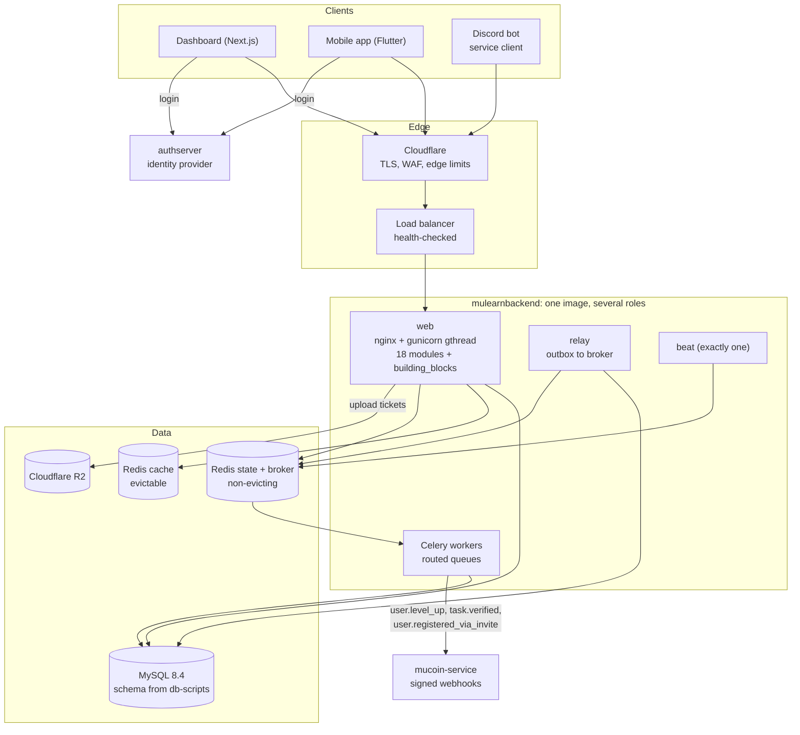

# Overview

Describes `dev` at 7fd66060 (21 Nov 2026).

This folder is μLearn's backend architecture. It covers how the backend works today, the shape it is moving to, the rules contributors follow, and the work, split into issues anyone can pick up. Start with [README.md](README.md) for the reading order.

## Summary

μLearn's backend is one Django project. Its code is grouped by screen (`api/dashboard/…`, `api/register/…`), and all of its models live in one shared `db/` package. That shape got the platform here. Several properties of today's backend now limit how far it can grow:

- **Karma has no single writer.** Karma rows are written from 13 places in the backend and by the Discord bot. Each writer applies its own version of the rules, and nothing can explain or reconcile a balance.
- **Ownership is invisible.** Any code can write any table, and four services share one schema.
- **The runtime is fragile.** Production runs Django's development server, opens a new database connection for every request, and deploys by `git pull` with no tests.
- **The platform is past its support dates.** Django 4.2 and Python 3.10 are out of support.

The decision is **option C: a modular monolith with strict layers and events**:

- one Django deployable;
- business code in domain modules with one fixed internal layout;
- a narrow public surface per module;
- one owner per table;
- an append-only karma ledger;
- a transactional outbox for everything that happens after a write.

It changes how the code is organised and how writes are made safe. It does not split the system into services.

The migration is incremental: an in-process strangler, one domain at a time, with the dashboard, the app and the bot unchanged until each step is proven. The first 12 weeks are planned as GitHub issues in [github-issues/](github-issues/README.md).

## Who this is for

| You are | Read |
|---|---|
| A first-time contributor | The issue you picked, then the pages it links to |
| A regular contributor | [04-module-rules.md](04-module-rules.md) and the page for your module in [modules/](modules/README.md) |
| A reviewer or maintainer | [04-module-rules.md](04-module-rules.md), [adr/](adr/README.md) and [13-migration-strategy.md](13-migration-strategy.md) |
| Leadership | This page, [14-roadmap.md](14-roadmap.md) and [15-risks-and-future-scale.md](15-risks-and-future-scale.md) |
| The platform admin | [06-data-and-schema.md](06-data-and-schema.md) and [10-infrastructure-and-deployment.md](10-infrastructure-and-deployment.md) |

## The options that were compared

Five shapes were compared against μLearn's actual code and goals.

| Option | Shape | What it gives | What it costs | Outcome |
|---|---|---|---|---|
| A | Tidy the current monolith: fix serving, CI and connections, keep the layout | Fast, low risk, cheaper production | Karma still has many writers; the tangle grows | Folded into C's early phases |
| B | Django apps per domain, with `services.py` and `selectors.py` | Most of the safety, little ceremony | Boundaries rest on lint and review; no event mechanism | Not chosen |
| **C** | **Strict layers and events: every module has the same layers, a `public.py` surface, a ledger and an outbox** | **The strongest boundaries short of services; nothing lost after a write; modules can be extracted later** | **More structure per feature; one more process (the relay)** | **Chosen** |
| D | Microservices with a database each | Independent scaling and deploys | About 450 foreign keys (about 300 to `user`) become calls or copies; a broker, many databases, tracing | Rejected for now |
| E | Rewrite on a new stack | A clean start | Two systems for a year; one big switch | Rejected |

C was chosen over B for its event mechanism and its extraction path. The cost is more files per feature. [04-module-rules.md](04-module-rules.md) and the `new_module` generator keep that cost predictable.

## Architecture styles, and where each one is used

| Approach | What it solves | Complexity it adds | In μLearn |
|---|---|---|---|
| Modular monolith | Clear ownership without network calls | Boundaries need tooling | **Now.** The overall shape ([ADR-001](adr/ADR-001-domain-oriented-modular-monolith.md)) |
| Microservices | Independent scaling and team autonomy | Distributed data, operations cost | **Later, per module, on five written conditions** ([ADR-001](adr/ADR-001-domain-oriented-modular-monolith.md)) |
| Domain-driven design | A shared language and real invariants | Ceremony if applied everywhere | **Now, where it pays:** aggregates in `contributions` and `gamification`; the rest stays simple ([03-target-architecture.md](03-target-architecture.md)) |
| Event-driven architecture | Decoupled follow-ups, replay | Eventual consistency | **Now, for cross-module follow-ups only** ([ADR-005](adr/ADR-005-transactional-outbox.md)) |
| Clean / hexagonal architecture | Testable rules, swappable adapters | More layers | **Now, as one fixed layout:** `domain/` has no Django; `adapters/` wrap outside systems ([ADR-017](adr/ADR-017-one-layered-module-structure.md)) |
| CQRS | Cheap reads of expensive aggregates | Projections to maintain | **Selective:** period totals and boards, in the same MySQL ([ADR-009](adr/ADR-009-selective-cqrs-projections.md)) |
| Transactional outbox | Events that can't be lost or invented | A relay process | **Now** ([ADR-005](adr/ADR-005-transactional-outbox.md)) |
| Asynchronous messaging | Slow work off the request path | Queues to monitor | **Now, on Celery and Redis**; no new broker ([ADR-042](adr/ADR-042-background-work-celery.md)) |
| Distributed processing | Throughput beyond one database | Partitioning, coordination | **Not needed.** Triggers are in [15-risks-and-future-scale.md](15-risks-and-future-scale.md) |

## Principles

Each principle exists because it prevents a failure listed in [15-risks-and-future-scale.md](15-risks-and-future-scale.md).

| # | Principle | What it means in code | ADRs |
|---|---|---|---|
| P1 | One deployable, many modules | Business code lives in `modules/<name>/`. Another module is reached only through its `public.py` (functions, DTOs) or `contracts.py` (events). | [001](adr/ADR-001-domain-oriented-modular-monolith.md), [017](adr/ADR-017-one-layered-module-structure.md), [038](adr/ADR-038-modules-own-their-tables.md) |
| P2 | One writer per table | Each table is written by exactly one module. Other services call the API. Enforced with MySQL grants per service and a shrinking allowlist of legacy writers. | [003](adr/ADR-003-one-owner-per-table.md), [038](adr/ADR-038-modules-own-their-tables.md) |
| P3 | The ledger is the truth for karma | `karma_ledger_entry` is append-only and keyed `UNIQUE(source, source_ref)`. `wallet.karma`, period totals and boards are projections that can be rebuilt. | [004](adr/ADR-004-karma-ledger.md), [009](adr/ADR-009-selective-cqrs-projections.md), [024](adr/ADR-024-leaderboards-and-period-totals.md) |
| P4 | One transaction per use case; side effects after commit | Every write is a service command. Events go to the outbox in the same transaction. Email, HTTP, push and Discord calls run after commit. | [005](adr/ADR-005-transactional-outbox.md), [041](adr/ADR-041-transactions-and-consistency.md) |
| P5 | Code never runs ahead of its schema | Alters have stable ids. A release declares the ids it needs, and deploy refuses it until they are applied. CI builds its database from the vendored schema. | [014](adr/ADR-014-db-scripts-single-schema-source.md), [040](adr/ADR-040-db-scripts-safety-net.md) |
| P6 | Every resource has a bound | Workers × threads come from the connection budget. Every outbound call has a timeout. Every list has a page cap. Every queue has its own workers. | [006](adr/ADR-006-gunicorn-gthread-behind-nginx.md), [019](adr/ADR-019-read-scaling-and-connections.md), [042](adr/ADR-042-background-work-celery.md), [044](adr/ADR-044-api-standards-v1-2.md) |
| P7 | Default deny; authority from verified grants | DRF defaults to authenticated. Public views say why. A decision is the union of per-grant decisions. Users hold several roles at once. | [007](adr/ADR-007-scoped-grants-and-policies.md), [046](adr/ADR-046-tokens-keys-service-clients.md) |
| P8 | Degrade, don't fail | Each dependency has a written degraded mode: Redis, the authserver, Discord, email, the broker. Security state never sits on the evictable cache. | [036](adr/ADR-036-rate-limiting.md), [043](adr/ADR-043-redis-cache-and-state.md) |
| P9 | Boring and enforced | DRF, Celery and the Django ORM, used the documented way. Conventions are import-linter contracts and tests, not wiki pages. | [016](adr/ADR-016-architecture-enforced-by-automation.md), [045](adr/ADR-045-hot-path-serialization.md), [051](adr/ADR-051-toolchain.md) |
| P10 | Personal data is minimal and in one place | Ledgers, audit and event payloads carry UUIDs and facts only. Users are anonymised, never hard-deleted. | [032](adr/ADR-032-audit-trail-and-retention.md), [052](adr/ADR-052-privacy-minors-erasure.md) |

## The target in one picture

The details are in [03-target-architecture.md](03-target-architecture.md).

## What stays the same

- MySQL stays (upgrading to 8.4 LTS), and `db-scripts` stays the only source of schema.
- The authserver stays a separate identity provider.
- Celery and Redis keep running background work. No new broker is added.
- The `/api/v1` contracts the dashboard, app and bot use stay compatible. Changes are additive only.

## What is deliberately deferred

Each of these waits for a measured trigger, listed in [15-risks-and-future-scale.md](15-risks-and-future-scale.md):
- Redis sorted-set leaderboards;
- configurable board definitions;
- read replicas and a database proxy;
- a search engine;
- hash-chained audit;
- asynchronous abuse detectors;
- RS256 tokens with JWKS;
- extracting any module into a service.

## Recommendations

1. **Make production safe to change before restructuring anything.** Guard the test suite, vendor the schema, add CI, then move to gunicorn and reused connections (Phases 0–2).
2. **Build the foundations once:** `building_blocks`, the module scaffold, the import contracts, the schema safety net and the outbox (Phases 1 and 3).
3. **Migrate karma first.** It has the most writers and the highest correctness risk. The bot moves to the internal API in the same phase (Phase 4).
4. **Then identity and access, then gamification and notifications, then privacy.** One core domain switches at a time (Phases 5–7).
5. **Keep everything else on demand.** A legacy area moves into its module when a feature needs to change it, not before.
6. **Measure before scaling.** Each deferred item has a written trigger. Add infrastructure only when its trigger fires.
7. **Let automation hold the line.** A rule that isn't a failing check will erode. Every rule in [04-module-rules.md](04-module-rules.md) has one.
