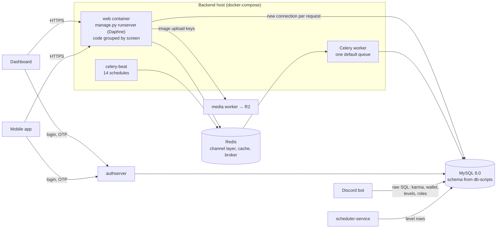
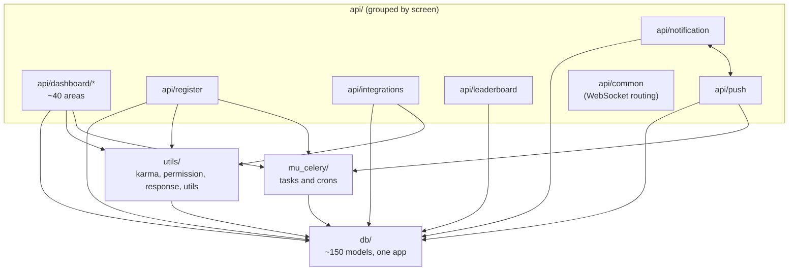
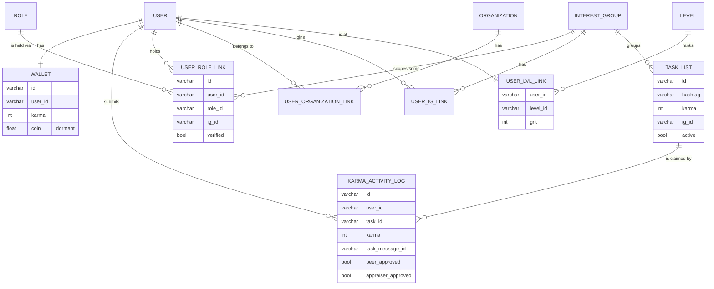
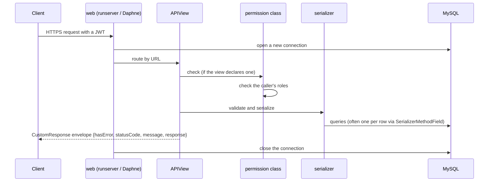
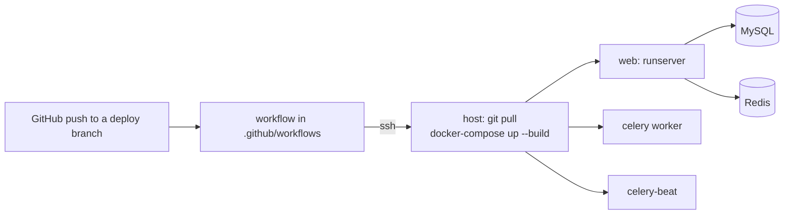

# How the backend works today

Describes `dev` at 7fd66060 (21 Nov 2026). Every number on this page was measured at that commit. Where a number depends on a method (for example, what counts as a "write site"), the method is named.

## The platform in one paragraph

`mulearnbackend` is one Django 4.2 project, about 90,000 lines of Python in 440 files. It serves about 718 routes through about 655 Django REST Framework `APIView` classes: no ViewSets, generic views or function views. Background work runs on Celery with Redis as the broker. The schema lives in a separate repository, `db-scripts`, and every model in this repository is `managed = False`, so Django never runs migrations. The dashboard (Next.js) and the mobile app (Flutter) are the main clients. Login, OTP and OpenID Connect live in a separate service, the authserver.

## The ecosystem

| System | Repository | What it does today |
|---|---|---|
| Backend | `mulearnbackend` (public) | The API, background jobs and admin features |
| Schema | `db-scripts` (private) | Versioned SQL alters and the full schema, `latest.sql`, applied by a maintainer |
| Identity | `authserver` (private) | Login, OTP, social sign-in and an OpenID Connect provider |
| Discord bot | `aaronchettan` (private) | Records task submissions from Discord reactions and writes karma, wallet, levels, roles and several aggregate tables directly in MySQL |
| Scheduler | `scheduler-service` (public) | The grit meter (inactivity level-down) and some emails; writes level rows directly |
| Media worker | `mulearn-media-worker` (public) | Validates and re-encodes images and stores them on Cloudflare R2 |
| μCoin | `mucoin-service` (public) | A standalone coin economy that will consume three signed events from core ([ADR-054](adr/ADR-054-mucoin-external-consumer.md)) |
| Clients | `mulearn-dashboard`, `mulearn-app` (public) | Call `/api/v1`; neither opens a WebSocket |

## How the code is organised

Code is grouped by surface, not by subject:
- `api/dashboard/` holds about 40 areas;
- `api/register/`, `api/integrations/`, `api/leaderboard/`, `api/notification/`, `api/push/` and others sit beside it;
- all models live in `db/`;
- shared helpers live in `utils/` (`utils/karma.py`, `utils/permission.py`, `utils/response.py`, `utils/utils.py`);
- Celery tasks live in `mu_celery/`.

Any package can import any model and write any table.

There is no rule about which package may import which. A few packages import each other in a cycle; notification and push are one example.

## Business domains

The table maps the domains this architecture uses to where their code and tables live today. "Owner module" is the target module from [03-target-architecture.md](03-target-architecture.md).

| Domain | Where the code is today | Main tables | Owner module |
|---|---|---|---|
| Roles and permissions | `api/dashboard/roles/`, `utils/permission.py` | `role`, `user_role_link` | `identity_access` |
| People and profiles | `api/register/`, `api/dashboard/profile/`, `api/dashboard/user/` | `user`, `socials`, `user_settings` | `people` |
| Organisations and campuses | `api/dashboard/organisation/`, `api/dashboard/campus/`, `api/dashboard/college/`, `api/dashboard/location/`, `api/dashboard/zonal/`, `api/dashboard/district/` | `organization`, `college`, `user_organization_link` | `organizations` |
| Interest groups and learning circles | `api/dashboard/ig/`, `api/dashboard/lc/`, `api/dashboard/learningcircle/`, `api/dashboard/channels/` | `interest_group`, `user_ig_link`, `learning_circle` | `communities` |
| Tasks | `api/dashboard/task/`, `api/dashboard/skill/`, `api/dashboard/task_report/` | `task_list`, `task_type`, `skill` | `learning` |
| Submissions and karma | `utils/karma.py`, `api/dashboard/profile/`, `api/dashboard/lc/`, `api/dashboard/manage_interns/`, the Discord bot | `karma_activity_log`, `wallet` | `contributions` |
| Levels, achievements and leaderboards | `api/dashboard/achievement/`, `api/leaderboard/`, `api/top100_coders/`, `mu_celery/achievement_*`, the bot, the scheduler | `level`, `user_lvl_link`, `achievement`, `user_achievements_log` | `gamification` |
| Vouchers, coupons and referrals | `api/dashboard/karma_voucher/`, `api/dashboard/coupon/`, `api/dashboard/referral/` | `voucher_log`, `user_referral_link` | `rewards` |
| Events and hackathons | `api/dashboard/events/`, `api/hackathon/`, `api/calendar/` | `events`, `hackathon` | `events` |
| Mentorship | `api/dashboard/mentor/` | `mentor_application`, `mentorship_session` | `mentorship` |
| Careers | `api/dashboard/company/`, `api/dashboard/career_lab/`, `api/dashboard/problem_statement/` | `company`, `company_jobs`, `user_job_application` | `careers` |
| Interns | `api/dashboard/manage_interns/`, `api/dashboard/intern/` | `intern_task`, `intern_weekly_review` | `interns` |
| Notifications | `api/notification/`, `api/push/` | `notification`, the push tables | `notifications` |
| Discord and partners | `api/integrations/`, `api/dashboard/discord_moderator/` | `integration`, `integration_authorization` | `integrations` |
| Donations | `api/donate/` | `donor`, `donation` | `payments` |
| Comics and media | `api/muComics/`, `api/media/`, `api/dashboard/media_content/` | `comic`, `media_content` | `media` |
| Projects | `api/dashboard/projects/` | `projects`, `impact_project` | `projects` |
| Settings and admin tools | `api/dashboard/feature/`, `api/dashboard/dynamic_management/`, `api/url_shortener/` | `system_setting`, `url_shortener` | `administration` |
| μCoin (frozen in core) | `api/dashboard/referral/` (coin debit) | `wallet.coin`, `mucoin_activity_log`, `mucoin_invite_log` | none; see [ADR-054](adr/ADR-054-mucoin-external-consumer.md) |

`api/launchpad/` is deprecated and excluded from this architecture.

**Who writes what.** An AST scan of the backend finds 732 write sites over 130 tables (launchpad excluded). Several tables have writers in more than one area or more than one service:

| Table | Backend writers | Other writers |
|---|---|---|
| `karma_activity_log` | 13 sites in 9 functions across 7 files, for example `utils/karma.py` `add_karma` and `api/dashboard/lc/dash_lc_view.py` | Discord bot |
| `wallet` | 17 sites in 11 functions across 9 files | Discord bot |
| `user_role_link` | 32 sites in 24 functions across 16 files | Discord bot |
| `user_lvl_link` | `api/register/serializers.py` (created at signup) | Discord bot, scheduler-service |
| `user` | several areas | authserver, Discord bot |

The per-module lists are on each page in [modules/](modules/README.md).

## Core data model today

- Keys are mostly UUID strings in `CharField(max_length=36)`.
- The schema in `db-scripts` defines about 170 tables and about 450 foreign keys. About 300 of those keys reference `user`, most with `ON DELETE CASCADE`.
- A user can hold several `user_role_link` rows at once, each with its own `verified` flag.
- The karma balance is the `wallet.karma` counter, updated alongside a `karma_activity_log` row.

## How a request flows today

**Authentication.** Clients get tokens from the authserver. The backend validates the JWT itself, and the token carries identity claims. Each view declares its own permission classes. `REST_FRAMEWORK` sets no project-wide default for authentication, permissions, throttling or exception handling.

## How it is deployed today

- `.github/workflows/prod-deploy.yml` deploys over SSH with `git pull` and `docker-compose up --build`. It runs no tests and builds no image in CI.
- A second node, pod 1, runs `docker-compose.pod.yml`: the web container (`runserver`) and one Celery worker, deliberately without beat (the file says there is exactly one beat per deployment). `.github/workflows/pod1-roll.yml` updates it by hand (`workflow_dispatch`) with rsync and SSH.
- `docker-compose.yml` starts the web container with `python manage.py runserver 0.0.0.0:8000`, and `entrypoint.sh` starts `daphne`.
- The image is `python:3.10-slim-buster`.

## Background work today

- **One queue.** All tasks in `mu_celery/` go to the default queue: there are no task routes.
- **One scheduler.** `celery-beat` runs 14 schedules from `CELERY_BEAT_SCHEDULE`: intern, alumni, mentorship, job expiry, event status, organisation and learning-circle aggregates, leaderboards and push.
- **Redis.** One host carries the WebSocket channel layer, the cache (DB 1) and the broker (DB 2), with no eviction policy set in the repository.
- **Request code.** Some request code calls `.delay()` without `transaction.on_commit`, and some sends email synchronously.
- **WebSockets.** Signal receivers for landing-page statistics are registered from `api/common/common_consumer.py`, which is imported by the WebSocket routing.

## Findings and technical debt

These are properties of the code that any reader can confirm at 7fd66060. Security-specific findings are tracked privately by the maintainers and are not listed here.

| ID | Finding | Evidence | Why it matters | Fixed by |
|---|---|---|---|---|
| T-01 | Karma has many writers, each with its own rules | 13 backend write sites plus the Discord bot | Double or lost awards; balances can't be explained | Ledger and one writer ([ADR-004](adr/ADR-004-karma-ledger.md), Phase 4) |
| T-02 | No table ownership | 732 write sites over 130 tables; `user_role_link` written from 16 files | A rule fixed in one place is missed in another | Modules own tables ([ADR-038](adr/ADR-038-modules-own-their-tables.md)) |
| T-03 | Code grouped by screen, models in one app | `api/dashboard/*`, `db/` | No natural place for a rule; anything can import anything | Module layout ([ADR-017](adr/ADR-017-one-layered-module-structure.md)) |
| T-04 | Development server in production | `docker-compose.yml` `runserver`; `entrypoint.sh` `daphne` | No worker bounds, timeouts or graceful drain | gunicorn `gthread` ([ADR-006](adr/ADR-006-gunicorn-gthread-behind-nginx.md), Phase 2) |
| T-05 | A new database connection per request | `CONN_MAX_AGE` 0 in `mulearnbackend/settings.py` | Connection storms under load | Connection budget ([ADR-019](adr/ADR-019-read-scaling-and-connections.md)) |
| T-06 | No CI before deploy | `.github/workflows/prod-deploy.yml` | Untested code reaches production; no clean rollback | Images by digest ([ADR-013](adr/ADR-013-immutable-images-by-digest.md), Phase 1–2) |
| T-07 | The test suite can run against a real database | the root `conftest.py` has no guard | A contributor's test run can damage a shared database | Issue 0001 |
| T-08 | One Celery queue | no task routes | A bulk job delays OTP emails and karma | Routed queues ([ADR-042](adr/ADR-042-background-work-celery.md)) |
| T-09 | Side effects inside request transactions | `.delay()` without `on_commit`; synchronous email | Lost or phantom side effects | Outbox ([ADR-005](adr/ADR-005-transactional-outbox.md), [ADR-041](adr/ADR-041-transactions-and-consistency.md)) |
| T-10 | Unused WebSocket layer | Channels and Daphne configured; no client opens a WebSocket | Extra moving parts and attack surface | Retire Channels ([ADR-039](adr/ADR-039-retire-channels-and-daphne.md)) |
| T-11 | N+1-prone serialization | about 334 `SerializerMethodField` declarations against about 43 `prefetch_related` calls | Query count grows with page size | Hot-path rules and budgets ([ADR-045](adr/ADR-045-hot-path-serialization.md), [ADR-026](adr/ADR-026-performance-budgets-in-ci.md)) |
| T-12 | Large pages and OR-ed search | `utils/utils.py` `MAX_PAGE_SIZE` = 1000; `icontains` across columns | Slow lists and full scans | Page caps, keyset pagination ([ADR-044](adr/ADR-044-api-standards-v1-2.md)), search on trigger ([ADR-020](adr/ADR-020-search-on-trigger.md)) |
| T-13 | No project-wide API defaults | `REST_FRAMEWORK` sets only the renderer and schema | Inconsistent errors and throttling | API standards ([ADR-044](adr/ADR-044-api-standards-v1-2.md)), default deny ([ADR-007](adr/ADR-007-scoped-grants-and-policies.md)) |
| T-14 | Stale API spec | `openapi.yaml` lists fewer paths than the router | Clients and contributors can't trust it | OpenAPI generated in CI ([ADR-044](adr/ADR-044-api-standards-v1-2.md)) |
| T-15 | Unknown request keys are rejected | a patch in `mulearnbackend/__init__.py` | Any additive client field becomes a 400 | Compatibility policy ([ADR-044](adr/ADR-044-api-standards-v1-2.md)) |
| T-16 | Hand-kept second schema file | `schema.sql` beside `db-scripts` | Drift between models, `schema.sql` and the real schema | Vendored schema and parity tests ([ADR-040](adr/ADR-040-db-scripts-safety-net.md)) |
| T-17 | Out-of-support platform | Django 4.2.7, `python:3.10-slim-buster` | No security fixes | Platform track ([ADR-050](adr/ADR-050-platform-versions.md)) |
| T-18 | Startup reads the database | `db/apps.py` `check_system_user_exists` from `AppConfig.ready()` | Boot fails or slows when the database is busy | Typed config and boot checks ([ADR-048](adr/ADR-048-typed-configuration.md)) |
| T-19 | Settings read at import with no default | `decouple_config` in `mulearnbackend/settings.py` | A missing variable crash-loops every container | Typed, fail-fast config ([ADR-048](adr/ADR-048-typed-configuration.md)) |
| T-20 | Most `api/` directories are not packages | about 30 of 91 directories under `api/` have an `__init__.py` | Import tools can't see most of the code | Phase 1 issue |

## Performance and scalability today

- **Connections are the first limit.** Every request opens its own connection, and nothing bounds how many requests run at once. A campus signup burst turns directly into a connection burst.
- **Serialization cost grows with the page.** Method fields that query per row, combined with pages of up to 1000 rows, make one list request into hundreds of queries.
- **Leaderboards aggregate on request.** `api/leaderboard/` sums karma rows; on dev, `mu_celery/leaderboard_cron.py` refreshes cached boards twice a day.
- **One queue serves everything,** so slow jobs delay urgent ones.
- **Correctness under concurrency is not guaranteed.** Karma is a read-modify-write counter updated from many places, so two concurrent awards can lose an update. Duplicate Discord reactions can produce duplicate awards unless each writer happens to guard against them.

No user number is claimed for today's system. The capacity model and the load tests that would justify one are in [09-performance-and-caching.md](09-performance-and-caching.md).

## Database assessment

- **The schema source is right.** `db-scripts` already owns the schema and Django never migrates it. That stays ([ADR-014](adr/ADR-014-db-scripts-single-schema-source.md)).
- **The safety net is missing.** There is no CI database, no model/DDL parity test, and a second hand-kept `schema.sql`, so models and DDL can drift unseen ([ADR-040](adr/ADR-040-db-scripts-safety-net.md)).
- **Deletes cascade widely.** About 300 foreign keys reference `user`, most with `ON DELETE CASCADE`, so deleting a user row removes history in many tables ([ADR-052](adr/ADR-052-privacy-minors-erasure.md) replaces hard deletes with anonymisation).
- **String UUID keys** are kept: converting them has no incremental path ([ADR-015](adr/ADR-015-uuid-keys-and-public-ids.md)).
- **Collations fold case and accents,** so identity must never be decided by SQL string equality ([ADR-002](adr/ADR-002-mysql-8-4-lts.md)).
- **Some money and coin columns are floating point.** The coin columns are frozen ([ADR-053](adr/ADR-053-business-calendar-and-money.md), [ADR-054](adr/ADR-054-mucoin-external-consumer.md)).
