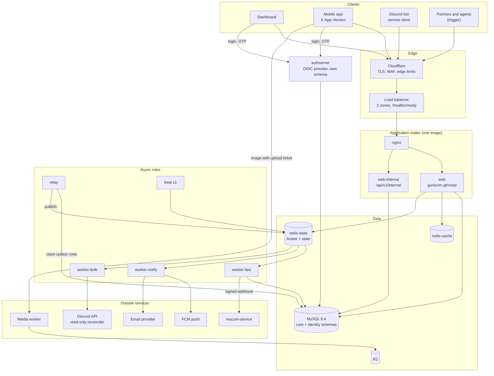
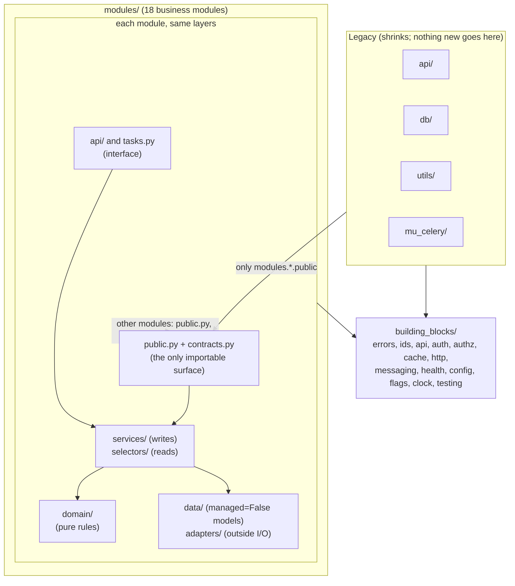
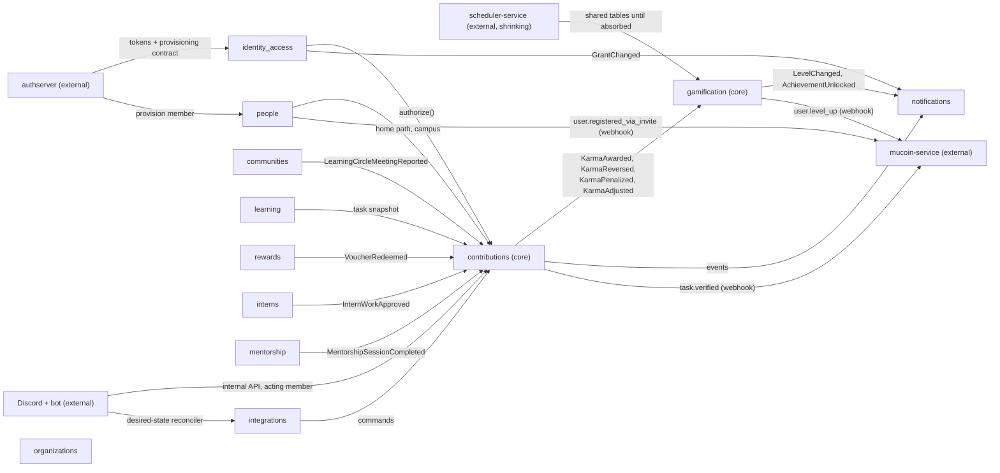
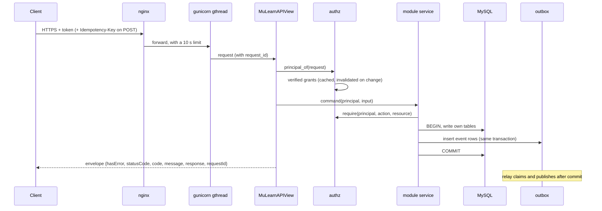

# Target architecture

This page describes where the backend is going. None of it exists at `dev` 7fd66060 unless a line says so. The current state is in [02-current-state.md](02-current-state.md).

## The target in one paragraph

μLearn's backend stays **one Django deployable** (Django 5.2 LTS, [ADR-050](adr/ADR-050-platform-versions.md)). Inside it:
- 18 business modules under `modules/` and one technical package, `building_blocks/`, all follow one layered structure ([ADR-017](adr/ADR-017-one-layered-module-structure.md), [ADR-038](adr/ADR-038-modules-own-their-tables.md));
- gunicorn `gthread` workers serve it behind nginx and a health-checked load balancer, sized from the MySQL connection budget ([ADR-006](adr/ADR-006-gunicorn-gthread-behind-nginx.md));
- every table has one owner module, and other services call the API instead of writing tables ([ADR-003](adr/ADR-003-one-owner-per-table.md));
- karma is an append-only ledger ([ADR-004](adr/ADR-004-karma-ledger.md)), and every follow-up to a write travels through a transactional outbox to routed Celery queues ([ADR-005](adr/ADR-005-transactional-outbox.md), [ADR-042](adr/ADR-042-background-work-celery.md));
- authorization comes from verified, scoped grants, and a user may hold any number of them ([ADR-007](adr/ADR-007-scoped-grants-and-policies.md)).

The schema stays in `db-scripts` ([ADR-014](adr/ADR-014-db-scripts-single-schema-source.md)), and the authserver stays a separate identity provider ([ADR-008](adr/ADR-008-authserver-separate-idp.md)).

## Components

"Now" means part of the planned phases. "Trigger" means it waits for a measured trigger ([15-risks-and-future-scale.md](15-risks-and-future-scale.md)).

| Tier | Component | Technology and settings | When | ADR |
|---|---|---|---|---|
| Edge | CDN, WAF, edge rate rules, cached public reads | Cloudflare in front of the load balancer | Now | [036](adr/ADR-036-rate-limiting.md), [044](adr/ADR-044-api-standards-v1-2.md) |
| Edge | Load balancer | Health-checked across two availability zones; readiness at `/healthz/ready` | With the second node | [006](adr/ADR-006-gunicorn-gthread-behind-nginx.md) |
| App | `web` role | nginx (10 MB body cap), gunicorn `gthread` with 4 threads, workers from the budget formula, a 9 s in-app deadline | Now | [006](adr/ADR-006-gunicorn-gthread-behind-nginx.md) |
| App | `web-internal` role | The same image, routed for `/api/v1/internal/*` (the bot and other service clients) | When the bot moves to the API | [023](adr/ADR-023-one-image-several-roles.md) |
| App | `web-admin`, `web-public` roles | The same image: admin reads go to a replica, public reads are cached | Trigger | [023](adr/ADR-023-one-image-several-roles.md) |
| Async | `worker-fast` | Celery queues `critical`, `default`, `projections` | Now | [042](adr/ADR-042-background-work-celery.md) |
| Async | `worker-notify` | Celery queue `notifications` | Now | [042](adr/ADR-042-background-work-celery.md), [047](adr/ADR-047-notification-pipeline.md) |
| Async | `worker-bulk` | Celery queues `bulk` and `integrations`, low concurrency | Now | [042](adr/ADR-042-background-work-celery.md) |
| Async | `beat` | Exactly one; every run first claims `(schedule, slot)` in `schedule_run` | Now | [042](adr/ADR-042-background-work-celery.md) |
| Async | `relay` | `manage.py outbox_relay`: claim, commit, send, mark | Now | [005](adr/ADR-005-transactional-outbox.md) |
| Data | MySQL | 8.4 LTS, Multi-AZ, point-in-time recovery, per-service database users | Now | [002](adr/ADR-002-mysql-8-4-lts.md), [019](adr/ADR-019-read-scaling-and-connections.md), [049](adr/ADR-049-deployment-platform-and-dr.md) |
| Data | `redis-cache` | `allkeys-lru`, no persistence; the Django `default` cache | Now | [043](adr/ADR-043-redis-cache-and-state.md) |
| Data | `redis-state` | `noeviction`; the Celery broker plus the `state` cache alias (limiters, locks, flag snapshots) | Now | [043](adr/ADR-043-redis-cache-and-state.md) |
| Files | Media worker and R2 | Images through the worker, which accepts upload tickets only | Now | [011](adr/ADR-011-object-storage-stateless-nodes.md), [046](adr/ADR-046-tokens-keys-service-clients.md) |
| Files | R2 through django-storages | Imports, certificates, receipts; a private bucket with signed URLs for anything personal | Now | [011](adr/ADR-011-object-storage-stateless-nodes.md) |
| Identity | authserver | A separate Django project and OIDC provider with its own schema | Now | [008](adr/ADR-008-authserver-separate-idp.md), [021](adr/ADR-021-separate-identity-schema.md) |
| Clients | Dashboard, app | `/api/v1` envelope with additive fields; the app sends `X-App-Version`; token claims `id`, `muid`, `expiry`, `roles` stay | Now | [044](adr/ADR-044-api-standards-v1-2.md) |
| Clients | Discord bot | A service client on `/api/v1/internal/contributions/*`; a heartbeat on processed events; read-only database access after its move | Phase 4 | [003](adr/ADR-003-one-owner-per-table.md), [018](adr/ADR-018-channel-agnostic-contributions.md) |
| Clients | Discord reconciler | A backend job with a read-only Discord credential that drives the same `contributions` commands | Phase 4 | [018](adr/ADR-018-channel-agnostic-contributions.md) |
| Clients | scheduler-service | Fixed in place (fail closed, idempotent per user and day), then absorbed into `gamification` | Phase 3, then later | [042](adr/ADR-042-background-work-celery.md) |
| Clients | `mucoin-service` | Receives three signed integration events by webhook | On hold: no μCoin work is planned for now | [054](adr/ADR-054-mucoin-external-consumer.md) |
| Clients | Partners and AI agents | OIDC client credentials with scopes `mulearn.<module>.read\|write` | Trigger: the first partner | [046](adr/ADR-046-tokens-keys-service-clients.md) |
| Ops | Telemetry | OpenTelemetry → collector → Grafana Cloud; Sentry with no personal data; CloudWatch Logs kept in India | Now | [012](adr/ADR-012-opentelemetry-sentry-json-logs.md), [033](adr/ADR-033-slos-and-burn-rate-alerts.md) |

## Proposed system

## Inside the backend

The rules that make this hold are in [04-module-rules.md](04-module-rules.md).

## Modules

| Module | Kind | Owns (main tables) | Starts in |
|---|---|---|---|
| `building_blocks` | Plumbing | `outbox_event`, `inbox_record`, `dead_letter`, `idempotency_record`, `feature_flag`, `schedule_run`, `audit_event`, `service_client` | Phase 1 and Phase 3 |
| `contributions` | Core | `karma_activity_log` (as submissions), `karma_ledger_entry`, `wallet` (karma column) | Phase 4 |
| `gamification` | Core | `level`, `user_lvl_link`, achievements, `karma_period_total` | Phase 6 |
| `identity_access` | Supporting | `role`, `user_role_link` (as scoped grants), `dynamic_role`, `mentor_scope_grant` | Phase 5 |
| `people` | Supporting | `user` (profile columns), `socials`, `user_settings`, consent records | Phase 7 |
| `organizations` | Supporting | `organization`, `college`, geography, chapters, memberships | On demand |
| `communities` | Supporting | `interest_group`, `user_ig_link`, `learning_circle`, `channel` | On demand |
| `learning` | Supporting | `task_list`, `task_type`, `skill`, `task_report` | On demand |
| `rewards` | Supporting | `voucher_log`, coupons, referrals; the coin tables are frozen | Phase 8 |
| `events` | Supporting | `events`, `hackathon`, event categories | On demand |
| `mentorship` | Supporting | mentor applications, sessions, availability | On demand |
| `careers` | Supporting | `company`, jobs, applications, problem statements | On demand |
| `interns` | Supporting | intern tasks, timesheets, reviews | On demand |
| `media` | Supporting | comics, media content | On demand |
| `projects` | Supporting | projects, impact projects | On demand |
| `notifications` | Generic | in-app notifications, push and email delivery, preferences | Phase 6 |
| `integrations` | Generic | `integration`, `integration_authorization`; the Discord reconciler | Phase 4 |
| `payments` | Generic | `donor`, `donation`, provider webhook events | On demand |
| `administration` | Generic | `system_setting` (platform keys), the URL shortener | On demand |
| `analytics` | Generic, deferred | nothing until its trigger | Trigger |

Each module has its own page in [modules/](modules/README.md).

## Domain design

**Bounded contexts:**

| Kind | Contexts | Why this kind |
|---|---|---|
| Core | `contributions`, `gamification` | Karma correctness and progression are the product. Both have real invariants. |
| Supporting | `identity_access`, `people`, `organizations`, `communities`, `learning`, `rewards`, `events`, `mentorship`, `careers`, `interns`, `media`, `projects` | Specific to μLearn, but mostly CRUD with a few rules |
| Generic | `notifications`, `payments`, `integrations`, `administration`, `analytics` | Solved problems; kept thin |
| External | the authserver, Discord, scheduler-service, `mucoin-service`, partners, FCM, the email provider, the media worker | Outside the deployable; reached through a published contract or an adapter |

**Context map:**

| Relationship | Pattern | What it means in code |
|---|---|---|
| authserver → identity_access, people | Published contract | The token claims and the provisioning call are a versioned contract ([ADR-046](adr/ADR-046-tokens-keys-service-clients.md)). The backend never reads identity tables. |
| learning → contributions | Customer/supplier | `contributions` copies a task snapshot when it decides, so later task edits can't rewrite history. |
| communities, interns, mentorship, rewards → contributions | Published events | The producer publishes an event; `contributions` awards karma with a per-source key. No producer writes karma. |
| contributions → gamification, notifications | Downstream subscribers | They react to ledger events and never write ledger tables. |
| Discord → contributions | Anti-corruption layer | The bot translates reactions into commands on the internal API. The backend reconciler reads Discord's current state and drives the same commands. |
| core → mucoin-service | Published events | One-way, signed webhooks. Nothing flows back ([ADR-054](adr/ADR-054-mucoin-external-consumer.md)). |

**Aggregates and their rules.** Only the core and identity modules have aggregates worth naming. The rest are plain models.

| Aggregate | Module | Rules it enforces |
|---|---|---|
| Submission | `contributions` | One submission per source reference. Only an appraiser decides. No self-approval. A replayed reaction changes nothing. |
| Karma account | `contributions` | The balance equals the sum of ledger entries. Only penalties may take it below zero. Entries are never edited or deleted. |
| Level progress | `gamification` | The level derives from the balance and the thresholds. At most one grit change per user per IST day. Only `gamification` writes level tables. |
| Period total | `gamification` | The total for a user and period equals the sum of that user's entries in that IST month, and can be rebuilt. |
| Grant | `identity_access` | One active grant per user, role and scope. Only verified grants authorize. A combination of grants never allows more than its parts. |

**Shared vocabulary.**

| Term | Meaning | Where it lives today |
|---|---|---|
| User UUID | The internal, pseudonymous subject id, used in ledgers, events, logs and audit | `user.id` |
| muid | The public person id, `<slug>@mulearn`; never logged | `user.muid` |
| Principal | Who is acting: a user with grants, or a service client with scopes | new, `building_blocks.authz` |
| Role | A named bundle of permissions: Student, Mentor, Campus Lead, Enabler, Appraiser and others | `role` |
| Grant | A verified role held within a scope. A user holds several at once. | `user_role_link`, gaining scope columns |
| Scope | What a grant applies to: `global`, `state`, `district`, `campus`, `ig`, `lc` or a chapter path | new |
| Task | A published piece of work that can earn karma; its public key is a hashtag | `task_list` |
| Submission | One claim of proof of work against a task, from any channel | `karma_activity_log` |
| Source, source ref | Where a submission or entry came from, and its idempotency key, such as `discord:<message_id>` | new columns |
| Appraisal | The final decision on a submission: approve (award) or reject | `appraiser_approved` |
| Award, reversal, penalty, adjustment | Ledger entry types | new `karma_ledger_entry` |
| Period | A business period with IST bounds; the ledger stores the IST month | new `building_blocks/clock` |
| Board | A ranked view over period totals | `api/leaderboard/` today |
| Integration event | An immutable, versioned fact a module publishes | new `contracts.py` |
| Outbox, inbox, dead letter | Rows that make event delivery transactional, de-duplicated and recoverable | new |
| Service client | A machine caller with a hashed secret, scopes and a quota | new `service_client` |

## What stays synchronous, and what becomes asynchronous

| Synchronous (inside the request) | Asynchronous (after commit, through the outbox and workers) |
|---|---|
| Recording a submission and its appraisal decision | Level and achievement updates after karma changes |
| The ledger entry and the `wallet.karma` projection, in one transaction | Period totals and leaderboards |
| Authorization decisions | Notifications: in-app, push, email |
| Profile, task and organisation reads and edits | Discord role and channel sync |
| Voucher redemption checks | Organisation and learning-circle aggregates |
| Issuing upload tickets | Imports, exports and other bulk jobs |
| | Webhooks to `mucoin-service` |
| | Discord reconciliation |

**The rule.** Anything the caller needs in the response stays synchronous, inside one module's transaction. Anything that crosses into another module, or calls an outside system, happens after commit ([ADR-041](adr/ADR-041-transactions-and-consistency.md)).

## How a request will flow

