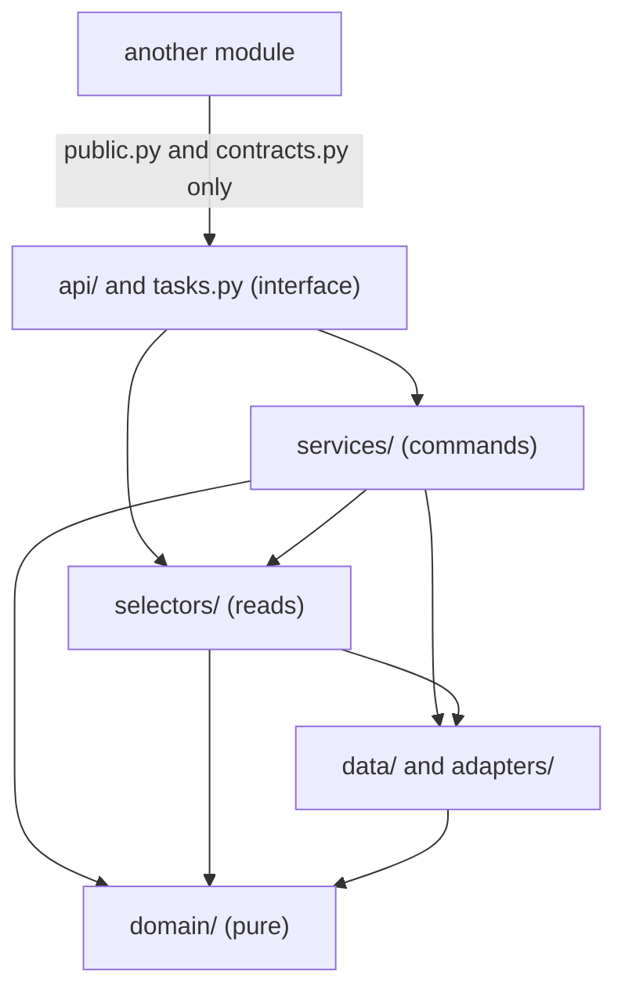

# Module rules

These rules apply to all new code. They describe the **target**: at `dev` 7fd66060 there is no `modules/` or `building_blocks/` package yet, and the Phase 1 issues in [github-issues/](github-issues/README.md) create them. Legacy code (`api/`, `db/`, `utils/`, `mu_celery/`) keeps working and shrinks; nothing new goes there.

The decisions behind these rules are [ADR-016](adr/ADR-016-architecture-enforced-by-automation.md), [ADR-017](adr/ADR-017-one-layered-module-structure.md), [ADR-038](adr/ADR-038-modules-own-their-tables.md) and [ADR-041](adr/ADR-041-transactions-and-consistency.md). A change that breaks a rule here needs a new ADR, not an exception.

## Where code lives

```text
building_blocks/            technical plumbing shared by every module; no business rules
modules/<name>/             one package per business domain, all with the same layout
modules/urls.py             public module routes, mounted at /api/v1/
modules/internal_urls.py    service-client routes, mounted at /api/v1/internal/
api/ db/ utils/ mu_celery/  legacy code: keeps working, shrinks, nothing new goes here
schema/latest.sql           a schema-only copy of db-scripts' latest.sql (source commit in schema/SOURCE)
tests/architecture/         the rules on this page, as tests
tests/schema/               model/DDL parity tests (MySQL tier)
docs/architecture/          this documentation; one page per module in modules/
```

A module is created when a change first needs it: its first table moving out of legacy `db/`, its first route, or a contract that another module or an integration needs. Tables move when a change needs them, not all at once.

## The anatomy of a module

Every module has the same layout. `python manage.py new_module <module>` creates it (a Phase 1 issue builds the generator).

```text
modules/<m>/
├── apps.py          AppConfig. ready() imports policies; it never touches the database.
├── public.py        the ONLY functions other modules may call (keep it under 25 names). It imports
│                    its parameter and return types from contracts.py; it never defines them.
├── contracts.py     where every DTO and every versioned event is DEFINED. Other modules import the
│                    types from here. A leaf: stdlib, building_blocks.messaging.events, and this
│                    module's domain/values.py only.
├── policies.py      authorization: one @policy per action.
├── flags.py         feature flags this module declares (optional).
├── tasks.py         Celery tasks and event consumers: one line each, calling services.
├── api/             views.py (thin), serializers.py (request and response shapes), urls.py
├── services/        commands: every write use case, one transaction each.
├── selectors/       reads: queries returning DTOs.
├── data/            models.py (managed=False mirrors of the DDL); repositories.py only when it pays.
├── adapters/        calls to external systems, through building_blocks.http.
├── domain/          pure Python: values, state machines, pricing rules, errors. No Django.
├── management/commands/   operator commands (dry-run by default).
└── tests/
    ├── domain/      pure unit tests and hypothesis properties
    ├── services/    command tests (SQLite tier)
    ├── selectors/   query-count tests
    ├── api/         envelope and authorization-matrix tests
    └── mysql/       @pytest.mark.mysql tests (concurrency, collation)
```

## Before you start: what exists, and who owns it

1. **Is there a module?** Look in `modules/`. Every module has a page, [`modules/<module>.md`](modules/README.md), listing the tables it owns, its `public.py` functions, its events and its state machines.
2. **Who owns a table?** [`modules/README.md`](modules/README.md) has one row per table: the owning module, or `legacy` when no module has claimed it yet. The per-service database grants are generated from the same ownership list.
3. **Where is the model of a legacy table?** In the legacy `db/` app: `grep -rn 'db_table = "<table>"' db/` finds it. Its columns are in `schema/latest.sql` (search for ``CREATE TABLE `<table>` ``).
4. **Using a legacy-owned table from a module.** Reading it through a read-only mapping is allowed while it is listed under `[reads]` in `tests/architecture/allowlists/legacy_writers.toml`. Writing it means moving the table into a module first ([16-contributing-to-the-architecture.md](16-contributing-to-the-architecture.md)), in its own pull request, which needs architecture review ([adr/README.md](adr/README.md)).
5. **If the page and the code disagree,** the code wins; fix the page in your pull request.

## The rules

### Layers and imports



1. **Imports point downwards only:** `api | tasks` → `services` → `selectors` → `data | adapters` → `domain`.
2. **`domain/` is framework-free.** It may not import Django, DRF, Celery, an HTTP client, or `building_blocks.persistence`, `.messaging`, `.http` or `.cache`. It may import `building_blocks.errors` and `building_blocks.clock`.
3. **Another module is reached only through its `public.py` (the functions you call) and its `contracts.py` (the DTOs those functions take and return, and its events).** Never its models, services, selectors or domain. A DTO is defined once, in `contracts.py`; `public.py` imports it for its signatures.
4. **The module graph is declared and acyclic.** Which modules may import whose `public.py` is listed in `tests/architecture/module_graph.toml`. To add an edge, add it there; a cycle fails CI. Importing another module's `contracts.py` to subscribe to an event is always allowed.
5. **`building_blocks` never imports `modules`**, and neither ever imports the legacy packages (`api`, `db`, `utils`, `mu_celery`).
6. **Legacy code may import only `modules.*.public`, `modules.*.contracts` and `building_blocks`.**
7. **Only `building_blocks.http` imports an HTTP client** (`requests`, `httpx`).

The contracts live in `.importlinter`, generated from `tests/architecture/module_graph.toml`, and CI runs them with import-linter's `lint-imports`.

### Data ownership

1. **Each table has exactly one owning module**, and only the owner writes it.
2. **A reference to another module's row is an id column** (`event_id = models.CharField(max_length=36)`), never a Django `ForeignKey`. The database keeps the foreign key for integrity; Python keeps the modules apart.
3. **Reading another module's data** goes through its `public.py` selectors, which return DTOs (dataclasses), never models or querysets. Selectors must accept a list of ids so callers don't loop.
4. **Writing another module's data** is never done directly. Publish an event the owner consumes, or (when you need the answer now) call the owner's public command **before** you open your own transaction.

### Transactions and side effects

1. **One transaction per use case.** Every write is a function in `services/` decorated with `@command(owner="<module>")` (from `building_blocks.persistence.command`). It opens the transaction, checks authorization, applies domain rules, writes, and publishes events.
2. **Never nest another module's command inside your transaction.** The `@command` guard raises in tests and development when a command of module B runs inside a transaction module A opened.
3. **Events go to the transactional outbox** with `outbox.publish(event)` inside the command. The event exists if and only if the change commits; the relay delivers it afterwards.
4. **No network inside a transaction.** Email, push, Discord, partner calls and `.delay()` never run inside a command. They run in consumers or tasks after commit. `transaction.on_commit` is only for small in-process work such as a cache version bump.
5. **Concurrency is handled by constraints and locks, not hope:** a `UNIQUE` constraint for every natural key, `select_for_update()` on the rows you own (in the lock order documented in your module page), `F()` expressions for counters, conditional updates (`UPDATE … WHERE status = 'issued'`) for single-use redemptions such as vouchers.
6. **Idempotency everywhere:** commands that can be retried take a key and return `created=False` on a replay; POST endpoints that create or charge accept an `Idempotency-Key` header; consumers are deduplicated by the inbox.

### Authorization

1. **Endpoints are authenticated by default.** Use `MuLearnAPIView`. A public endpoint uses `PublicAPIView`, must set `public_reason`, and must be listed in `tests/architecture/allowlists/public_views.txt`. Machine endpoints use `InternalAPIView` with a `required_scope`.
2. **Services decide.** A service calls `require(principal, "<module>.<action>", resource=…)`. A view may add `scoped_action("<module>.<action>")` to its `permission_classes` for a fast 403, but the service check is the authority.
3. **A user holds several roles at once** (for example Student, Mentor and Campus Lead). A decision is the **union of what each grant allows on its own**: a policy looks at one grant at a time and never says "role A and role B". A property test runs every policy against random grant combinations and fails if a combination allows more than its grants do alone.
4. **Grants are scoped**: global, an interest group, a campus, or a chapter path such as `IN/KL/EKM`, where a chapter grant covers its whole subtree.
5. **Only verified grants authorize.** Role names in tokens are a display hint for clients; the backend never authorizes from them.
6. **Never check role names in a view.** Register a policy.

### Errors and responses

- Every response uses the envelope `{hasError, statusCode, code, message: {general, fields}, response, requestId}`. Use `self.ok(data)` in views.
- Every failure is a `DomainError` subclass registered with `@error_code("<module>.<code>")` in `domain/errors.py`, which gives it a stable `code` and HTTP status. Never build an error `Response` by hand.
- Use correct HTTP statuses (404, 409, 422, 429 …). Validation errors list fields under their camelCase names.

### API conventions

- Routes live under `/api/v1/<module>/`. Field names in JSON are camelCase.
- New list endpoints use **keyset pagination**: `?cursor=&limit=` with `limit` at most 100, ordered by an indexed unique key. Responses carry `nextCursor`.
- Filters and sort fields are allowlisted; an unknown parameter returns 400 on new endpoints (`parse_query`).
- Public reads send `Cache-Control: public, max-age=60, stale-while-revalidate=300` and an ETag (`@public_cache()`); every authenticated response is `private, no-store` automatically.
- Reports and exports bigger than one page run as background jobs and deliver a file link, never a CSV built on the request thread.
- The OpenAPI spec is generated in CI. Removing or renaming a response field, adding a required request field or changing a status code is a breaking change: CI blocks it unless an ADR and the deprecation policy (a `Sunset` header and at least six months of notice for first-party clients) are in place.
- Internal ids that are sequential numbers never appear in URLs or payloads. Public references are UUIDs, or `muid` for people.

### Time, money and identifiers

- Get the current time from `building_blocks.clock.now()` (timezone-aware UTC). Never call `datetime.now()`.
- Business periods (day, week, month, year) are **India Standard Time**: use `clock.period_bounds(kind, at)` for any "this month" query. Midnight IST is 18:30 UTC the day before.
- New money columns are integers in minor units (paise).
- New rows get ids from `building_blocks.ids.uuid7_str()` (time-ordered UUIDs).
- Key, reference and path columns are `ascii_bin` in the DDL and compared exactly in Python. Never decide identity or security by comparing text in SQL: the default collation folds case and accents.

### Logging and personal data

- Logs are JSON and carry `request_id` and the user's UUID automatically. Never log request bodies, tokens, passwords, OTPs, emails, phone numbers or `muid`.
- Event payloads, ledger entries and audit records carry UUIDs and facts, never names, emails or phones. A test rejects events whose payload keys look personal.
- Users are never hard-deleted; erasure anonymises personal fields and keeps history.

## Where does my code go?

| I need to… | Put it in | Not in |
|---|---|---|
| Add an endpoint | `modules/<m>/api/views.py` (a `MuLearnAPIView` / `PublicAPIView` / `InternalAPIView` subclass), `modules/<m>/api/serializers.py`, `modules/<m>/api/urls.py` | Legacy `api/` packages |
| Validate request shape (types, lengths, required fields) | `modules/<m>/api/serializers.py` | Views, services |
| Enforce a business rule | `domain/` (pure function or state machine), called by a service | Serializers, views, models, signals |
| Change data | A `@command` in `services/` | Views, serializer `create()`/`update()`, `save()` overrides, signals |
| Read data for a screen | A function in `selectors/` returning DTOs, keyset-paginated, with `select_related`/`prefetch_related` declared | `SerializerMethodField` queries |
| Decide who may do something | `policies.py` (`@policy`), plus `require()` in the service | Role-name checks in views |
| Use another module's data | Its `public.py`, or subscribe to its event | Its models, raw SQL on its tables |
| Tell other modules something happened | An event in `contracts.py`, published with `outbox.publish` in your command | Direct calls into their services |
| React to another module's event | A `@consumer` in your `tasks.py`, calling your service | Signals |
| Add or change a table or column | An alter in `db-scripts`, then the `managed=False` model in `data/models.py` | Django migrations, SQL run by hand |
| Call an external service | `adapters/`, through `building_blocks.http.get_client(name)`, from a consumer or task | Views, commands, inside a transaction |
| Run something later or on a schedule | A task in `tasks.py` on the right queue, plus `@scheduled` for periodic work | Host cron, long `eta`/`countdown` |
| Cache something | `building_blocks.cache.get_or_compute` with a versioned key, invalidated on commit | Balances, per-user data under shared keys, authorization decisions |
| Send a notification | Publish your domain event; `notifications` maps it to a template | `send_mail` or push calls in your module |
| Add a feature switch | `flags.py` with `declare(...)` (owner, kind, expiry) | Environment variables, settings flags |
| Add a configuration value | Declare it through `building_blocks.config` (type, default, required environments, secret marker) | `os.environ` reads scattered in code |
| Share a technical helper | `building_blocks/` (no business rules) | A new `utils.py` |
| Share a business helper | The owning module's `public.py` | `building_blocks/` |

## How CI enforces each rule

Every rule above is a failing check on pull requests ([ADR-016](adr/ADR-016-architecture-enforced-by-automation.md)). Legacy code that already breaks a rule sits on a **ratchet allowlist**: a new offender fails, and so does a stale entry, so the lists only shrink.

| Rule | Check | Where |
|---|---|---|
| Imports point downwards; `domain/` is framework-free | import-linter layer and forbidden contracts | `.importlinter` (generated) |
| Other modules only through `public.py` and `contracts.py` | import-linter independence contracts | `.importlinter` |
| The module graph is declared and acyclic | a test over `module_graph.toml` | `tests/architecture/test_module_graph.py` |
| Legacy code imports only `modules.*.public`, `modules.*.contracts` and `building_blocks` | an import-linter contract over `api`, `db`, `utils`, `mu_celery` | `.importlinter` |
| No `ForeignKey` to another module's model | AST fitness function | `tests/architecture/test_no_cross_module_fk.py` |
| One writer per table | a shrink-only allowlist of legacy writers | `tests/architecture/allowlists/legacy_writers.toml` |
| No module command inside another module's transaction | the `@command` guard (raises in tests), plus an allowlist of legacy callers | `tests/architecture/allowlists/legacy_tx_callers.toml` |
| Every view is authenticated unless declared public | auth-coverage ratchet | `tests/architecture/allowlists/public_views.txt` |
| Only `building_blocks.http` imports an HTTP client | import-linter forbidden contract | `.importlinter` |
| No `print`, no bare `except Exception: pass` | AST fitness function | `tests/architecture/test_hygiene.py` |
| Event payloads carry no personal data or reserved names | a test over every `contracts.py` | `tests/architecture/test_event_payloads.py` |
| Models match the DDL | parity tests against the CI MySQL built from `schema/latest.sql` | `tests/schema/` |
| No Django migrations | a test that fails if a `migrations` package appears | `tests/architecture/test_no_migrations.py` |

For import-linter to see the legacy code at all, every directory under `api/` needs an `__init__.py`. At 7fd66060 only about 30 of 91 do; a Phase 1 issue adds the rest.

## Examples

These show target code. None of it is in the repository yet.

**Module structure** for `contributions`:

```text
modules/contributions/
├── apps.py
├── public.py            record_submission, appraise, reverse_award, get_balance, ...
├── contracts.py         SubmissionApproved, KarmaAwarded, KarmaReversed, TaskVerified, BalanceDTO, ...
├── policies.py          contributions.appraise, contributions.reverse, ...
├── tasks.py             consumers: on_voucher_redeemed, on_lc_meeting_reported, ...
├── api/                 views.py, serializers.py, urls.py, internal_urls.py
├── services/            commands.py (one @command per use case)
├── selectors/           balances.py, queue.py
├── data/                models.py (KarmaActivityLogRow, LedgerEntryRow, WalletRow), repositories.py
├── adapters/            (none yet)
├── domain/              submission.py (state machine), keys.py, errors.py
└── tests/               domain/, services/, selectors/, api/, mysql/
```

**Calling another module.** `notifications` needs to know who bookmarked an event. It asks `events` through `public.py` with a batch selector, and never reads the `events` tables:

```python
# modules/events/public.py
from modules.events.selectors.bookmarks import bookmarker_ids  # (event_id: str) -> list[str]

# modules/notifications/services/event_notices.py
from modules.events.public import bookmarker_ids
from modules.notifications.services.notify import notify


def notify_cancellation(*, event_id: str) -> None:
    notify(user_ids=bookmarker_ids(event_id), template="event_cancelled",
           data={"event_id": event_id}, dedupe_key=f"event_cancelled:{event_id}")
```

The edge `notifications -> events` is declared in `tests/architecture/module_graph.toml`. Without it, CI fails.

**A repository, where it pays.** Most modules use the ORM directly in services and selectors. The karma ledger is the exception, because its writes must always follow the same lock order and key rules:

```python
# modules/contributions/data/repositories.py
from django.db.models import Sum

from modules.contributions.data.models import LedgerEntryRow, WalletRow


class LedgerRepository:
    def append(self, *, user_id: str, entry_type: str, amount: int, source: str, source_ref: str,
               period: str, member_path: str, task_scope_path: str) -> tuple[LedgerEntryRow, bool]:
        # UNIQUE(source, source_ref) makes a replay return the existing row (created=False).
        return LedgerEntryRow.objects.get_or_create(
            source=source, source_ref=source_ref,
            defaults=dict(user_id=user_id, entry_type=entry_type, amount=amount, period=period,
                          member_path=member_path, task_scope_path=task_scope_path),
        )

    def lock_wallet(self, user_id: str) -> WalletRow:
        return WalletRow.objects.select_for_update().get(user_id=user_id)

    def ledger_balance(self, user_id: str) -> int:
        return LedgerEntryRow.objects.filter(user_id=user_id).aggregate(s=Sum("amount"))["s"] or 0
```
