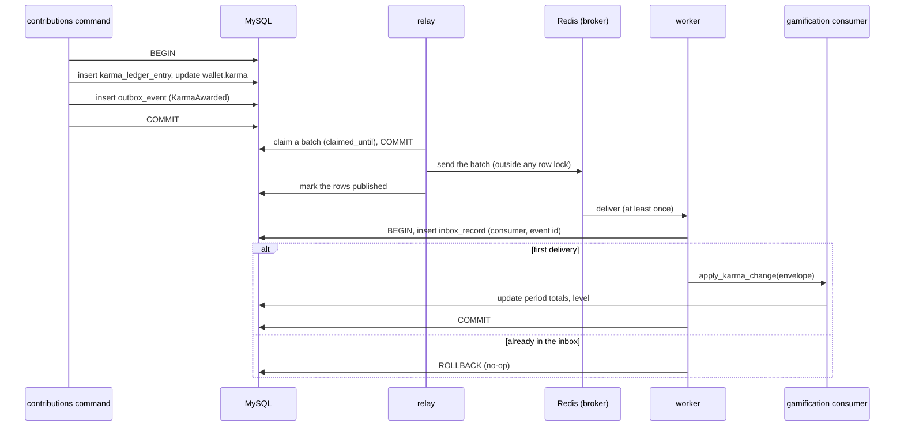
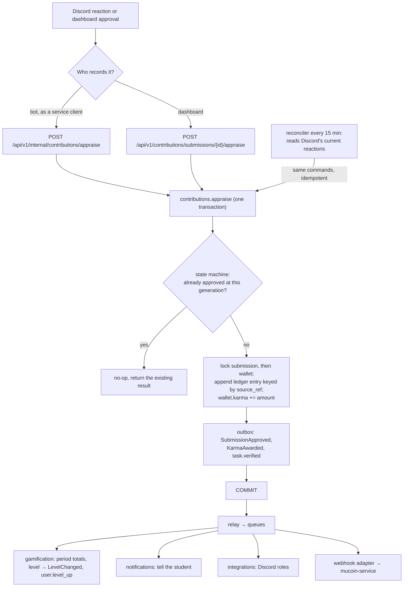

# Events and background work

This page describes the target. At `dev` 7fd66060 there is no outbox, no event envelope and no queue routing: all Celery tasks in `mu_celery/` share the default queue, and some request code calls `.delay()` without `transaction.on_commit` ([02-current-state.md](02-current-state.md)).

The decisions are:
- [ADR-005](adr/ADR-005-transactional-outbox.md): the outbox;
- [ADR-035](adr/ADR-035-cloudevents-envelope.md): the envelope;
- [ADR-041](adr/ADR-041-transactions-and-consistency.md): transactions;
- [ADR-042](adr/ADR-042-background-work-celery.md): Celery;
- [ADR-047](adr/ADR-047-notification-pipeline.md): notifications;
- [ADR-054](adr/ADR-054-mucoin-external-consumer.md): external consumers.

## Why events

A write often has follow-ups in other modules. When a submission is approved, the karma ledger gets an entry. After that:
- levels and period totals update;
- the student gets a notification;
- Discord roles may change;
- `mucoin-service` would hear about the verified task (on hold with the μCoin integration).

If the approval request did all of that inline, any failure would leave the state half-changed, and a slow follow-up would slow the request. Firing them off after the request ("fire and forget") loses follow-ups whenever the process dies or the broker is down.

The rule is: **a module changes only its own tables inside its own transaction, and tells everyone else through an event written in that same transaction.** The event exists if and only if the change commits.

## How an event travels



**Delivery and processing guarantees:**
- **The outbox is written in the business transaction.** No event can exist without its change, or a change without its event.
- **The relay claims, sends, then marks.** It claims a batch of due rows (`claimed_until`) and commits. It sends them to the broker outside any row lock, then marks them published. Several relays can run, because claims use `SKIP LOCKED`.
- **Delivery is at least once,** and processing takes effect once. Each consumer records `(consumer name, event id)` in `inbox_record` in the same transaction as its work, so a redelivery is a no-op. Each consumer's service also uses its own idempotency key for the fact (for example `voucher:<id>`), so a replay under a new event id still has one effect.
- **Retries and dead letters.** Failed handlers retry with jittered exponential backoff. After the last retry, the delivery is parked in `dead_letter` with the error, and an alert fires. `manage.py replay_dead_letters --consumer <name>` re-sends parked deliveries after a fix.
- **Versions.** A consumer declares the versions it accepts. A delivery of any other version goes to a dead letter and raises an alert; it is never silently dropped. An event type with no subscriber yet is only counted.
- **Ordering.** No ordering is guaranteed. Consumers tolerate reordering, using the state machine or "newest wins" by `time`. Per-aggregate ordering can be turned on later through the generated `relay_partition` column without a backfill.
- **Retention.** Published outbox rows and inbox rows are kept 30 days.

Exactly-once delivery is not assumed anywhere. "Effectively once" comes from the inbox, the per-fact keys and the state machines.

## The envelope

Every event uses one envelope with CloudEvents 1.0 attribute names ([ADR-035](adr/ADR-035-cloudevents-envelope.md)):

```json
{
  "specversion": "1.0",
  "id": "01936b2e-5b7e-7c2a-9d1e-3f4a5b6c7d8e",
  "source": "/mulearn/contributions",
  "type": "org.mulearn.contributions.karma_awarded.v1",
  "subject": "submission:6f0c…",
  "time": "2026-12-10T09:30:12.481Z",
  "datacontenttype": "application/json",
  "traceparent": "00-…",
  "correlationid": "req_…",
  "causationid": "01936b2e-…",
  "data": {
    "user_id": "a3b1…",
    "amount": 200,
    "entry_id": "01936b2e-…",
    "period": "2026-12",
    "member_path": "IN/KL/EKM/c-1a2b",
    "task_scope_path": "IN"
  }
}
```

- **Payloads carry UUIDs and facts only,** never names, emails or phone numbers. A test rejects personal-looking payload keys ([ADR-052](adr/ADR-052-privacy-minors-erasure.md)).
- **Schemas live in the producer's `contracts.py`.** Adding an optional field keeps the version. Removing, renaming or retyping a field, or changing its meaning, needs a new version, published alongside the old one for at least one release.

## Event catalogue

The main events. Each module page lists its full set.

| Event | Producer | Consumers | Delivery |
|---|---|---|---|
| `people.user_registered` | `people` | `gamification` (create level progress), `rewards` (referral), `integrations` | `default` |
| `contributions.submission_recorded` | `contributions` | `notifications` | `default` |
| `contributions.submission_approved` | `contributions` | `notifications` | `critical` |
| `contributions.karma_awarded` | `contributions` | `gamification`, `organizations`, `communities`, `notifications` | `projections` |
| `contributions.karma_reversed` / `karma_penalized` / `karma_adjusted` | `contributions` | `gamification` | `projections` |
| `gamification.level_changed` | `gamification` | `notifications`, `integrations` (Discord roles) | `default` |
| `gamification.achievement_unlocked` | `gamification` | `notifications` | `notifications` |
| `identity_access.grant_changed` | `identity_access` | `notifications`, `integrations`; grant-cache invalidation | `critical` |
| `communities.learning_circle_meeting_reported` | `communities` | `contributions` (award) | `critical` |
| `interns.intern_work_approved` | `interns` | `contributions` (award), `gamification` (streaks) | `critical` |
| `rewards.voucher_redeemed` | `rewards` | `contributions` (award, keyed `voucher:<id>`) | `critical` |
| `events.event_cancelled` | `events` | `notifications` | `notifications` |
| `payments.donation_captured` | `payments` | `notifications` | `notifications` |

**Integration events for `mucoin-service`** ([ADR-054](adr/ADR-054-mucoin-external-consumer.md)). **On hold:** no μCoin work is planned for now; this is the design for when it resumes. Each goes through the same outbox, and the webhook delivery adapter subscribes to it:

| Event type | Producer | Trigger | Payload |
|---|---|---|---|
| `user.level_up` | `gamification` | A level **increases** (never on a decrease) | `{"muid": str, "old_level": int, "new_level": int}` |
| `task.verified` | `contributions` | A submission reaches appraiser-approved | `{"muid": str, "task_hashtag": str, "task_id": str}` |
| `user.registered_via_invite` | `people` | A registration carries a μCoin invite code | `{"invitee_muid": str, "invite_code": str}` |

`mucoin-service` identifies people by `muid`, so these three payloads carry `muid` by contract. That is the one exception to the UUID-only payload rule. When the integration resumes, these go on the payload test's allowlist; until then, the test allows no exception.

**Webhook delivery.**
- **Request:** `POST {MUCOIN_URL}/api/v1/events/ingest` with body `{"payload": {...}}`.
- **Headers:** `Content-Type: application/json`, `X-Mu-Event-Id` (the outbox event id), `X-Mu-Event-Type` and `X-Mu-Signature: sha256=<hex HMAC-SHA256 of the raw body>`, signed with `MUCOIN_WEBHOOK_SECRET`.
- **Responses:**
  - `200 processed`, `200 duplicate` and `202 ignored` mark the delivery done;
  - `400` and `401` go to a dead letter with an alert;
  - `5xx` and timeouts retry with backoff.

## Queues and workers

| Queue | Worker role | What runs there |
|---|---|---|
| `critical` | `worker-fast` | Karma awards from events, grant changes, OTP and login email |
| `default` | `worker-fast` | Ordinary follow-ups |
| `projections` | `worker-fast` | Period totals, organisation and learning-circle aggregates, batched |
| `notifications` | `worker-notify` | In-app, push and email delivery |
| `bulk` | `worker-bulk` | Imports, exports, backfills, reconciliation |
| `integrations` | `worker-bulk` | Discord sync and the reconciler, partner calls, `mucoin-service` webhooks |

**Rules for every task** ([ADR-042](adr/ADR-042-background-work-celery.md)):
- Every task is routed to a named queue. A CI test fails on any unrouted task or on a beat entry that doesn't resolve.
- Every task has soft and hard time limits, `acks_late`, and retries with jittered backoff. It is idempotent, because it may run twice.
- No long `eta` or `countdown`: anything delayed beyond the broker's visibility timeout is stored as a due row and picked up by a scheduled task instead.
- **Exactly one beat.** Every scheduled run first claims `(schedule name, slot start)` in `schedule_run`, so a second beat, or a beat restarted mid-slot, cannot run a job twice. The claim is also the heartbeat: an alert fires when a schedule misses two intervals.
- Legacy `.delay()` calls go through `safe_enqueue()`, which enqueues on commit and falls back to an outbox row if the broker is down.

## Critical workflow: approving a task submission



## Examples

These show target code. None of it is in the repository yet.

**A domain event definition** in the producer's `contracts.py`:

```python
from dataclasses import dataclass

from building_blocks.messaging.events import IntegrationEvent


@dataclass(frozen=True, kw_only=True)
class KarmaAwarded(IntegrationEvent):
    EVENT_TYPE = "contributions.karma_awarded"   # stable forever
    VERSION = 1                                   # bump only for a breaking payload change
    PRODUCER = "contributions"
    user_id: str
    amount: int
    entry_id: str
    period: str            # IST month, "YYYY-MM"
    member_path: str
    task_scope_path: str
```

**Publishing inside the command that makes it true** (an idempotent command):

```python
from building_blocks.authz.core import Principal, require
from building_blocks.messaging import outbox
from building_blocks.persistence.command import command
from modules.contributions.contracts import AwardResult, KarmaAwarded, TaskVerified
from modules.contributions.data.repositories import LedgerRepository
from modules.contributions.domain.submission import approve


@command(owner="contributions")
def appraise(*, principal: Principal, submission_id: str, expected_generation: int) -> AwardResult:
    require(principal, "contributions.appraise", resource=submission_id)
    repo = LedgerRepository()
    sub = repo.lock_submission(submission_id)            # lock order: submission, then wallet
    decision = approve(sub, expected_generation)          # pure state machine; no-op on replay
    if decision.noop:
        return AwardResult(entry_id=decision.entry_id, created=False)
    entry, created = repo.append(user_id=sub.user_id, entry_type="award", amount=sub.amount,
                                 source=sub.source, source_ref=decision.key, period=decision.period,
                                 member_path=sub.member_path, task_scope_path=sub.task_scope_path)
    if created:
        repo.add_to_wallet(sub.user_id, sub.amount)       # F() expression, same transaction
        outbox.publish(KarmaAwarded(aggregate_type="submission", aggregate_id=submission_id,
                                    user_id=sub.user_id, amount=sub.amount, entry_id=entry.id,
                                    period=decision.period, member_path=sub.member_path,
                                    task_scope_path=sub.task_scope_path))
        outbox.publish(TaskVerified(aggregate_type="submission", aggregate_id=submission_id,
                                    muid=sub.muid, task_hashtag=sub.hashtag, task_id=sub.task_id))
    return AwardResult(entry_id=entry.id, created=created)
```

**An event handler** in the consumer's `tasks.py`, one line into its service:

```python
from typing import Any

from building_blocks.messaging.consumer import consumer
from building_blocks.messaging.registry import subscribe
from modules.contributions.contracts import KarmaAwarded
from modules.gamification.services import progress


@subscribe(KarmaAwarded)
@consumer("gamification.apply_karma_change", queue="projections")
def on_karma_awarded(envelope: dict[str, Any]) -> None:
    progress.apply_karma_change(envelope)   # deduped by the inbox; keyed by entry_id inside
```

**The transactional outbox.** `publish` writes a row; the relay moves committed rows:

```python
# building_blocks/messaging/outbox.py
from django.db import connection, transaction

from building_blocks.messaging.models import OutboxEvent


def publish(event) -> None:
    if not connection.in_atomic_block:
        raise RuntimeError("outbox.publish must run inside a @command transaction")
    OutboxEvent.objects.create(**event.to_row())   # same transaction as the business change


# building_blocks/messaging/relay.py  (run by `manage.py outbox_relay`)
def relay_once(batch: int = 200) -> int:
    with transaction.atomic():
        rows = list(OutboxEvent.objects.select_for_update(skip_locked=True)
                    .filter(published_at__isnull=True, claimed_until__lt=now())
                    .order_by("id")[:batch])
        OutboxEvent.objects.filter(id__in=[r.id for r in rows]).update(claimed_until=now() + CLAIM)
    sent = send_to_broker(rows)                      # outside any row lock
    OutboxEvent.objects.filter(id__in=sent).update(published_at=now())
    return len(sent)
```

**A background task** with routing, limits and idempotency:

```python
# modules/contributions/tasks.py
from building_blocks.tasks import mu_task


@mu_task(queue="bulk", soft_time_limit=1500, time_limit=1800, scheduled="contributions.reconcile_nightly")
def reconcile_nightly() -> None:
    from modules.contributions.services.reconciliation import run_reconciliation
    run_reconciliation()     # claims (schedule, slot) first; compares wallets with ledger sums
```
