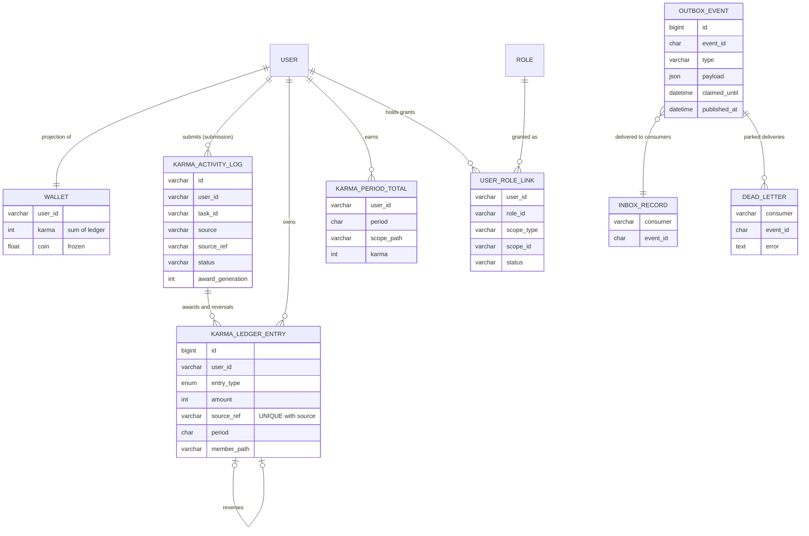

# Data and schema

The database decisions are:
- [ADR-002](adr/ADR-002-mysql-8-4-lts.md): MySQL 8.4;
- [ADR-004](adr/ADR-004-karma-ledger.md): the ledger;
- [ADR-014](adr/ADR-014-db-scripts-single-schema-source.md): `db-scripts` as the schema source;
- [ADR-015](adr/ADR-015-uuid-keys-and-public-ids.md): keys;
- [ADR-040](adr/ADR-040-db-scripts-safety-net.md): the safety net;
- [ADR-041](adr/ADR-041-transactions-and-consistency.md): transactions;
- [ADR-052](adr/ADR-052-privacy-minors-erasure.md): erasure;
- [ADR-053](adr/ADR-053-business-calendar-and-money.md): time and money.

Today's schema is described in [02-current-state.md](02-current-state.md).

## The database

**MySQL stays, upgraded from 8.0 to 8.4 LTS** with an RDS blue/green deployment, outside the academic exam period ([ADR-002](adr/ADR-002-mysql-8-4-lts.md)).

PostgreSQL was considered. It has better pooling, partial indexes and transactional DDL. It was rejected for now, because:
- every table and about 450 foreign keys would move;
- other services' raw SQL would need rewriting;
- collation-dependent behaviour would change meaning.

It is reconsidered only when all external writers are behind the API, a measured need blocks releases, and an estimate comes in under one quarter of team time.

## Where the schema lives, and how it changes

`db-scripts` is the only source of schema ([ADR-014](adr/ADR-014-db-scripts-single-schema-source.md)):
- Schema changes are versioned SQL alters, reviewed there and applied by a maintainer. Nothing else applies DDL to a shared database.
- This repository has no Django migrations. Every model is `managed = False` and mirrors the DDL.
- `db-scripts` is private. A **schema-only copy** of its `latest.sql` (DDL only, with no data and no comments) is vendored here as `schema/latest.sql`, with the source commit recorded in `schema/SOURCE`. A maintainer refreshes it after each alter merges. The local MySQL and the CI MySQL tier are built from it.

**How a contributor changes the schema:**
1. **Open the issue in this repository.** Write the exact DDL in the issue and in the pull request description.
2. **A maintainer writes the alter** in `db-scripts`, with the standard header, and gets it reviewed and applied (an expand alter, see below). Contributors never choose alter numbers.
3. **Update the model.** The backend pull request updates the `managed = False` model and its tests, and merges after the alter is applied.
4. **Refresh the copy.** A maintainer refreshes `schema/latest.sql`.

**Expand, then contract.**
- An **expand** alter only adds: a nullable or defaulted column, a table, an index built online.
- Code that uses it ships after the alter is applied.
- A **contract** alter removes or tightens something. It ships at least one release after the last code that referenced the old shape, outside exam periods.

**The safety net** ([ADR-040](adr/ADR-040-db-scripts-safety-net.md)):
- **Stable ids.** Each alter has a stable id and a header: `-- id:`, `-- requires:`, `-- online:`, `-- owner:`, `-- expand-contract:`.
- **An applied set, not a version number.** The runner records each applied alter, so applying alters out of order never lowers anything.
- **Code declares its schema.** The backend lists the alter ids it needs. Deploy pre-flight and boot refuse a release whose ids aren't applied.
- **A CI MySQL tier** (8.0 and 8.4) loads `schema/latest.sql`. Parity tests check every `managed = False` model and every enum against the DDL. Known drift sits in a shrink-only allowlist.
- **A nightly job** compares production's `information_schema` with the CI-built schema and reports drift.
- **Retiring `schema.sql`.** The hand-kept `schema.sql` in this repository is retired once the parity tests pass.

## Keys and identifiers

- **Existing keys stay.** They are UUID strings in `VARCHAR(36)`; converting them has no incremental path ([ADR-015](adr/ADR-015-uuid-keys-and-public-ids.md)).
- **New ids are UUIDv7** (time-ordered), from `building_blocks.ids.uuid7_str()`.
- **New append-heavy tables** (the ledger, the outbox, logs) may use BIGINT primary keys. These never appear in URLs or payloads.
- **Exact comparison for key columns.** New key, reference and path columns use the `ascii_bin` collation. The default collation folds case and accents, so identity is never decided by SQL string equality.
- **Public references** are UUIDs, or `muid` for people.

## Table ownership and references

- Each table has one owning module ([ADR-038](adr/ADR-038-modules-own-their-tables.md)). The ownership list is in [modules/README.md](modules/README.md), and the per-service database grants follow it ([ADR-003](adr/ADR-003-one-owner-per-table.md)).
- A reference to another module's row is an id column in Python, never a Django `ForeignKey`. The database keeps the foreign key for integrity, so the modules stay separable in code.
- **History is not deleted.** Users are anonymised, never hard-deleted. History foreign keys move from `CASCADE` to `RESTRICT` once account deletion anonymises instead of deleting (Phase 7); until then a `RESTRICT` key would make every user with history undeletable, so new history tables such as the karma ledger start with `CASCADE` ([ADR-052](adr/ADR-052-privacy-minors-erasure.md)).

## Transactions and consistency

- **One transaction per use case** ([ADR-041](adr/ADR-041-transactions-and-consistency.md)). Every write is a `@command`, and a command of one module never runs inside another module's transaction.
- **Isolation is READ COMMITTED.** Serialisation comes from row locks (`select_for_update` on rows the module owns, in a documented order) and constraints.
- **Every natural key used by `get_or_create` has a `UNIQUE` constraint.** Without one, two concurrent requests create two rows.
- **Counters use `F()` expressions,** and single-use redemptions use conditional updates.
- **No network call inside a transaction.**

## The karma ledger

`karma_ledger_entry` is the source of truth for karma; `wallet.karma` is a projection updated in the same transaction ([ADR-004](adr/ADR-004-karma-ledger.md)).

**Entry types:**

| Type | Rule |
|---|---|
| `award` | One per approval generation of a submission |
| `reversal` | Cancels one specific award or adjustment, at most once |
| `penalty` | The only entry type that may take karma below zero |
| `adjustment` | An audited manual correction; a negative adjustment stops at zero |
| `opening` | One per user: the migrated starting balance |

**Keys:**
- A submission's key is its channel reference, for example `discord:<message_id>`.
- A re-award after a reversal is the next generation, `<key>#<n>`.
- A reversal is keyed `reversal:<entry_id>`.
- Keys are never per actor, so two appraisers can't create two awards.

**Coins are not in the ledger.** `wallet.coin` and the other dormant coin tables are frozen ([ADR-054](adr/ADR-054-mucoin-external-consumer.md)).

**Example schema** (target DDL, written in `db-scripts`):

```sql
CREATE TABLE karma_ledger_entry (
  id              BIGINT UNSIGNED NOT NULL AUTO_INCREMENT,
  entry_uuid      CHAR(36)       NOT NULL,                    -- UUIDv7, the public reference
  user_id         VARCHAR(36)    NOT NULL,
  submission_id   VARCHAR(36)    NULL,
  entry_type      ENUM('award','reversal','penalty','adjustment','opening') NOT NULL,
  amount          INT            NOT NULL,                    -- negative for reversals and penalties
  source          VARCHAR(32)    CHARACTER SET ascii COLLATE ascii_bin NOT NULL,
  source_ref      VARCHAR(191)   CHARACTER SET ascii COLLATE ascii_bin NOT NULL,
  reverses_entry_id BIGINT UNSIGNED NULL,
  period          CHAR(7)        NOT NULL,                    -- IST month, YYYY-MM
  member_path     VARCHAR(191)   CHARACTER SET ascii COLLATE ascii_bin NOT NULL,
  task_scope_path VARCHAR(191)   CHARACTER SET ascii COLLATE ascii_bin NOT NULL,
  created_by      VARCHAR(36)    NULL,
  created_at      DATETIME(6)    NOT NULL,
  PRIMARY KEY (id),
  UNIQUE KEY uq_karma_ledger_entry_source (source, source_ref),
  UNIQUE KEY uq_karma_ledger_entry_reverses (reverses_entry_id),
  UNIQUE KEY uq_karma_ledger_entry_uuid (entry_uuid),
  KEY idx_karma_ledger_entry_user_period (user_id, period),
  KEY idx_karma_ledger_entry_submission (submission_id),
  CONSTRAINT fk_karma_ledger_entry_ref_user FOREIGN KEY (user_id) REFERENCES `user` (id) ON DELETE CASCADE
) ENGINE=InnoDB;
```

**Reconciliation.**
- **During a module's migration,** a job compares the legacy log with the ledger and opens a ticket on any drift.
- **After cut-over,** a nightly job compares every wallet with its ledger sum and pages on any difference.

```sql
-- wallets whose karma differs from the sum of their ledger entries
SELECT w.user_id, w.karma, COALESCE(SUM(e.amount), 0) AS ledger_sum
FROM wallet w
LEFT JOIN karma_ledger_entry e ON e.user_id = w.user_id
GROUP BY w.user_id, w.karma
HAVING w.karma <> COALESCE(SUM(e.amount), 0);
```

**Migrating to the ledger.** Every existing user gets one `opening` entry, equal to today's `wallet.karma`. The backfill runs in batches of at most 5,000 ids, off-peak, resumable and idempotent through the ledger keys. It shows a dry-run report first.

## Proposed data model for the core



## Indexing

- **Name indexes** `idx_<table>_<columns>`, unique keys `uq_<table>_<columns>`, and foreign keys `fk_<source_table>_ref_<target_column>`.
- **Index for the query, not the column.** Every new selector's query plan is checked against the CI MySQL tier, and a full scan on a large table fails review.
- **Hot paths get composite indexes** in the order of their filter and sort:

```sql
-- appraiser queue: pending submissions for a scope, oldest first
CREATE INDEX idx_karma_activity_log_status_created ON karma_activity_log (status, created_at);
-- the bot and the reconciler look submissions up by their Discord message
CREATE INDEX idx_karma_activity_log_task_message_id ON karma_activity_log (task_message_id);
-- monthly boards read period totals by period and scope
CREATE INDEX idx_karma_period_total_period_scope ON karma_period_total (period, scope_path, karma);
```

- **Online changes.** Indexes are added online (`ALGORITHM=INPLACE, LOCK=NONE`), outside peak hours. The alter header records `-- online: yes`.

## Soft deletion, audit and retention

- **No hard deletes on history tables.** Removing a submission writes a reversal. Removing a user anonymises personal columns and keeps ledger and audit rows ([ADR-052](adr/ADR-052-privacy-minors-erasure.md)).
- **Admin and security-relevant actions** write an insert-only `audit_event` in the same transaction ([ADR-032](adr/ADR-032-audit-trail-and-retention.md)). `audit_event` replaces today's `system_action_log`.
- **Retention:**
  - published outbox and inbox rows, 30 days;
  - dead letters, until resolved;
  - application logs, per [11-reliability-and-observability.md](11-reliability-and-observability.md);
  - personal side tables, per their stated purpose.

## Time and money

- **Store UTC, compute business periods in IST** with `building_blocks/clock` `period_bounds` ([ADR-053](adr/ADR-053-business-calendar-and-money.md)). Midnight IST is 18:30 UTC the day before.
- **New money columns** are integers in minor units (paise).
- **Existing floating-point money columns** are migrated later, when payments change.
