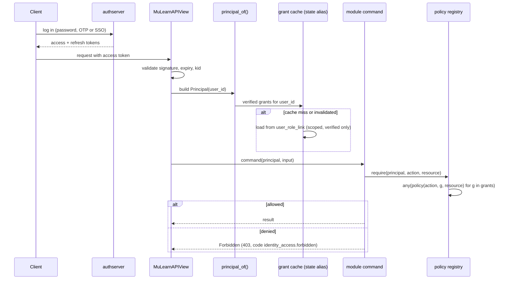

# Authentication and authorization

How callers prove who they are, and how the backend decides what they may do. The decisions are:
- [ADR-007](adr/ADR-007-scoped-grants-and-policies.md): grants and policies;
- [ADR-008](adr/ADR-008-authserver-separate-idp.md): the identity provider;
- [ADR-021](adr/ADR-021-separate-identity-schema.md): the identity schema;
- [ADR-036](adr/ADR-036-rate-limiting.md): abuse controls;
- [ADR-046](adr/ADR-046-tokens-keys-service-clients.md): tokens, keys and service clients.

**Status at `dev` 7fd66060.**
- The authserver is already a separate service.
- The backend validates tokens itself. Each view declares its own permission classes (`utils/permission.py`).
- Role links (`user_role_link`) carry a `verified` flag and, for some roles, an interest group.
- None of the grant, policy or service-client machinery below exists yet.

## Who is who

| Part | Responsibility |
|---|---|
| **authserver** (identity provider) | Login, OTP, social sign-in, partner single sign-on and OpenID Connect. It owns credentials, sessions and its own schema ([ADR-021](adr/ADR-021-separate-identity-schema.md)). |
| **backend** (resource server) | Validates tokens, resolves the caller's **grants** itself, and decides with **policies** |
| **service clients** | Machine callers such as the Discord bot. They authenticate as themselves with a hashed secret, scopes and a quota. |
| **partners and AI agents** (on a trigger) | OIDC client credentials with scopes `mulearn.<module>.read\|write` |

## Users hold several roles at once

A learner can be a Student, a Mentor, a Campus Lead and an Enabler at the same time, and each role is verified separately. Nothing in the backend may assume "the user's role".

A **grant** is a verified role held **within a scope**:

```text
Grant(role="Campus Lead", scope_type="campus",       scope_id="c-1a2b", status="verified")
Grant(role="Mentor",      scope_type="ig",           scope_id="web-dev", status="verified")
Grant(role="Student",     scope_type="global",       scope_id="",        status="verified")
Grant(role="Enabler",     scope_type="campus",       scope_id="c-9f3e", status="pending")
```

- **Scope types** are `global`, `state`, `district`, `campus`, `ig`, `lc` and `chapter_path`.
- **A chapter grant covers its subtree:** a grant on `IN/KL` covers `IN/KL/EKM/c-1a2b` ([ADR-028](adr/ADR-028-chapter-materialised-paths.md)).
- **Only verified grants authorize.** A pending grant is shown to the user as pending and allows nothing.
- **Every role is classified in the role catalogue** as privileged or not. A privileged role takes effect only after it is verified.

## How a decision is made

**A decision is the union of per-grant decisions:**

```text
allowed(principal, action, resource) = any(policy(action, grant, resource) for grant in verified_grants(principal))
```

- **A policy looks at one grant at a time.** No policy may say "role A **and** role B". A combination of roles therefore never allows more than its parts.
- **A property test enforces the union rule.** It generates random grant sets and fails if a set allows something that none of its grants allows alone. A rule that genuinely needs two grants together needs its own ADR.
- **Services decide.** A command calls `require(principal, "<module>.<action>", resource=…)` before it changes anything. A view may add a permission class for an early 403, but the service check is the authority.
- **Default deny.**
  - `DEFAULT_PERMISSION_CLASSES` becomes authenticated-only.
  - A public endpoint uses `PublicAPIView`, states a `public_reason` and is listed in an allowlist.
  - Existing public endpoints are marked explicitly before the default changes, so nothing changes behaviour.
  - An auth-coverage ratchet blocks any new implicitly public view.
- **Scheduled jobs act as a named system principal** that policies grant nothing. Their writes are audited with `actor_kind = system`.



## Example: a policy and its check

Target code; none of it is in the repository yet.

```python
# modules/contributions/policies.py
from building_blocks.authz.core import policy, scope_covers


@policy("contributions.appraise")
def can_appraise(grant, submission) -> bool:
    # One grant at a time. An Appraiser grant covers submissions for tasks in its scope.
    return grant.role == "Appraiser" and scope_covers(grant, submission.task_scope_path)


# modules/contributions/services/commands.py
@command(owner="contributions")
def appraise(*, principal, submission_id: str, expected_generation: int):
    sub = SubmissionRow.objects.select_for_update().get(id=submission_id)
    require(principal, "contributions.appraise", resource=sub)   # raises Forbidden
    if sub.user_id == principal.user_id:
        raise SelfApprovalNotAllowed()                            # a domain rule, not a role check
    ...
```

## Caching grants, and keeping the cache honest

- **Where grants are cached.** Verified grants are cached per user on the non-evicting `state` cache, never on the evictable cache, because losing them must never change a decision ([ADR-043](adr/ADR-043-redis-cache-and-state.md)).
- **How the cache is invalidated.** Every grant change goes through an `identity_access` command (`request_role`, `verify_grant`, `revoke_grant`, `grant_directly`). That command invalidates the user's cache entry on commit and publishes `GrantChanged`. No other code writes `user_role_link`.
- **Decisions are never cached.** Only the grant set is, so a policy change takes effect immediately.

## Tokens and keys

**Phase 1** works with today's clients:
- **One key per signing purpose:**
  - access and refresh tokens, with a `kid`;
  - partner tokens;
  - the learning-circle HMAC.

  No key serves two purposes.
- **Rotation without logouts.** Tokens signed with the previous key are accepted for the refresh-token lifetime (7 days), then the old key is dropped. `SECRET_KEY` rotates through `SECRET_KEY_FALLBACKS`.
- **Services that only check a caller hold ticket keys, never token signing keys:**
  - the media worker accepts **upload tickets**: short-lived HMACs over the user id, purpose, maximum size and expiry, with a key held only by the backend, which mints them, and the worker;
  - `mucoin-service` follows the same rule ([ADR-054](adr/ADR-054-mucoin-external-consumer.md)).
- **Service credentials never mint user tokens.** Acting for a member (the bot recording a member's submission) is an explicit, scoped and audited `act_as` capability.

**Phase 2** (deferred, or earlier if a partner needs it):
- RS256 access tokens from the authserver's JWKS, with `iss`, `aud`, `token_use=access` and a 15-minute lifetime;
- rotating refresh tokens with reuse detection;
- revocation through a per-user `auth_epoch`, bumped on logout-all, credential reset, suspension or grant revocation.

## Service clients

A `service_client` table replaces environment lists. Each client has a hashed secret, scopes, `act_as` capabilities, a per-minute quota and an active switch. During a rotation, the previous secret stays valid until a stated time.

Clients are managed only through `manage.py service_client create|rotate|disable`, which writes an audit record. Internal routes use `InternalAPIView` with a `required_scope`.

## Abuse controls on authentication

- **Rate limits** are keyed by identifier and device, with IP only as a high ceiling, and a campus event mode for bursts ([ADR-036](adr/ADR-036-rate-limiting.md)).
- **The real client address** comes from a measured, trusted proxy hop count, and is forwarded to the authserver over a trusted hop.
- **Turnstile** protects web signup and OTP requests. The app relies on device-keyed limits.
- **When the state store is down,** authentication limiters fall back to a coarse in-process limiter. They never fail open.

## Audit

- **What is audited:** every grant change, admin action, service-client change and `act_as` use writes an insert-only `audit_event` in the same transaction ([ADR-032](adr/ADR-032-audit-trail-and-retention.md)).
- **What a record holds:** UUIDs and facts, never personal data.

## Security standards

These controls map to OWASP ASVS 5.0 and the OWASP API Security Top 10.

| Risk | Control |
|---|---|
| Broken object-level authorization | `require(principal, action, resource=…)` in every command; ownership is a policy, not a view check |
| Broken authentication | Separate identity provider; per-purpose keys; rotation; device-keyed limits; Turnstile |
| Broken function-level authorization | Default deny; auth-coverage ratchet; a generated roles × actions × scopes test matrix |
| Mass assignment | Explicit request serializers per endpoint; module serializers never bind model fields directly |
| Unrestricted resource consumption | Page caps, rate limits, request deadlines, upload size caps |
| Sensitive data exposure | No personal data in logs, events, traces or error tracking; signed URLs for private files |
| Security misconfiguration | Typed, fail-fast settings ([ADR-048](adr/ADR-048-typed-configuration.md)); secrets from a secret store, never in the repository |
| Unsafe consumption of APIs | Outbound calls only through `building_blocks.http`, with timeouts; provider webhooks verified and idempotent |
| Privilege escalation through role combinations | The union-of-grants rule and its property test |

How these are tested in CI is in [12-testing-and-quality-gates.md](12-testing-and-quality-gates.md).

## Testing authorization

- **A generated test matrix** covers roles × actions × scope relations (same scope, parent chapter, sibling, none), built from the policy table.
- **The union property test** (above) runs at least 10,000 examples.
- **Every endpoint gets an API test** for anonymous, wrong-scope and right-scope callers.
- **Before a policy switch,** a shadow-mode report compares the old checks with the new policies. It must show under 0.1% disagreement, every case explained, before enforcement.
