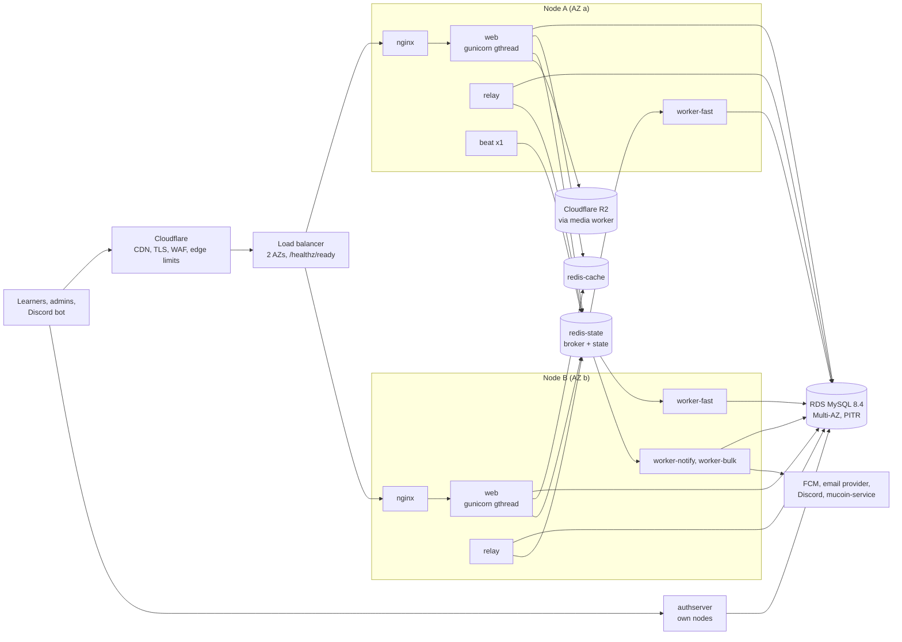

# Infrastructure and deployment

Where the backend runs and how a change reaches production. The decisions are:
- [ADR-006](adr/ADR-006-gunicorn-gthread-behind-nginx.md): serving;
- [ADR-011](adr/ADR-011-object-storage-stateless-nodes.md): files;
- [ADR-013](adr/ADR-013-immutable-images-by-digest.md): images;
- [ADR-023](adr/ADR-023-one-image-several-roles.md): roles;
- [ADR-039](adr/ADR-039-retire-channels-and-daphne.md): retiring Channels;
- [ADR-048](adr/ADR-048-typed-configuration.md): configuration;
- [ADR-049](adr/ADR-049-deployment-platform-and-dr.md): platform and recovery.

**Status at `dev` 7fd66060:**
- `docker-compose.yml` runs `manage.py runserver`, one Celery worker and one beat on the host;
- a second node, pod 1, runs `docker-compose.pod.yml` (web and one worker, no beat), updated by hand through `.github/workflows/pod1-roll.yml`;
- `entrypoint.sh` starts `daphne`;
- the image is built on the host from `python:3.10-slim-buster`;
- `.github/workflows/prod-deploy.yml` deploys with SSH, `git pull` and `docker-compose up --build`.

None of the target below exists yet.

## Platform

- **Now: Docker Compose on EC2,** in an Indian AWS region. Images are pulled by digest from GHCR, with nginx on each node, behind a health-checked load balancer across two availability zones once there is a second node.
- **On a trigger: ECS on Fargate.** The trigger is four or more app nodes, autoscaling for national events, or more than one day a month spent on host operations. The roles map to ECS services one to one.
- **Not planned: Kubernetes.** Its trigger is five or more independently deployed services owned by separate teams.

## One image, several roles

The same image runs every role; only the command differs ([ADR-023](adr/ADR-023-one-image-several-roles.md)).

| Role | Command | Count | When |
|---|---|---|---|
| `web` | `gunicorn mulearnbackend.wsgi -c gunicorn.conf.py` (`gthread`, 4 threads, W from the budget) | per node | Phase 2 |
| `worker-fast` | `celery -A mulearnbackend worker -Q critical,default,projections` | per node | Phase 3 |
| `worker-notify` | `celery -A mulearnbackend worker -Q notifications` | 1+ | Phase 3 |
| `worker-bulk` | `celery -A mulearnbackend worker -Q bulk,integrations --concurrency 2` | 1 | Phase 3 |
| `beat` | `celery -A mulearnbackend beat` | **exactly one**, on one node | Phase 3 |
| `relay` | `python manage.py outbox_relay` | one per node | Phase 3 |
| `web-internal` | `web`, routed for `/api/v1/internal/*` | per node | when the bot moves to the API |
| `web-admin`, `web-public` | `web`, admin reads go to a replica, public reads are cached | per node | trigger |

**Channels and Daphne are retired** in the same release that moves to gunicorn ([ADR-039](adr/ADR-039-retire-channels-and-daphne.md)). No first-party client opens a WebSocket. Before the release, the signal receivers registered from `api/common/common_consumer.py` move to `AppConfig.ready()`, and landing statistics move to a cached HTTP endpoint.

## Deployment architecture



## Deploying a release

- **Build once.** CI builds the image once and pushes it to GHCR. The same digest is promoted along `dev` → `dev-server` → `staging` → `production` ([ADR-013](adr/ADR-013-immutable-images-by-digest.md)).
- **`deploy.sh <env> <digest>`:**
  1. Pre-flight: the configuration check, the connection budget, and the required schema ids, all applied ([06-data-and-schema.md](06-data-and-schema.md)).
  2. Node by node, canary first: drain → stop → start → readiness → next node.
- **Draining.** The drain flag makes readiness return 503. The balancer deregisters the node. gunicorn gets SIGTERM and exits gracefully within 25 s.
- **Rollback** is redeploying the previous digest. The previous digest is kept for at least two weeks after a cut-over.
- **Hotfixes** land on `dev` first and are promoted by digest like any other change.

## Containers

- **Multi-stage build.** A builder stage compiles wheels (`mysqlclient`), and the runtime stage installs them with no compilers.
- **Base image.** A supported slim Debian base (`trixie`) on the Python version from [ADR-050](adr/ADR-050-platform-versions.md), pinned by digest.
- **Non-root.** The app runs as an unprivileged user with a read-only root filesystem, plus a writable `/tmp`.
- **Small and reproducible.** Dependencies are locked with hashes ([ADR-051](adr/ADR-051-toolchain.md)). No source bind mounts in production. `.dockerignore` excludes tests, docs and virtualenvs.
- **Health:**
  - `/healthz/live` answers when the process is up;
  - `/healthz/ready` answers when this process can serve. It checks its own database and Redis connections and the drain flag, not the whole fleet.
- **Resource limits** on every compose service: memory and CPU limits, plus `max_requests` on gunicorn and `max_memory_per_child` on bulk workers.
- **Ports.** Only nginx publishes a port. Every other service listens on the internal network.

## Configuration and secrets

- **Typed and checked.** Every setting is declared once in `building_blocks.config` with a type, a default, the environments that require it, and a secret marker ([ADR-048](adr/ADR-048-typed-configuration.md)). `manage.py config_check` validates an environment before a deploy. A missing required value fails the pre-flight, not the running containers.
- **No work at import.** Settings modules do no I/O at import time.
- **Secrets** live in a secret store (AWS SSM Parameter Store or Secrets Manager), are injected at deploy, and are never committed. CI runs secret scanning ([12-testing-and-quality-gates.md](12-testing-and-quality-gates.md)).

## Environments

| Environment | Purpose | Database | Deployed from |
|---|---|---|---|
| Local | A contributor's machine | Docker MySQL loaded from `schema/latest.sql`; tests use in-memory SQLite or a local `test_` database | the working tree |
| `dev` | Integration of merged work | Its own database, never production data | `dev` branch, by digest |
| `dev-server` | Shared testing with the dashboard and app | Its own database | promoted digest |
| `staging` | Release candidate; load tests; restore drills | Restored from a production snapshot, with personal data masked | promoted digest |
| `production` | Users | Production RDS | promoted digest, after approval |

- **Isolation.** Each environment has its own database, Redis, secrets and service credentials. No environment shares a database with another.
- **Test runs never touch a shared database.** Tests refuse any database whose name doesn't start with `test_` ([12-testing-and-quality-gates.md](12-testing-and-quality-gates.md)).

## Files, CDN and media

- **R2 for everything** ([ADR-011](adr/ADR-011-object-storage-stateless-nodes.md)). Images go through the media worker, which accepts upload tickets only. Other files use django-storages against R2, with a private bucket and signed URLs for anything personal.
- **Stateless nodes.** No file lives on a node's disk. That is what lets a second node join the balancer.

## Backups and recovery

- **Backups.** RDS Multi-AZ, with automated backups for 14 days and point-in-time recovery, plus a daily snapshot copy to a second Indian region.
- **Targets** ([ADR-049](adr/ADR-049-deployment-platform-and-dr.md)):
  - in-region: RPO ≤ 5 min, RTO ≤ 2 h;
  - loss of a whole region: RPO ≤ 24 h, RTO ≤ 24 h, an accepted risk.
- **A quarterly restore drill** restores to a scratch instance, runs the schema-parity and karma-reconciliation checks, and records the time taken.

## Examples

These show target files. None of them is in the repository yet.

**Local development, `docker-compose.yml`:**

```yaml
services:
  mysql:
    image: mysql:8.4
    environment:
      MYSQL_DATABASE: mulearn
      MYSQL_ROOT_PASSWORD: local-only
    volumes:
      - ./schema/latest.sql:/docker-entrypoint-initdb.d/01-schema.sql:ro
    healthcheck:
      test: ["CMD", "mysqladmin", "ping", "-h", "127.0.0.1"]
      interval: 5s
      retries: 20
  redis-cache:
    image: redis:7
    command: ["redis-server", "--maxmemory", "128mb", "--maxmemory-policy", "allkeys-lru"]
  redis-state:
    image: redis:7
    command: ["redis-server", "--maxmemory-policy", "noeviction"]
  web:
    build: .
    command: python manage.py runserver 0.0.0.0:8000
    env_file: .env.local
    ports: ["127.0.0.1:8000:8000"]
    depends_on:
      mysql: {condition: service_healthy}
  worker:
    build: .
    command: celery -A mulearnbackend worker -Q critical,default,projections,notifications,bulk,integrations -l info
    env_file: .env.local
    depends_on: [mysql, redis-state]
  beat:
    build: .
    command: celery -A mulearnbackend beat -l info --schedule /data/celerybeat-schedule
    env_file: .env.local
    volumes: ["beat-data:/data"]
  relay:
    build: .
    command: python manage.py outbox_relay
    env_file: .env.local
volumes:
  beat-data:
```

**Production `Dockerfile`:**

```dockerfile
FROM python:3.13-slim-trixie AS builder
RUN apt-get update && apt-get install -y --no-install-recommends build-essential default-libmysqlclient-dev pkg-config \
    && rm -rf /var/lib/apt/lists/*
WORKDIR /build
COPY requirements.lock .
RUN pip wheel --require-hashes --no-deps -r requirements.lock -w /wheels

FROM python:3.13-slim-trixie
RUN apt-get update && apt-get install -y --no-install-recommends libmariadb3 && rm -rf /var/lib/apt/lists/* \
    && useradd --create-home --uid 10001 app
COPY --from=builder /wheels /wheels
RUN pip install --no-cache-dir /wheels/* && rm -rf /wheels
WORKDIR /app
COPY --chown=app:app . .
USER app
ENV PYTHONDONTWRITEBYTECODE=1 PYTHONUNBUFFERED=1
HEALTHCHECK --interval=10s --timeout=3s CMD python -c "import urllib.request,sys; sys.exit(0 if urllib.request.urlopen('http://127.0.0.1:8000/healthz/live').status==200 else 1)"
CMD ["gunicorn", "mulearnbackend.wsgi", "-c", "gunicorn.conf.py"]
```

**Health checks:**

```python
# building_blocks/health/views.py
from django.db import connection
from django.http import JsonResponse

from building_blocks.health import drain


def live(request):
    return JsonResponse({"status": "ok"})


def ready(request):
    if drain.is_draining():
        return JsonResponse({"status": "draining"}, status=503)
    try:
        with connection.cursor() as cur:
            cur.execute("SELECT 1")
        from django.core.cache import caches
        caches["state"].get("healthz")
    except Exception:
        return JsonResponse({"status": "unavailable"}, status=503)
    return JsonResponse({"status": "ready"})
```
