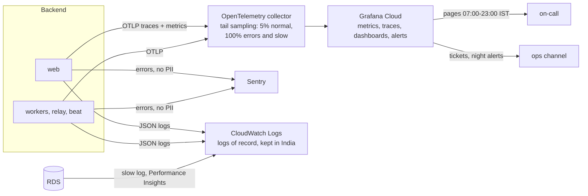

# Reliability and observability

How the backend stays up, degrades instead of failing, and tells the maintainers when something is wrong. The decisions are:
- [ADR-006](adr/ADR-006-gunicorn-gthread-behind-nginx.md): timeouts and draining;
- [ADR-012](adr/ADR-012-opentelemetry-sentry-json-logs.md): telemetry;
- [ADR-023](adr/ADR-023-one-image-several-roles.md): bulkheads;
- [ADR-033](adr/ADR-033-slos-and-burn-rate-alerts.md): SLOs and alerts;
- [ADR-043](adr/ADR-043-redis-cache-and-state.md): Redis roles;
- [ADR-049](adr/ADR-049-deployment-platform-and-dr.md): recovery.

**Status at `dev` 7fd66060:**
- one web process with no request timeout or graceful drain;
- no OpenTelemetry, Sentry, SLOs or alerts;
- no heartbeat that would notice the Discord bot silently stop recording karma.

## High availability

- **At least two app nodes** in two availability zones once the second node joins, behind a load balancer that health-checks `/healthz/ready`. Losing one node loses capacity, not service.
- **RDS Multi-AZ** with point-in-time recovery ([10-infrastructure-and-deployment.md](10-infrastructure-and-deployment.md)).
- **Exactly one beat.** Every scheduled run claims its slot first, so a duplicate beat after a failover runs nothing twice.
- **One relay per node.** Claims use `SKIP LOCKED`, so either relay can carry the whole load.

## Timeouts, retries and circuit breakers

**Aligned timeouts.** A client retry never overlaps a request that is still running.

| Layer | App routes | Admin routes |
|---|---|---|
| nginx `proxy_read_timeout` | 10 s | 30 s |
| In-app deadline | 9 s | 29 s |
| Load balancer idle timeout | 35 s | 35 s |
| gunicorn `timeout` (backstop) | 35 s | 35 s |

- **Outbound calls** go through `building_blocks.http` only. Each named client has a connect and read timeout, bounded retries with jittered backoff for idempotent calls, and a circuit breaker that fails fast after repeated failures.
- **Retries are bounded everywhere:** HTTP clients, Celery tasks and outbox delivery. Nothing retries in a tight loop, so a dependency outage can't turn into a retry storm.
- **Bulkheads.** Separate queues and worker groups per workload keep a bulk import from starving OTP email or karma awards ([05-events-and-background-work.md](05-events-and-background-work.md)). Separate API pools come later, on their trigger ([ADR-023](adr/ADR-023-one-image-several-roles.md)).

## Degraded modes

Each dependency has a written degraded mode. Security state never sits on the evictable cache.

| Dependency down | What still works | What degrades | What never happens |
|---|---|---|---|
| `redis-cache` | Everything | Slower reads (cache misses go to MySQL) | Wrong data: nothing on the cache is the only copy |
| `redis-state` (broker and state) | Reads; commands that commit | Events wait in the outbox; authentication limiters fall back to a coarse in-process limiter; idempotency replays are unavailable | Lost events; authentication limits failing open |
| authserver | Requests with a valid access token | Login, OTP and refresh fail fast with 503 `dependency_unavailable` | 30-second hangs holding threads |
| Discord | Everything outside Discord | Discord sync and the reconciler retry later | Lost submissions: the reconciler catches up from channel history |
| Email or FCM | Everything | Notifications queue and retry | Duplicate sends after recovery (claim-first dedupe) |
| `mucoin-service` | Everything in core | Webhooks retry, then dead-letter | Any effect on karma, levels or ranks |
| MySQL primary | Nothing that writes | Multi-AZ failover; readiness fails, so nodes stop taking traffic | Partial writes: one transaction per use case |

## Failure isolation

- **A failure in one consumer** parks its deliveries in the dead letters and alerts. Other consumers of the same event are unaffected.
- **A failing scheduled job** misses its heartbeat and opens a ticket. It never blocks beat.
- **A slow partner or Discord call** happens in a worker, never on a request thread.

## Observability architecture



**Logs:**
- JSON, carrying `request_id`, the user's UUID and `trace_id`;
- never request bodies, tokens, passwords, OTPs, emails, phone numbers or `muid`;
- kept long enough to cover the legal minimums for logs kept in India (see [ADR-012](adr/ADR-012-opentelemetry-sentry-json-logs.md)).

**Metrics and traces:**
- OpenTelemetry SDK → collector → Grafana Cloud;
- no user identifiers as metric labels;
- traces drop request bodies and query strings.

**Errors:** Sentry, with `send_default_pii=False` and a redaction filter.

**Database:**
- the RDS slow query log and Performance Insights;
- a Django `execute_wrapper` that logs any statement over 200 ms with its request id.

**Jobs and queues:**
- queue depth and age per queue;
- task runtime and failures;
- outbox lag (the oldest unpublished row);
- dead-letter count per consumer;
- schedule heartbeats.

## Metrics

**Technical:**

| Metric | Why |
|---|---|
| Request rate, error rate and latency (p50/p95/p99) per route family | The core SLIs |
| Database connections in use against the budget | The first scaling limit |
| Query duration and slow-query count | Regressions and missing indexes |
| Cache hit ratio per key family | Whether a cache earns its place |
| Queue depth and oldest-message age per queue | Backpressure |
| Task duration and failures per task | Broken jobs |
| Outbox lag and dead-letter count | Lost or stuck events |
| Worker and container restarts, memory and CPU per role | Leaks and crash loops |

**Business:**

| Metric | Why |
|---|---|
| Signups per hour and signup success rate | Campus events and funnel health |
| Active users (daily and monthly) | Load planning |
| Submissions per hour, by channel | Bot and app health |
| Approval latency (submission → appraisal) and appraiser-queue age | Community operations |
| Karma awarded per hour; reconciliation drift | Ledger correctness |
| Bot task-channel events processed per minute | Detects a silent bot outage |
| Event registrations | Event features |
| Achievement and level changes per hour | Gamification pipeline health |
| `mucoin-service` webhook deliveries and failures | The external consumer |

## SLOs and alerts

The first SLOs ([ADR-033](adr/ADR-033-slos-and-burn-rate-alerts.md)), over 30-day windows:

| SLI | Target | Alert |
|---|---|---|
| API availability (non-5xx) | 99.5% | Page on a fast burn (2% of the budget in 1 h) or a slow burn (5% in 6 h) |
| Award latency, approval → ledger entry | p95 ≤ 60 s | Page |
| Signup success | ≥ 99% | Ticket |
| Bot task-channel processing | events processed within 10 min of channel activity | Page by day, ops channel at night |
| Appraiser-queue age | oldest < 48 h | Ticket to community operations |
| Outbox lag | oldest unpublished < 5 min | Page |
| Scheduled-run heartbeats | ≤ 2 × interval | Ticket |
| Ledger reconciliation drift | 0 | Ticket during migration; page after a module's cut-over |

**Paging policy:**
- Pages go out only 07:00–23:00 IST, with a business-hours response target.
- Out of hours, alerts go to the ops channel.
- There is one named escalation person for the ledger and one for authentication.
- No page goes live without a runbook.

## Example: OpenTelemetry setup

Target code:

```python
# building_blocks/observability/otel.py
from opentelemetry import trace
from opentelemetry.exporter.otlp.proto.http.trace_exporter import OTLPSpanExporter
from opentelemetry.instrumentation.celery import CeleryInstrumentor
from opentelemetry.instrumentation.django import DjangoInstrumentor
from opentelemetry.instrumentation.redis import RedisInstrumentor
from opentelemetry.sdk.resources import Resource
from opentelemetry.sdk.trace import TracerProvider
from opentelemetry.sdk.trace.export import BatchSpanProcessor

from building_blocks import config


def setup(role: str) -> None:
    if not config.get("OTEL_ENABLED"):
        return
    resource = Resource.create({"service.name": "mulearnbackend", "service.namespace": "mulearn",
                                "deployment.environment": config.get("MULEARN_ENV"), "mulearn.role": role})
    provider = TracerProvider(resource=resource)
    provider.add_span_processor(BatchSpanProcessor(OTLPSpanExporter(endpoint=config.get("OTEL_EXPORTER_OTLP_ENDPOINT"))))
    trace.set_tracer_provider(provider)
    DjangoInstrumentor().instrument(request_hook=_drop_query_string)
    CeleryInstrumentor().instrument()
    RedisInstrumentor().instrument()


def _drop_query_string(span, request) -> None:
    span.set_attribute("http.target", request.path)   # never the query string or the body
```
