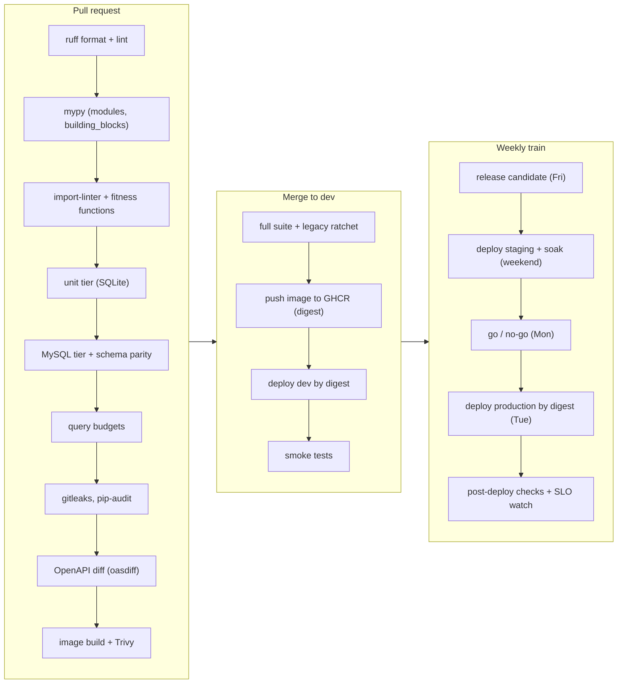

# Testing and quality gates

How changes are tested, what CI checks, and how a release reaches production. The decisions are:
- [ADR-013](adr/ADR-013-immutable-images-by-digest.md): images;
- [ADR-016](adr/ADR-016-architecture-enforced-by-automation.md): architecture checks;
- [ADR-026](adr/ADR-026-performance-budgets-in-ci.md): performance budgets;
- [ADR-037](adr/ADR-037-weekly-release-train.md): the release train;
- [ADR-040](adr/ADR-040-db-scripts-safety-net.md): the schema safety net;
- [ADR-051](adr/ADR-051-toolchain.md): the toolchain.

**Status at `dev` 7fd66060:**
- 31 test files with about 250 test functions;
- no workflow runs tests or architecture checks;
- the root `conftest.py` runs `django.setup()` with the project settings and has **no guard** against a non-test database.

## Running tests safely

**Read this before you run anything.** Some legacy tests flush every table of the database they run against. With a normal `.env`, that is a shared database.

**Until the test guard lands (issue 0001),** run backend tests only with the in-memory SQLite override.

Bash:

```sh
DATABASE_ENGINE=django.db.backends.sqlite3 DATABASE_NAME=":memory:" DATABASE_USER= DATABASE_PASSWORD= DATABASE_HOST= DATABASE_PORT= python -m pytest <paths> --import-mode=importlib
```

PowerShell:

```powershell
$env:DATABASE_ENGINE="django.db.backends.sqlite3"; $env:DATABASE_NAME=":memory:"; $env:DATABASE_USER=""; $env:DATABASE_PASSWORD=""; $env:DATABASE_HOST=""; $env:DATABASE_PORT=""; python -m pytest <paths> --import-mode=importlib
```

**Never run `pytest` on `api/dashboard` or on the whole repository with a normal `.env`.**

**After the guard and the safe runner land,** `scripts/test.sh` wraps both test tiers. It refuses any database that isn't SQLite or a local database whose name starts with `test_`.

## Test tiers

| Tier | Database | What it covers | Marker |
|---|---|---|---|
| Unit and domain | none, or SQLite in memory | Pure rules, state machines, values; code that touches no schema table | default |
| MySQL | a local or CI MySQL built from `schema/latest.sql`, database name `test_*` | Anything that reads or writes a schema table; locks, constraints, collations, concurrency, model/DDL parity | `@pytest.mark.mysql` plus `@pytest.mark.django_db` |
| Load and failure | staging, restored from a production snapshot | Capacity, slow dependencies, recovery | k6 scenarios ([09-performance-and-caching.md](09-performance-and-caching.md)) |

**How a test reaches the database.** Every model is `managed = False` and there are no migrations, so the SQLite tier has none of the schema's tables. A test that reads or writes a schema table runs on the MySQL tier and carries both markers. That tier uses the `test_mulearn` database already loaded from `schema/latest.sql`: no test database is created. Each test runs in a transaction that is rolled back. Only tests that need rows committed across connections, such as concurrency tests, use `transaction=True`; they create every row they need, and the system user is restored after them (issue 0012).

## Kinds of tests

| Kind | Where | Example |
|---|---|---|
| Unit | `modules/<m>/tests/domain/` | the submission state machine refuses a second approval at the same generation |
| Domain properties | `modules/<m>/tests/domain/` with hypothesis | a balance always equals the sum of its entries, for any sequence of awards, reversals and penalties |
| Application (services) | `modules/<m>/tests/services/` | `appraise` called twice creates one entry and publishes one event |
| Integration | `modules/<m>/tests/` across a consumer | `KarmaAwarded` delivered twice updates the period total once |
| API contract | `modules/<m>/tests/api/`, plus the OpenAPI diff in CI | the envelope, `code` and status for each branch |
| Database integration | `tests/schema/`, `@pytest.mark.mysql` | every `managed = False` model matches the DDL; every enum value exists |
| Authorization | `modules/<m>/tests/api/`, plus the generated matrix | anonymous 401; wrong scope 403; right scope 200; a role combination never allows more than its parts |
| Concurrency | `@pytest.mark.mysql` | two appraisers approve the same submission at once: one award |
| Load | k6 on staging | mixed steady state at 2× peak |
| Stress | k6 on staging | load beyond the model until shedding starts with 429 and 503, not errors |
| Soak | k6 on staging for 8 h | no connection, memory or queue growth |
| End-to-end | the dashboard and app test suites against `dev-server` | sign up, submit a task, see karma |
| Failure recovery | staging drills | broker outage, `redis-state` outage, a restore drill, a reconciler drill over a 2 h gap |

**Cases that matter most:**
- users with several roles, and every role combination;
- concurrent and duplicate submissions, and replayed Discord reactions;
- karma correctness: awards, reversals, re-awards, penalties;
- wallet consistency with the ledger;
- permission boundaries across scopes;
- event redelivery, unknown versions and replay;
- retry behaviour;
- rollback of a failed transaction, which must leave neither state nor events behind.

## Characterization tests before every move

A legacy route is moved into a module only behind tests that pin today's behaviour:

1. **Find the callers** of the route in the dashboard, the app and the bot.
2. **Write golden-response tests** at page size 1 and the maximum page size, for success and for each error branch. Include 401 and 403 with `statusCode 1000` for token failures, and 404.
   - **Never pin a success that should be a refusal.** If a route answers a caller it should refuse (no token, or a caller without the right role), stop. Report it privately as `SECURITY.md` describes, and leave that case out of the tests until the maintainers say otherwise.
3. **Record the query count** with `django_assert_max_num_queries`, and record the side effects: rows written, email and tasks enqueued.
4. **Implement the module command or selector** with its own tests.
5. **Empty the legacy view** so it calls `modules.<m>.public`. The legacy serializer keeps the response shape.
6. **Run the characterization tests unchanged.** A difference is either a bug or a named behaviour change with a flag and release-notes text.
7. **Remove the legacy writer** from the allowlist. The ratchet fails if the entry is still needed.

## CI pipelines



**On every pull request:**
1. **Format and lint:** ruff, which replaces black. It runs locally too, through pre-commit.
2. **Types:** mypy with django-stubs, strict on `modules/` and `building_blocks/`.
3. **Architecture:** import-linter and the fitness functions ([04-module-rules.md](04-module-rules.md#how-ci-enforces-each-rule)).
4. **Unit tier,** then the **MySQL tier with schema parity.**
5. **Query budgets** on list endpoints.
6. **Security scans:**
   - secret scanning with gitleaks, including history;
   - dependency scanning with pip-audit;
   - container scanning with Trivy on the built image.
7. **API contract:** the generated OpenAPI spec is diffed against `dev`'s with `oasdiff`. It is report-only at first, then blocking.
8. **Coverage:** `diff-cover` ≥ 80% on changed lines in `modules/` and `building_blocks/`. Legacy code is under a ratchet.
9. **The legacy suite as a ratchet:** its failure set must be a subset of the recorded baseline.

**On merge to `dev`:**
1. Run the full suite.
2. Build the image once, push it to GHCR and tag it with the version.
3. Deploy it to `dev` by digest and run the smoke tests.

**On the weekly train** ([ADR-037](adr/ADR-037-weekly-release-train.md)):
1. Cut a release candidate on Friday.
2. Soak it on staging over the weekend.
3. Hold a go/no-go on Monday.
4. Deploy to production by digest on Tuesday.
5. Run post-deploy checks.

## Release strategy

- **Versions** follow semantic versioning, `v<major>.<minor>.<patch>`, with release notes generated from merged pull requests.
- **Features ship dark** and are turned on by audited flag rollouts ([ADR-031](adr/ADR-031-feature-flags.md)).
- **Deploys are rolling,** node by node, canary first. Blue-green and canary-by-percentage come with the ECS move, if ever.
- **Rollback** is redeploying the previous digest, rehearsed before every risky cut-over.
- **Database changes are compatible across a rollback:**
  - expand alters ship before the code that uses them, so the previous digest still runs;
  - contract alters ship at least one release after the last code that referenced the old shape;
  - code never runs ahead of its schema, because deploy pre-flight refuses it ([06-data-and-schema.md](06-data-and-schema.md)).
- **Freeze and caution windows** cover the year end, the exam season and national events.

## Branches

- **Feature branches** are created from `dev` and merged by pull request into `dev`.
- **Promotion** is by digest: `dev` → `dev-server` → `staging` → `production`. No branch merges straight into `production`.
- **Hotfixes** land on `dev` first and are promoted like any other change.
- **Branch protection** on `dev`, `staging` and `production`:
  - at least one review;
  - two reviews for authentication, authorization, ledger, payment and deploy paths (`core-review`).

## Engineering standards

| Area | Standard |
|---|---|
| Naming | Modules and packages `snake_case`; event types `<module>.<fact_in_past_tense>`; error codes `<module>.<code>`; consumers `<module>.<purpose>` |
| Folder structure | The module layout in [04-module-rules.md](04-module-rules.md); nothing new in legacy packages |
| Dependency direction | Downwards only; other modules through `public.py` and `contracts.py` |
| DTOs | Frozen dataclasses defined in `contracts.py`; selectors return DTOs, never models or querysets |
| Validation | Request shape in serializers; business rules in `domain/` |
| Exceptions | Registered `DomainError`s only; one exception handler |
| Logging | JSON with `request_id`; no personal data |
| Configuration | Declared in `building_blocks.config`; no scattered `os.environ` reads |
| Database access | Owned tables only; `select_related` or `prefetch_related` declared in selectors; no raw SQL on another module's tables |
| Transactions | One `@command` per use case; no network inside a transaction |
| Testing | A test for every rule, command, policy and endpoint; the safe test commands above |
| Documentation | Update the module page and the ADRs in the same pull request as the change |
| API contracts | Additive on `/api/v1`; the generated spec is the contract |
| Code review | One approval, two for `core-review` paths; the reviewer checks the module page and the rules on this page |

## Examples

These show target code. None of it is in the repository yet.

**CI workflow** (a new `ci.yml` in `.github/workflows/`):

```yaml
name: ci
on:
  pull_request:
  push:
    branches: [dev]
jobs:
  test:
    runs-on: ubuntu-latest
    services:
      mysql:
        image: mysql:8.4
        env: {MYSQL_ROOT_PASSWORD: ci, MYSQL_DATABASE: test_mulearn}
        ports: ["3306:3306"]
        options: --health-cmd="mysqladmin ping -h 127.0.0.1" --health-interval=5s --health-retries=20
    steps:
      - uses: actions/checkout@v4
        with: {fetch-depth: 0}
      - uses: astral-sh/setup-uv@v3
      - run: uv sync --frozen
      - run: uv run ruff format --check . && uv run ruff check .
      - run: uv run mypy building_blocks modules
      - run: uv run lint-imports
      - name: Load the vendored schema
        run: mysql -h 127.0.0.1 -uroot -pci test_mulearn < schema/latest.sql
      - name: Unit tier
        env: {DATABASE_ENGINE: django.db.backends.sqlite3, DATABASE_NAME: ":memory:"}
        run: uv run pytest -m "not mysql" --import-mode=importlib
      - name: MySQL tier
        env: {DATABASE_HOST: 127.0.0.1, DATABASE_NAME: test_mulearn, DATABASE_USER: root, DATABASE_PASSWORD: ci}
        run: uv run pytest -m mysql --import-mode=importlib
      - run: uv run pip-audit
      - uses: gitleaks/gitleaks-action@v2
```

**A characterization test:**

```python
# api/dashboard/profile/tests/test_user_profile_characterization.py
import pytest


@pytest.mark.mysql
def test_profile_get_shape_is_unchanged(api_client, learner, django_assert_max_num_queries):
    with django_assert_max_num_queries(12):
        r = api_client(learner).get("/api/v1/dashboard/profile/user-profile/")
    body = r.json()
    assert r.status_code == 200
    assert set(body) >= {"hasError", "statusCode", "message", "response"}
    assert body["hasError"] is False
    assert "muid" in body["response"]
```

**A concurrency test for double awards:**

```python
# modules/contributions/tests/mysql/test_double_appraisal.py
import threading

import pytest

from modules.contributions.public import appraise, ledger_balance


@pytest.mark.mysql
@pytest.mark.django_db(transaction=True)
def test_two_appraisers_at_once_award_once(pending_submission, appraiser_a, appraiser_b):
    barrier = threading.Barrier(2)

    def run(principal):
        barrier.wait()
        appraise(principal=principal, submission_id=pending_submission.id, expected_generation=1)

    threads = [threading.Thread(target=run, args=(p,)) for p in (appraiser_a, appraiser_b)]
    for t in threads:
        t.start()
    for t in threads:
        t.join()
    assert ledger_balance(pending_submission.user_id) == pending_submission.amount
```
