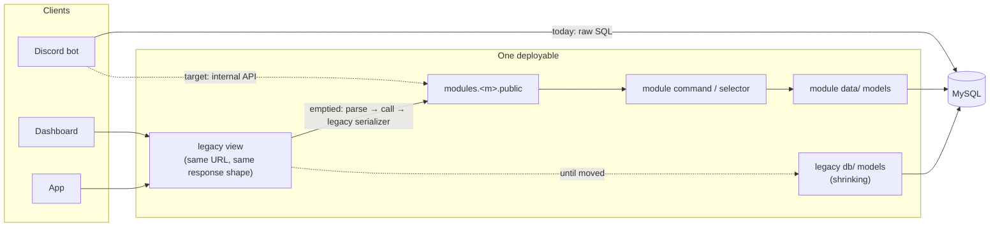

# Migration strategy

How the backend moves from today's shape ([02-current-state.md](02-current-state.md)) to the target ([03-target-architecture.md](03-target-architecture.md)) without a rewrite, without downtime, and without breaking the dashboard, the app or the Discord bot.

## The approach: strangle in place

A rewrite was rejected ([01-overview.md](01-overview.md)). The backend changes **in place**, one route family and one table at a time. The new modules grow around the legacy code until the legacy code is empty.

**Rules for the in-process strangler:**

1. **A legacy view is migrated by emptying it.** Its body becomes: parse the request, call `modules.<m>.public`, and render with the legacy serializer. The URL, status codes, envelope and field names stay the same.
2. **Characterization tests come before every move** ([12-testing-and-quality-gates.md](12-testing-and-quality-gates.md#characterization-tests-before-every-move)). A route with no characterization test may not be moved.
3. **Legacy code calls the new code only through `modules.*.public`.** The import contracts make this mechanical.
4. **Legacy writers are allowlisted, and the allowlists only shrink.** A module's allowlist entries must be empty at its cut-over.
5. **Tables move on demand.** A table moves into its module when a change needs it, or when it sits on a money, authorization or identity path. "Done" does not mean "every table moved".
6. **Behaviour changes ship behind a flag** with an owner and an expiry. Pure fixes (a row lock, a conditional update, a bound) ship without one.
7. **Schema changes expand first and contract later** ([06-data-and-schema.md](06-data-and-schema.md)). A maintainer applies every alter.
8. **Shadow before switch** for anything that matters: the bot's karma path, authorization policies and leaderboard readers. The new path runs alongside the old one, and its differences are logged and explained before it takes over.
9. **One core domain switches in production at a time.** Never two core domains together, and never a domain together with its consumers.

## Outside services

| Service | Today | Path | Who |
|---|---|---|---|
| Discord bot | Writes karma, wallet, levels, roles and aggregate tables by raw SQL | Moves to `/api/v1/internal/contributions/*` one command at a time: heartbeat, then shadow mode, then switch, then its write grants are revoked. Order of tables: karma, then roles, then profile fields. | Maintainers (private repository) |
| scheduler-service | Writes level rows (grit meter), `notification_log` and its own `jobs` | Fixed in place first: fail closed, idempotent per user and day, email after commit (issue 0079). Absorbed into `gamification` later. | Contributors (public repository) |
| authserver | A separate identity provider in the same schema | Its own track: identity tables into `db-scripts` first, then its own schema and database user, then key separation | Maintainers (private repository) |
| mucoin-service | Waits for events | On hold: no μCoin work is planned for now. When it resumes, it receives signed webhooks from the outbox, in three steps ([ADR-054](adr/ADR-054-mucoin-external-consumer.md)) | Contributors, with a maintainer for staging secrets |

## Module order, and why

| Order | Module | What moves | Why at this point |
|---|---|---|---|
| 1 | `contributions` | `karma_activity_log` as submissions, the new ledger, `wallet.karma`; the 9 backend karma-writing functions; the bot's karma path | The highest correctness risk and the most writers. Every projection derives from it. |
| 2 | `identity_access` | `user_role_link` writes behind grant commands (24 functions in 16 files today) | Authorization correctness. Independent of the ledger, so it runs on its own track, but switches after `contributions`. |
| 3 | `gamification` | levels, achievements, the new period totals; later the grit meter | Consumes ledger events, removes the heaviest read queries, and is where `user.level_up` becomes possible |
| 4 | `notifications` | email and push delivery through the outbox | Takes SMTP off request paths |
| 5 | `people` | consent records and erasure first, then signup | A legal date (DPDP, about May 2027) |
| 6 | `rewards` | vouchers and coupons through `VoucherRedeemed`; the coin tables stay frozen | After the ledger exists |
| 7 | `organizations` and chapters | the cached aggregate columns, chapter paths | Multi-state chapters and campus dashboards |
| Later | `communities`, `learning`, `events`, `mentorship`, `careers`, `interns`, `media`, `projects`, `payments`, `administration` | When a feature changes them | Lower correctness risk |

`api/launchpad/` is deprecated and excluded from every phase.

## Phases

**Phase 0: Stabilise and secure.**
- **Affected:** the test configuration (`conftest.py`), settings read at import, the beat schedule, `db-scripts`.
- **Introduced:**
  - the test guard and `scripts/test.sh`;
  - the vendored `schema/latest.sql`;
  - the local environment;
  - per-environment beat schedules;
  - the private security work.
- **Database:** the interest-group image columns are added to `db-scripts` (issue 0007).
- **API:** none.
- **Data:** none.
- **Tests:** the guard's own tests.
- **Rollback:** each change is independent.
- **Depends on:** nothing.
- **Acceptance:** tests refuse shared databases, and a fresh clone runs the unit tier.

**Phase 1: Foundations.**
- **Affected:** `.github/workflows/` and the `api/` package layout.
- **Introduced:**
  - CI with both test tiers;
  - `building_blocks` (ids, clock, errors, logs, config, `@command`, HTTP client, base views, the authorization core);
  - `modules/` and the generator;
  - fitness functions;
  - the characterization harness;
  - governance.
- **Database:** none.
- **API:** additive only (`code`, `requestId`).
- **Data:** none.
- **Tests:** unit tests for every building block, and characterization tests for the envelope.
- **Rollback:** revert the pull request; nothing is wired into legacy behaviour except the additive envelope fields.
- **Depends on:** Phase 0.
- **Acceptance:** import contracts and fitness functions pass in CI, and legacy responses gain only the two keys.

**Phase 2: Serving and runtime.**
- **Affected:** `docker-compose.yml`, `entrypoint.sh`, `Dockerfile`, the deploy workflows, `api/common/common_consumer.py`, `requirements.txt`.
- **Introduced:**
  - gunicorn `gthread` and nginx;
  - health endpoints and drain;
  - images by digest and `deploy.sh`;
  - telemetry;
  - DRF 3.17, then Django 5.2.
- **Removed:** Channels and Daphne.
- **Database:** none.
- **API:** no HTTP change. The unused WebSocket route goes away.
- **Data:** none.
- **Tests:** the steady-state and slow-dependency load tests on staging, and a rollback rehearsal.
- **Rollback:** the previous digest within 5 minutes, kept for two weeks after the cut-over.
- **Depends on:** Phase 1 CI, and the Phase 0 security epic for the production cut-over.
- **Acceptance**, 24 hours after the cut-over:
  - connections within budget and flat;
  - every 5xx response is the JSON envelope;
  - top-20 route p95 within 10% of baseline.

**Phase 3: Schema safety net and events.**
- **Affected:** `db-scripts` tooling, `schema.sql`, `.delay()` call sites, the Celery settings, Redis settings, `scheduler-service`.
- **Introduced:**
  - stable alter ids and the applied-set runner;
  - required schema ids;
  - parity tests and the drift report;
  - outbox, relay, consumers, dead letters and replay;
  - routed queues, the task base and schedule claims;
  - the flag store;
  - the Redis split.
- **Database:** expand alters for the messaging, schedule and flag tables.
- **API:** none.
- **Data:** a baseline of the alters already applied to production.
- **Tests:**
  - parity for every model and enum;
  - two relays and two beats at once;
  - broker and Redis-state outage drills on staging.
- **Rollback:** expand alters are additive; queue routes and flags are configuration.
- **Depends on:** Phase 1.
- **Acceptance:**
  - parity covers every `managed = False` model;
  - no new drift for four weeks;
  - every task is routed;
  - no duplicate schedule claims;
  - `redis-state` evicts nothing.

**Phase 4: Contributions and the ledger.**
- **Affected:**
  - `utils/karma.py`;
  - the karma writers in `api/dashboard/lc/`, `api/dashboard/manage_interns/`, `api/dashboard/profile/`, `api/dashboard/referral/` and `api/register/`;
  - the Discord bot.
- **Introduced:**
  - the ledger;
  - the `contributions` module and its commands and selectors;
  - service clients and the internal API;
  - classification, opening balances and the backfill;
  - the ledger-writes flag;
  - reconciliation;
  - the bot heartbeat;
  - shadow mode.
- **Database:** an expand alter for the ledger table and the four submission columns, and the `service_client` table. The contract step (revoking the bot's write grants) comes at least 14 days after the switch.
- **API:** legacy endpoints keep their shapes; the internal endpoints are new. A named behaviour change: karma can go negative after penalties, consistent with the bot today.
- **Data:** classification in batches of at most 5,000, and the backfill of awards and opening balances. Both are off-peak, resumable, idempotent through ledger keys, and show a dry run first.
- **Tests:**
  - ledger property tests;
  - MySQL concurrency tests (double appraisal, replayed reaction, a reversal before its award);
  - the Discord storm and replay load test;
  - a reconciler drill.
- **Rollback:**
  - turning the ledger-writes flag off returns backend writers to the legacy path;
  - per-command bot flags fall back to its SQL until the grant revoke;
  - after the revoke, rollback is forward-only (fix and replay through the reconciler).
- **Depends on:** Phases 1 and 3. The bot's shadow mode and the learning-circle and signup moves also wait for the Phase 0 security epic.
- **Acceptance:**
  - no duplicate `(source, source_ref)`;
  - drift for backend sources explained to zero for 14 days;
  - all backend karma writes through `contributions.public`;
  - after the revoke, the bot holds no write grant on karma tables.

**Phases 5–8, and later work, are epics:**
- [identity and access](github-issues/epics/phase-5-identity-and-access.md);
- [gamification and notifications](github-issues/epics/phase-6-gamification-and-notifications.md);
- [people and privacy](github-issues/epics/phase-7-people-and-privacy.md);
- [API standards and rewards](github-issues/epics/phase-8-api-standards-and-rewards.md);
- [later, on demand](github-issues/epics/later-on-demand.md).

Each epic lists its contents, entry conditions and exit criteria, and is split into detailed issues when its phase comes within reach. Phase 5 starts only after the Phase 0 security epic closes.

## Releases that span repositories

Some steps change more than one repository: the bot's switch, the authserver's schema, the dashboard's use of new fields. For each:
1. **The backend change ships first,** additive and behind a flag or with no effect.
2. **The other repository's change ships next** and starts using it.
3. **The flag turns on** in a later train, after the go/no-go.
4. **The old path is removed** (a contract step) at least one release later.

Every step is reversible until the last one.
