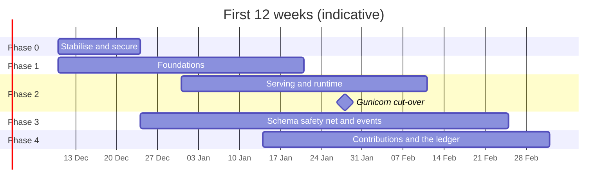

# Roadmap: the first 12 weeks

The plan for the first 90 days, built from the issues in [github-issues/](github-issues/README.md). Week 1 starts on **Thursday 10 December 2026** and week 12 ends on **Wednesday 3 March 2027**.

The weeks are **indicative**. Anyone may pick up these issues, so the pace isn't known in advance. What is fixed is the order: no issue is scheduled before the issues it depends on. The schedule was generated from the issue catalogue and checked for that.

## Assumptions

- **Releases.** A weekly production train on Tuesdays: a Friday release candidate, a weekend soak on staging, and a Monday go/no-go ([ADR-037](adr/ADR-037-weekly-release-train.md)).
- **The year-end freeze** covers week 3 (24–30 December). There are no production deploys that week.
- **Maintainers.** `maintainer-only` issues need a maintainer with production or private-repository access. One risky production change goes out per train.
- **Security.** The Phase 0 security work is tracked privately and must finish before the gunicorn cut-over (week 8), before week 12's bot shadow mode and the learning-circle and signup moves, and before Phase 5 starts.
- **Exams.** The exam season (April to mid-May) and national events are caution windows. That is one reason the MySQL 8.4 upgrade and the privacy phase sit after week 12.

## Tracks

| Track | Weeks 1–4 | Weeks 5–8 | Weeks 9–12 |
|---|---|---|---|
| Foundations (`building_blocks`, `platform`) | test guard, CI, packages, ids, clock, errors, logs, config, `@command`, generator | envelope, HTTP client, fitness functions, authorization core, base views | (support) |
| Database and schema | vendored schema, alter ids, parity tests | applied-set runner, required schema ids, drift, `schema.sql` retired | (support) |
| Events and background work | queue routing | task base, outbox, schedule claims, relay, `safe_enqueue`, flag store | consumers, replay |
| Runtime and deployment | receivers in `ready()`, health, Dockerfile | Channels retired, digest deploys, **gunicorn cut-over (week 8)** | Django 5.2 (soak may run past week 12) |
| Core modules (`contributions`) | — | ledger and service-client tables, module, state machine | commands, internal API, backfill, writers moved, reconciliation, bot shadow mode |
| Observability | JSON logs, request ids | OpenTelemetry, Sentry, dashboards and alerts, bot heartbeat | reconciliation reports |
| CI and testing | unit tier, MySQL tier, legacy ratchet, characterization harness | k6 scenarios, image builds | concurrency and property tests |
| Docs and governance | CONTRIBUTING, DEVELOPMENT, CODEOWNERS, branch rules | module pages kept current | module pages kept current |

## Week by week

### Week 1: Thu 10 Dec – Wed 16 Dec 2026

**Objective.** Make the repository safe to work in, and the schema visible to everyone.

| Issue | Title | Phase | Module | Depends on |
|---|---|---|---|---|
| [0001](github-issues/0001-guard-tests-against-real-databases.md) | Guard the test suite against real databases | 0 | platform | none |
| [0002](github-issues/0002-add-safe-test-runner.md) | Add a safe test runner script | 0 | platform | 0001 |
| [0003](github-issues/0003-vendor-schema-snapshot.md) | Vendor a schema-only copy of latest.sql | 0 | platform | none |
| [0005](github-issues/0005-clear-error-for-missing-settings.md) | Fail with a clear message when a required setting is missing | 0 | platform | none |
| [0006](github-issues/0006-choose-beat-schedules-per-environment.md) | Let each environment choose which beat schedules run | 0 | platform | none |
| [0007](github-issues/0007-add-interest-group-image-columns.md) | Add the interest-group image key columns to db-scripts | 0 | communities | none |
| [0010](github-issues/0010-ruff-for-new-code.md) | Add ruff with checks on new code | 1 | platform | none |
| [0028](github-issues/0028-codeowners.md) | Add a CODEOWNERS file | 1 | platform | none |

- **Workstreams:** communities, platform
- **Deliverables:** Tests refuse real databases; `scripts/test.sh`; the vendored schema; clear errors for missing settings; per-environment beat schedules; ruff on new code; a CODEOWNERS file.
- **Tests:** The guard's own tests: a non-test database is refused and SQLite runs.
- **Acceptance:** `scripts/test.sh` refuses a configured shared database. `schema/latest.sql` loads into a fresh MySQL.
- **Risks:** Contributors run tests before 0001 lands: the safe commands are on every issue and in the README.
- **Definition of done:** Every issue in the week has merged with its acceptance criteria checked; the safe test commands pass; docs and module pages are updated in the same pull requests; no new entry was added to an allowlist; any rollout issue has a recorded result.

### Week 2: Thu 17 Dec – Wed 23 Dec 2026

**Objective.** Give every contributor CI and a one-command local environment.

| Issue | Title | Phase | Module | Depends on |
|---|---|---|---|---|
| [0004](github-issues/0004-local-dev-environment.md) | Add a one-command local development environment | 0 | platform | 0002, 0003 |
| [0008](github-issues/0008-contributing-and-development-guides.md) | Add CONTRIBUTING.md and DEVELOPMENT.md | 0 | platform | 0004 |
| [0009](github-issues/0009-make-api-directories-packages.md) | Make every directory under api/ a package | 1 | platform | 0002 |
| [0011](github-issues/0011-ci-unit-tier.md) | Run the unit test tier and ruff on every pull request | 1 | platform | 0002, 0010 |
| [0013](github-issues/0013-legacy-test-ratchet.md) | Record the legacy test baseline and fail only on new failures | 1 | platform | 0011 |
| [0029](github-issues/0029-branch-rules.md) | Protect dev, staging and production with review rules | 1 | platform | 0011, 0028 |

- **Workstreams:** platform
- **Deliverables:** The local `docker compose` environment; CONTRIBUTING and DEVELOPMENT guides; packages under `api/`; CI with the unit tier; the legacy-test ratchet; branch rules.
- **Tests:** CI runs on its own pull request; the legacy baseline is recorded.
- **Acceptance:** A fresh clone reaches a green unit tier locally by following DEVELOPMENT.md.
- **Risks:** Adding `__init__.py` files changes test discovery: compare the safe-run results before and after.
- **Definition of done:** Every issue in the week has merged with its acceptance criteria checked; the safe test commands pass; docs and module pages are updated in the same pull requests; no new entry was added to an allowlist; any rollout issue has a recorded result.

### Week 3: Thu 24 Dec – Wed 30 Dec 2026

**Objective.** Lay the first foundations during the year-end freeze (no deploys this week).

| Issue | Title | Phase | Module | Depends on |
|---|---|---|---|---|
| [0012](github-issues/0012-ci-mysql-tier.md) | Add a MySQL test tier to CI built from the vendored schema | 1 | platform | 0003, 0004, 0011 |
| [0014](github-issues/0014-building-blocks-skeleton.md) | Create the building_blocks package and its import contracts | 1 | building_blocks | 0009, 0011 |
| [0015](github-issues/0015-uuid7-ids.md) | Add UUIDv7 id helpers | 1 | building_blocks | 0014 |
| [0016](github-issues/0016-business-clock.md) | Add the business clock with IST period bounds | 1 | building_blocks | 0014 |
| [0049](github-issues/0049-alter-ids-and-header-lint.md) | Give alters stable ids and lint their headers | 3 | platform | none |

- **Workstreams:** building_blocks, platform
- **Deliverables:** The CI MySQL tier; the `building_blocks` package and import contracts; UUIDv7 and clock helpers; stable alter ids in `db-scripts`.
- **Tests:** The import contracts pass on the current code; the MySQL tier loads the vendored schema.
- **Acceptance:** `lint-imports` runs in CI. A db-scripts alter without a valid header fails its lint.
- **Risks:** Holiday availability: nothing this week is on the critical path for a deploy.
- **Definition of done:** Every issue in the week has merged with its acceptance criteria checked; the safe test commands pass; docs and module pages are updated in the same pull requests; no new entry was added to an allowlist; any rollout issue has a recorded result.

### Week 4: Thu 31 Dec – Wed 06 Jan 2027

**Objective.** Build the core plumbing, and start the schema and runtime tracks.

| Issue | Title | Phase | Module | Depends on |
|---|---|---|---|---|
| [0017](github-issues/0017-domain-error-registry.md) | Add the DomainError registry with stable codes | 1 | building_blocks | 0014 |
| [0018](github-issues/0018-request-context-and-json-logs.md) | Add request ids and JSON logging | 1 | building_blocks | 0014 |
| [0020](github-issues/0020-typed-configuration.md) | Add typed configuration and config_check | 1 | building_blocks | 0005, 0014 |
| [0021](github-issues/0021-command-decorator.md) | Add the `@command` decorator and its transaction guard | 1 | building_blocks | 0014 |
| [0023](github-issues/0023-modules-package-and-generator.md) | Add the modules package and the new_module generator | 1 | building_blocks | 0014 |
| [0025](github-issues/0025-characterization-test-harness.md) | Add the characterization-test harness | 1 | platform | 0012 |
| [0030](github-issues/0030-signal-receivers-in-ready.md) | Register signal receivers in AppConfig.ready() | 2 | platform | 0011 |
| [0032](github-issues/0032-health-endpoints.md) | Add live and ready health endpoints with a drain flag | 2 | building_blocks | 0014 |
| [0039](github-issues/0039-lock-dependencies.md) | Lock dependencies with hashes and remove unused packages | 2 | platform | 0011 |
| [0041](github-issues/0041-deprecation-warnings-as-errors.md) | Treat Django deprecation warnings as errors in new code | 2 | platform | 0014 |
| [0053](github-issues/0053-model-ddl-parity-tests.md) | Add model/DDL parity tests | 3 | platform | 0012 |
| [0054](github-issues/0054-enum-parity-tests.md) | Add enum parity tests | 3 | platform | 0012 |
| [0064](github-issues/0064-celery-queue-routing.md) | Route Celery tasks to named queues and worker groups | 3 | platform | 0004, 0011 |
| [0079](github-issues/0079-grit-meter-fail-closed.md) | Make the grit meter fail closed and run once per user per day | 3 | gamification | none |

- **Workstreams:** building_blocks, gamification, platform
- **Deliverables:** The error registry, request ids and JSON logs, typed configuration, the `@command` guard, the module generator, the characterization harness, signal receivers in `ready()`, health endpoints, locked dependencies, parity tests, queue routing, and the grit-meter fix.
- **Tests:** Unit tests for each building block; parity tests run against the vendored schema.
- **Acceptance:** `config_check` validates an environment file. Every Celery task is routed. Model/DDL parity runs, with known drift listed.
- **Risks:** Parity tests surface a lot of drift: record it in the shrink-only allowlist and don't fix it all now.
- **Definition of done:** Every issue in the week has merged with its acceptance criteria checked; the safe test commands pass; docs and module pages are updated in the same pull requests; no new entry was added to an allowlist; any rollout issue has a recorded result.

### Week 5: Thu 07 Jan – Wed 13 Jan 2027

**Objective.** Finish the foundations; prepare serving; start the event tables.

| Issue | Title | Phase | Module | Depends on |
|---|---|---|---|---|
| [0019](github-issues/0019-envelope-code-and-exception-handler.md) | Add code and requestId to the envelope, with one exception handler | 1 | building_blocks | 0017, 0018 |
| [0022](github-issues/0022-outbound-http-client.md) | Add the outbound HTTP client with timeouts and a circuit breaker | 1 | building_blocks | 0014, 0020 |
| [0024](github-issues/0024-architecture-fitness-functions.md) | Add the architecture fitness functions | 1 | platform | 0014, 0023 |
| [0026](github-issues/0026-base-api-views.md) | Add MuLearnAPIView and PublicAPIView | 1 | building_blocks | 0019 |
| [0031](github-issues/0031-landing-stats-over-http.md) | Serve landing statistics over cached HTTP | 2 | platform | 0030 |
| [0033](github-issues/0033-gunicorn-and-nginx-config.md) | Add gunicorn gthread and nginx configuration | 2 | platform | 0032 |
| [0035](github-issues/0035-production-dockerfile.md) | Build a multi-stage, non-root image | 2 | platform | 0011, 0032, 0033 |
| [0050](github-issues/0050-applied-set-migration-runner.md) | Track applied alters as a set in the migration runner | 3 | platform | 0049 |
| [0052](github-issues/0052-required-schema-ids.md) | Declare required schema ids and refuse to start without them | 3 | platform | 0020, 0032, 0049 |
| [0055](github-issues/0055-schema-drift-command.md) | Add a schema drift report command | 3 | platform | 0053 |
| [0058](github-issues/0058-messaging-tables-alter.md) | Create the outbox, inbox, dead-letter and idempotency tables | 3 | building_blocks | 0049 |
| [0065](github-issues/0065-task-base-class.md) | Add a task base with time limits, acks_late and backoff | 3 | building_blocks | 0064 |
| [0066](github-issues/0066-schedule-run-alter.md) | Create the schedule_run table | 3 | building_blocks | 0049 |
| [0071](github-issues/0071-redis-cache-and-state-aliases.md) | Split Redis into cache and state aliases | 3 | platform | 0020 |
| [0073](github-issues/0073-feature-flag-tables-alter.md) | Create the feature flag tables | 3 | building_blocks | 0049 |

- **Workstreams:** building_blocks, platform
- **Deliverables:** The envelope with `code` and `requestId`, the HTTP client, fitness functions, the base views, landing stats over HTTP, the gunicorn and nginx config, the production Dockerfile, the applied-set runner, required schema ids, the drift command, messaging, schedule and flag table alters, the task base, and the Redis aliases.
- **Tests:** Envelope characterization tests; gunicorn boots in CI; the union-of-grants property test.
- **Acceptance:** Legacy responses gain only `code` and `requestId`. The image runs as a non-root user.
- **Risks:** The envelope change touches every response: characterization tests on the busiest routes first.
- **Definition of done:** Every issue in the week has merged with its acceptance criteria checked; the safe test commands pass; docs and module pages are updated in the same pull requests; no new entry was added to an allowlist; any rollout issue has a recorded result.

### Week 6: Thu 14 Jan – Wed 20 Jan 2027

**Objective.** Retire Channels, build images in CI, and land the outbox.

| Issue | Title | Phase | Module | Depends on |
|---|---|---|---|---|
| [0027](github-issues/0027-authz-core.md) | Add principals, grants and the policy registry | 1 | building_blocks | 0014, 0017, 0026 |
| [0034](github-issues/0034-retire-channels-and-daphne.md) | Retire Channels and Daphne | 2 | platform | 0031, 0033 |
| [0036](github-issues/0036-ci-image-build-and-push.md) | Build the image once in CI and push it by digest | 2 | platform | 0035 |
| [0038](github-issues/0038-k6-load-tests.md) | Add the k6 load-test scenarios | 2 | platform | 0033 |
| [0040](github-issues/0040-drf-3-17.md) | Upgrade Django REST Framework to 3.17 | 2 | platform | 0025, 0039 |
| [0043](github-issues/0043-opentelemetry-and-sentry.md) | Wire up OpenTelemetry and Sentry | 2 | building_blocks | 0018, 0020 |
| [0044](github-issues/0044-slow-query-logging.md) | Log slow queries with their request id | 2 | building_blocks | 0018 |
| [0051](github-issues/0051-production-alter-baseline.md) | Record the production baseline of applied alters | 3 | platform | 0050 |
| [0057](github-issues/0057-retire-schema-sql.md) | Retire schema.sql | 3 | platform | 0003, 0053 |
| [0059](github-issues/0059-outbox-publish.md) | Add the outbox models and outbox.publish_raw | 3 | building_blocks | 0012, 0015, 0021, 0053, 0058 |
| [0067](github-issues/0067-schedule-slot-claims.md) | Claim each scheduled slot once and record heartbeats | 3 | building_blocks | 0012, 0065, 0066 |
| [0072](github-issues/0072-rollout-redis-split.md) | Provision the evictable cache Redis and switch each environment | 3 | platform | 0071 |
| [0074](github-issues/0074-feature-flag-store.md) | Add the persisted feature flag store | 3 | building_blocks | 0012, 0021, 0071, 0073 |
| [0080](github-issues/0080-ledger-alter.md) | Add the karma ledger table and the submission columns | 4 | contributions | 0049, 0051 |
| [0089](github-issues/0089-service-client-alter.md) | Create the service_client table | 4 | building_blocks | 0049 |

- **Workstreams:** building_blocks, contributions, platform
- **Deliverables:** The authorization core, Channels and Daphne removed, CI image builds, k6 scenarios, DRF 3.17, OpenTelemetry and Sentry, slow-query logs, the production alter baseline, `schema.sql` retired, `outbox.publish_raw`, schedule claims, the Redis split rollout, the flag store, and the ledger and service-client alters.
- **Tests:** WebSocket routes gone with no client errors; k6 steady-state and slow-dependency scripts run on staging.
- **Acceptance:** The dev image is built once in CI and identified by digest. Outbox rows commit with their transaction and roll back with it.
- **Risks:** A hidden WebSocket consumer (for example the marketing site): checked by a maintainer before 0034 merges.
- **Definition of done:** Every issue in the week has merged with its acceptance criteria checked; the safe test commands pass; docs and module pages are updated in the same pull requests; no new entry was added to an allowlist; any rollout issue has a recorded result.

### Week 7: Thu 21 Jan – Wed 27 Jan 2027

**Objective.** Deploy by digest; prepare the cut-over; start contributions.

| Issue | Title | Phase | Module | Depends on |
|---|---|---|---|---|
| [0037](github-issues/0037-deploy-script.md) | Add deploy.sh with pre-flight checks, rolling deploys and rollback | 2 | platform | 0020, 0032, 0036 |
| [0045](github-issues/0045-rollout-digest-deploys.md) | Roll out digest deploys to dev-server and staging | 2 | platform | 0037 |
| [0046](github-issues/0046-persistent-database-connections.md) | Make persistent database connections configurable | 2 | platform | 0033 |
| [0048](github-issues/0048-dashboards-and-alerts.md) | Set up dashboards, SLO alerts and paging | 2 | platform | 0043 |
| [0056](github-issues/0056-nightly-drift-job.md) | Run the schema drift report nightly against production | 3 | platform | 0055 |
| [0060](github-issues/0060-cloudevents-envelope.md) | Add IntegrationEvent with CloudEvents names and a payload test | 3 | building_blocks | 0059 |
| [0068](github-issues/0068-beat-schedule-on-a-volume.md) | Keep the beat schedule file on a volume | 3 | platform | 0004, 0037, 0064 |
| [0081](github-issues/0081-contributions-module-and-models.md) | Create the contributions module and its models | 4 | contributions | 0012, 0023, 0080 |
| [0090](github-issues/0090-service-clients.md) | Add service clients and InternalAPIView | 4 | building_blocks | 0012, 0026, 0027, 0071, 0089 |

- **Workstreams:** building_blocks, contributions, platform
- **Deliverables:** `deploy.sh` with rollback, digest deploys on dev-server and staging, configurable persistent connections, dashboards and alerts, the nightly drift job, the event envelope and `outbox.publish`, the beat volume, the contributions module, and service clients.
- **Tests:** A rollback rehearsal on staging; the slow-dependency load test passes on staging.
- **Acceptance:** Staging deploys by digest, node by node, and rolls back to the previous digest within 5 minutes.
- **Risks:** Deploy-script bugs: staging only this week.
- **Definition of done:** Every issue in the week has merged with its acceptance criteria checked; the safe test commands pass; docs and module pages are updated in the same pull requests; no new entry was added to an allowlist; any rollout issue has a recorded result.

### Week 8: Thu 28 Jan – Wed 03 Feb 2027

**Objective.** **Cut production over to gunicorn**; start the relay; contributions domain.

| Issue | Title | Phase | Module | Depends on |
|---|---|---|---|---|
| [0047](github-issues/0047-rollout-gunicorn-cutover.md) | Cut production over to gunicorn | 2 | platform | 0034, 0038, 0045, 0046, epic:phase-0-security-hardening |
| [0061](github-issues/0061-outbox-relay.md) | Add the outbox relay | 3 | building_blocks | 0004, 0037, 0059, 0060, 0064 |
| [0082](github-issues/0082-submission-state-machine.md) | Add the submission state machine and ledger key rules | 4 | contributions | 0017, 0081 |
| [0087](github-issues/0087-contributions-selectors.md) | Add balance, entry and appraisal-queue selectors | 4 | contributions | 0027, 0081 |
| [0093](github-issues/0093-classify-karma-log.md) | Add a command that classifies existing karma rows | 4 | contributions | 0081 |
| [0101](github-issues/0101-bot-heartbeat-endpoint.md) | Add the Discord bot heartbeat endpoint and metric | 4 | integrations | 0023, 0090 |
| [0102](github-issues/0102-bot-sends-heartbeat.md) | Send heartbeats from the Discord bot | 4 | integrations | 0101 |

- **Workstreams:** building_blocks, contributions, integrations, platform
- **Deliverables:** The production cut-over (gated on the Phase 0 security epic and the load tests), the relay and the worker groups in the deploy file, the submission state machine, contributions selectors, the karma-row classifier, and the bot heartbeat (both sides).
- **Tests:** 24 hours after the cut-over: connections flat, every 5xx a JSON envelope, top-20 route p95 within 10% of baseline.
- **Acceptance:** Production runs gunicorn `gthread` behind nginx, and the previous digest is kept for rollback.
- **Risks:** Thread-safety or GIL surprises under real traffic: rollback by digest within 5 minutes; persistent connections stay off for one clean week.
- **Definition of done:** Every issue in the week has merged with its acceptance criteria checked; the safe test commands pass; docs and module pages are updated in the same pull requests; no new entry was added to an allowlist; any rollout issue has a recorded result.

### Week 9: Thu 04 Feb – Wed 10 Feb 2027

**Objective.** Consumers and the first contributions commands; start the Django upgrade.

| Issue | Title | Phase | Module | Depends on |
|---|---|---|---|---|
| [0042](github-issues/0042-django-5-2.md) | Upgrade Django to 5.2 LTS | 2 | platform | 0012, 0040, 0041 |
| [0062](github-issues/0062-consumers-inbox-and-dead-letters.md) | Add consumers with inbox de-duplication, retries and dead letters | 3 | building_blocks | 0061 |
| [0069](github-issues/0069-safe-enqueue.md) | Add safe_enqueue for legacy .delay() calls | 3 | building_blocks | 0059, 0062, 0065 |
| [0083](github-issues/0083-ledger-property-tests.md) | Add property tests for the ledger rules | 4 | contributions | 0082 |
| [0084](github-issues/0084-record-and-peer-approve.md) | Add the record_submission and peer_approve commands | 4 | contributions | 0027, 0059, 0082 |

- **Workstreams:** building_blocks, contributions, platform
- **Deliverables:** Consumers with inbox, retries and dead letters; `safe_enqueue`; ledger property tests; `record_submission` and `peer_approve`; the Django 5.2 upgrade branch.
- **Tests:** Redelivery is a no-op; an unknown version goes to a dead letter; hypothesis ledger properties.
- **Acceptance:** A consumer's work and its inbox row commit together.
- **Risks:** Django 5.2 regressions: it ships only after a two-week staging soak, so it may land after week 12.
- **Definition of done:** Every issue in the week has merged with its acceptance criteria checked; the safe test commands pass; docs and module pages are updated in the same pull requests; no new entry was added to an allowlist; any rollout issue has a recorded result.

### Week 10: Thu 11 Feb – Wed 17 Feb 2027

**Objective.** Appraisal and reversal.

| Issue | Title | Phase | Module | Depends on |
|---|---|---|---|---|
| [0063](github-issues/0063-replay-and-purge-commands.md) | Add dead-letter replay and outbox purge commands | 3 | building_blocks | 0062 |
| [0070](github-issues/0070-safe-enqueue-on-request-paths.md) | Use safe_enqueue on request paths | 3 | platform | 0069 |
| [0085](github-issues/0085-appraise-and-reverse.md) | Add the appraise and reverse_award commands | 4 | contributions | 0016, 0084 |
| [0088](github-issues/0088-ledger-concurrency-tests.md) | Add MySQL concurrency tests for awards | 4 | contributions | 0012, 0085 |

- **Workstreams:** building_blocks, contributions, platform
- **Deliverables:** Dead-letter replay and purge, `safe_enqueue` on request paths, `appraise` and `reverse_award`, MySQL concurrency tests.
- **Tests:** Two appraisers at once produce one award; a replayed reaction is a no-op.
- **Acceptance:** `UNIQUE(source, source_ref)` holds under the concurrency tests.
- **Risks:** Lock-order mistakes: the documented order (submission, wallet, ledger) is checked in review.
- **Definition of done:** Every issue in the week has merged with its acceptance criteria checked; the safe test commands pass; docs and module pages are updated in the same pull requests; no new entry was added to an allowlist; any rollout issue has a recorded result.

### Week 11: Thu 18 Feb – Wed 24 Feb 2027

**Objective.** The internal API for the bot; the relay and workers on staging; backfill tooling; the ledger flag.

| Issue | Title | Phase | Module | Depends on |
|---|---|---|---|---|
| [0078](github-issues/0078-rollout-relay-and-worker-groups-staging.md) | Run the relay and the worker groups on staging | 3 | platform | 0037, 0061, 0064, 0072 |
| [0086](github-issues/0086-penalize-and-adjust.md) | Add the penalize and adjust commands | 4 | contributions | 0085 |
| [0091](github-issues/0091-internal-contributions-api.md) | Add the internal contributions API for the Discord bot | 4 | contributions | 0085, 0086, 0090 |
| [0094](github-issues/0094-opening-balances-and-backfill.md) | Add opening balances and the award backfill | 4 | contributions | 0085, 0093 |
| [0095](github-issues/0095-ledger-writes-flag-and-utils-karma.md) | Route utils/karma.py through contributions behind a flag | 4 | contributions | 0025, 0074, 0085 |

- **Workstreams:** contributions, platform
- **Deliverables:** The relay and the worker groups on staging, `penalize` and `adjust`, the internal contributions API, opening balances and the backfill, and `utils/karma.py` routed through `contributions` behind the flag.
- **Tests:** A staging event consumed once and its re-delivery skipped; backfill dry-run report; characterization tests for `utils/karma.py`.
- **Acceptance:** Staging drains its outbox, and a re-delivered event is skipped.
- **Risks:** Backfill load on the primary: batches of 5,000, off-peak, resumable, with a dry run first.
- **Definition of done:** Every issue in the week has merged with its acceptance criteria checked; the safe test commands pass; docs and module pages are updated in the same pull requests; no new entry was added to an allowlist; any rollout issue has a recorded result.

### Week 12: Thu 25 Feb – Wed 03 Mar 2027

**Objective.** Move the backend's karma writers; reconciliation; the bot in shadow mode; ledger writes on.

| Issue | Title | Phase | Module | Depends on |
|---|---|---|---|---|
| [0096](github-issues/0096-move-learning-circle-karma-writes.md) | Move learning-circle karma writes onto contributions | 4 | contributions | 0095, epic:phase-0-security-hardening |
| [0097](github-issues/0097-move-intern-karma-writes.md) | Move intern karma writes onto contributions | 4 | contributions | 0095 |
| [0098](github-issues/0098-move-profile-karma-write.md) | Move the profile karma write onto contributions | 4 | contributions | 0095 |
| [0099](github-issues/0099-move-signup-and-referral-wallet-writes.md) | Move the signup wallet write onto contributions | 4 | contributions | 0095, epic:phase-0-security-hardening |
| [0100](github-issues/0100-reconciliation-ticket-mode.md) | Add nightly karma reconciliation in ticket mode | 4 | contributions | 0067, 0094 |
| [0103](github-issues/0103-bot-shadow-mode.md) | Run the bot's karma path through the internal API in shadow mode | 4 | integrations | 0091, epic:phase-0-security-hardening |
| [0104](github-issues/0104-rollout-ledger-writes.md) | Turn on ledger writes in production | 4 | contributions | 0094, 0096, 0097, 0098, 0099, 0100 |
| [0105](github-issues/0105-rollout-relay-and-worker-groups.md) | Run the relay and the worker groups in production | 3 | platform | 0047, 0061, 0064, 0078 |

- **Workstreams:** contributions, integrations, platform
- **Deliverables:** The learning-circle, intern, profile and signup karma writes on `contributions`, nightly reconciliation in ticket mode with drift per source, the bot's karma path in shadow mode, ledger writes on in production, and the relay and worker groups running in production.
- **Tests:** Characterization tests unchanged for every moved writer; the reconciliation report.
- **Acceptance:** Every backend karma write goes through `contributions` behind the flag, and reconciliation drift for backend sources is explained.
- **Risks:** Drift between the legacy log and the ledger while the bot still writes directly: expected, and reconciliation runs in ticket mode, not paging.
- **Definition of done:** Every issue in the week has merged with its acceptance criteria checked; the safe test commands pass; docs and module pages are updated in the same pull requests; no new entry was added to an allowlist; any rollout issue has a recorded result.

## State at day 90 (Wednesday 3 March 2027)

If the issues land on this schedule:

- **Safety.** Tests can't touch a shared database. CI runs both test tiers, the import contracts and the security scans on every pull request. The legacy suite is a ratchet.
- **Runtime.** Production runs gunicorn `gthread` behind nginx and is deployed by digest, with a rehearsed rollback. Channels and Daphne are gone. Redis is split into cache and state. Telemetry, error tracking, dashboards and the first SLO alerts are live.
- **Schema.** `db-scripts` alters have stable ids and an applied-set runner. The backend refuses to start without the schema it needs. Parity tests and a nightly drift report run. `schema.sql` is retired.
- **Events.** The outbox, relay, consumers, dead letters and replay work. Tasks run on routed queues, scheduled jobs claim their slots, and flags live in one audited store.
- **Karma.** The ledger exists. Every backend karma write goes through `contributions` behind a flag, opening balances are backfilled, and nightly reconciliation runs in ticket mode. The Discord bot sends heartbeats and runs its karma path through the internal API in shadow mode.
- **Platform.** DRF 3.17 is in production, and Django 5.2 is in its staging soak.

## Deliberately later

| Item | Where | Why later |
|---|---|---|
| Bot switch, bot write-grant revoke, the Discord reconciler | [Phase 4 cut-over epic](github-issues/epics/phase-4-contributions-cutover.md) | Needs 7 days of explained shadow-mode diffs first |
| Identity and access: grants module, default deny, key separation | [Phase 5 epic](github-issues/epics/phase-5-identity-and-access.md) | One core domain switches at a time |
| Period totals, boards, levels in `gamification`; the notification pipeline; `user.level_up` | [Phase 6 epic](github-issues/epics/phase-6-gamification-and-notifications.md) | Needs the ledger as the source of truth, and level writes out of the bot and scheduler |
| Consent, minors and erasure | [Phase 7 epic](github-issues/epics/phase-7-people-and-privacy.md) | Needs legal review; due before about May 2027 |
| OpenAPI gate, app versions, page caps, vouchers | [Phase 8 epic](github-issues/epics/phase-8-api-standards-and-rewards.md) | After the contributions cut-over |
| MySQL 8.4, the Python upgrade, Django 6.2 | [Later epic](github-issues/epics/later-on-demand.md) | Rehearsed outside the exam season |
| Sorted-set boards, replicas, a search engine, ECS, service extraction | [15-risks-and-future-scale.md](15-risks-and-future-scale.md) | Each waits for its measured trigger |

## Release sprints

The 12 weeks run as six two-week sprints. Each sprint ends in a release, so production moves forward in small, tested steps. Sprint N covers weeks 2N−1 and 2N:

| Sprint | Weeks | Dates | Release cut | Production release |
|---|---|---|---|---|
| 1 | 1–2 | Thu 10 Dec 2026 – Wed 23 Dec 2026 | Mon 21 Dec 2026 | Wed 23 Dec 2026 |
| 2 | 3–4 | Thu 24 Dec 2026 – Wed 06 Jan 2027 | Mon 04 Jan 2027 | Wed 06 Jan 2027 |
| 3 | 5–6 | Thu 07 Jan 2027 – Wed 20 Jan 2027 | Mon 18 Jan 2027 | Wed 20 Jan 2027 |
| 4 | 7–8 | Thu 21 Jan 2027 – Wed 03 Feb 2027 | Mon 01 Feb 2027 | Wed 03 Feb 2027 |
| 5 | 9–10 | Thu 04 Feb 2027 – Wed 17 Feb 2027 | Mon 15 Feb 2027 | Wed 17 Feb 2027 |
| 6 | 11–12 | Thu 18 Feb 2027 – Wed 03 Mar 2027 | Mon 01 Mar 2027 | Wed 03 Mar 2027 |

Each sprint is a release train:
1. **Merge to `dev`** through the sprint.
2. **Cut the release** on the sprint's second Monday: whatever has merged by then goes to staging. Anything else waits for the next train.
3. **Soak on staging** until Wednesday, with the smoke checks, the error reports and any rollout issue in the sprint.
4. **Release to production** on the sprint's last day, and only if staging is green. A train that isn't green waits; nothing is forced out.
5. **Roll back** by redeploying the previous image digest ([10-infrastructure-and-deployment.md](10-infrastructure-and-deployment.md)). A flag in the flag store turns off without a deploy.

Rules that keep a release from breaking anything:
- **Production only gets what soaked on staging.**
- **Schema changes in a release are expand-only.** The `db-scripts` alter is applied before the deploy that needs it, and the contract step ships in a later release.
- **New behaviour ships behind a flag,** off by default, and is turned on per environment.
- **Only rollout issues change an environment** (`maintainer-only`). Each sits in the sprint whose release carries it, and a production cut-over still needs its gate.
- **The backend releases first** when a dashboard change needs it; the dashboard tracks this in its own roadmap.
- **Each sprint has a release issue** on GitHub, in the sprint's milestone, with this checklist.

## Replanning

- **When an issue slips,** its dependants slip with it. Nothing starts before its dependencies merge.
- **Before a production cut-over,** the maintainers confirm its gate: load tests, the security epic and a rollback rehearsal. Without the gate, the cut-over moves to the next train.
- **Before a phase's epic turns into issues,** the epic is split into detailed issues by a maintainer when its entry conditions are met, using the same template and rules.
