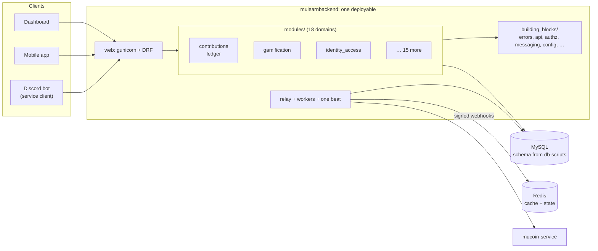

# μLearn backend architecture

This folder is the architecture of `mulearnbackend`:
- how it works today;
- the shape it is moving to (**a modular monolith with strict layers and events**);
- the rules every contributor follows;
- the first 12 weeks of work, split into issues anyone can pick up.

The current-state pages describe `dev` at 7fd66060 (21 Nov 2026). The target pages describe where the code is going: nothing in them exists yet unless a page says so.

## The shape in one picture

## Reading order

| You are | Start with | Then |
|---|---|---|
| A first-time contributor | The issue you picked in [github-issues/](github-issues/README.md) | The pages its "Before you start" links |
| A regular contributor | [04-module-rules.md](04-module-rules.md) | Your module's page in [modules/](modules/README.md); [16-contributing-to-the-architecture.md](16-contributing-to-the-architecture.md) |
| A reviewer or maintainer | [04-module-rules.md](04-module-rules.md) | [adr/](adr/README.md), [13-migration-strategy.md](13-migration-strategy.md), [12-testing-and-quality-gates.md](12-testing-and-quality-gates.md) |
| Leadership | [01-overview.md](01-overview.md) | [14-roadmap.md](14-roadmap.md), [15-risks-and-future-scale.md](15-risks-and-future-scale.md) |
| The platform admin | [06-data-and-schema.md](06-data-and-schema.md) | [10-infrastructure-and-deployment.md](10-infrastructure-and-deployment.md), [11-reliability-and-observability.md](11-reliability-and-observability.md) |

## Pages

| Page | What it covers |
|---|---|
| [01-overview.md](01-overview.md) | Summary, the options compared, principles, recommendations |
| [02-current-state.md](02-current-state.md) | How the backend works today: ecosystem, domains, diagrams, findings |
| [03-target-architecture.md](03-target-architecture.md) | Components, the modular backend, modules, domain design, request flow |
| [04-module-rules.md](04-module-rules.md) | Module anatomy, layer and data rules, where code goes, how CI enforces it |
| [05-events-and-background-work.md](05-events-and-background-work.md) | Outbox, relay, consumers, the event catalogue, queues, the karma workflow |
| [06-data-and-schema.md](06-data-and-schema.md) | MySQL, `db-scripts`, keys, transactions, the ledger, indexing |
| [07-api-standards.md](07-api-standards.md) | Compatibility, the envelope, pagination, idempotency, rate limits |
| [08-auth-and-permissions.md](08-auth-and-permissions.md) | Grants for users with several roles, policies, tokens, service clients, security standards |
| [09-performance-and-caching.md](09-performance-and-caching.md) | Targets, the capacity model, load tests, read models, caching |
| [10-infrastructure-and-deployment.md](10-infrastructure-and-deployment.md) | Roles from one image, deploys, containers, environments, recovery |
| [11-reliability-and-observability.md](11-reliability-and-observability.md) | Timeouts, degraded modes, telemetry, metrics, SLOs |
| [12-testing-and-quality-gates.md](12-testing-and-quality-gates.md) | Safe tests, test tiers, CI, releases, engineering standards |
| [13-migration-strategy.md](13-migration-strategy.md) | The strangler rules, module order, phases |
| [14-roadmap.md](14-roadmap.md) | The first 12 weeks, week by week |
| [15-risks-and-future-scale.md](15-risks-and-future-scale.md) | Failure modes, the risk register, scale tiers and triggers |
| [16-contributing-to-the-architecture.md](16-contributing-to-the-architecture.md) | Golden paths, decisions, reviews |
| [modules/](modules/README.md) | One page per module |
| [adr/](adr/README.md) | The architecture decision records |
| [github-issues/](github-issues/README.md) | The work, as issues |

## Coverage

This architecture answers a fixed list of 32 questions. The table shows where each one is answered.

| # | Section | Where |
|---|---|---|
| 1 | Executive Summary | [01-overview.md, Summary](01-overview.md#summary) |
| 2 | Current Platform Understanding | [02-current-state.md, The platform in one paragraph](02-current-state.md#the-platform-in-one-paragraph) |
| 3 | Existing Architecture Overview | [02-current-state.md, The ecosystem](02-current-state.md#the-ecosystem) |
| 4 | Business Domain Analysis | [02-current-state.md, Business domains](02-current-state.md#business-domains) |
| 5 | Existing Architecture Diagrams | [02-current-state.md](02-current-state.md#how-the-code-is-organised): code organisation, data model, request flow, deployment |
| 6 | Architectural Findings and Technical Debt | [02-current-state.md, Findings and technical debt](02-current-state.md#findings-and-technical-debt) |
| 7 | Performance and Scalability Audit | [02-current-state.md, Performance and scalability today](02-current-state.md#performance-and-scalability-today) and [09-performance-and-caching.md](09-performance-and-caching.md) |
| 8 | Database Assessment | [02-current-state.md, Database assessment](02-current-state.md#database-assessment) |
| 9 | Architecture Strategy Comparison | [01-overview.md, The options that were compared](01-overview.md#the-options-that-were-compared) |
| 10 | Recommended Target Architecture | [03-target-architecture.md](03-target-architecture.md) |
| 11 | Domain-Driven Design | [03-target-architecture.md, Domain design](03-target-architecture.md#domain-design) |
| 12 | Module and Folder Structure | [04-module-rules.md](04-module-rules.md) and [modules/](modules/README.md) |
| 13 | Event-Driven Architecture | [05-events-and-background-work.md](05-events-and-background-work.md) |
| 14 | CQRS and Read Model Strategy | [09-performance-and-caching.md, Read models](09-performance-and-caching.md#read-models) |
| 15 | API Design Standards | [07-api-standards.md](07-api-standards.md) |
| 16 | Authentication and Authorization | [08-auth-and-permissions.md](08-auth-and-permissions.md) |
| 17 | Database Target Architecture | [06-data-and-schema.md](06-data-and-schema.md) |
| 18 | Caching Strategy | [09-performance-and-caching.md, Caching](09-performance-and-caching.md#caching) |
| 19 | Infrastructure and Deployment Architecture | [10-infrastructure-and-deployment.md](10-infrastructure-and-deployment.md) |
| 20 | Reliability and High Availability | [11-reliability-and-observability.md](11-reliability-and-observability.md) |
| 21 | Security Architecture | [08-auth-and-permissions.md, Security standards](08-auth-and-permissions.md#security-standards) and [12-testing-and-quality-gates.md, CI pipelines](12-testing-and-quality-gates.md#ci-pipelines) |
| 22 | Observability | [11-reliability-and-observability.md, Observability architecture](11-reliability-and-observability.md#observability-architecture) |
| 23 | Testing Strategy | [12-testing-and-quality-gates.md](12-testing-and-quality-gates.md) |
| 24 | Engineering Standards | [12-testing-and-quality-gates.md, Engineering standards](12-testing-and-quality-gates.md#engineering-standards) and [04-module-rules.md](04-module-rules.md) |
| 25 | CI/CD Architecture | [12-testing-and-quality-gates.md, CI pipelines](12-testing-and-quality-gates.md#ci-pipelines) and [10-infrastructure-and-deployment.md, Deploying a release](10-infrastructure-and-deployment.md#deploying-a-release) |
| 26 | Open-Source Governance | [16-contributing-to-the-architecture.md](16-contributing-to-the-architecture.md) |
| 27 | Migration Strategy | [13-migration-strategy.md](13-migration-strategy.md) |
| 28 | 90-Day Implementation Roadmap | [14-roadmap.md](14-roadmap.md) |
| 29 | Risk Register | [15-risks-and-future-scale.md, Risk register](15-risks-and-future-scale.md#risk-register) |
| 30 | Architecture Decision Records | [adr/README.md](adr/README.md) |
| 31 | Future Scalability Roadmap | [15-risks-and-future-scale.md, Scale tiers and their triggers](15-risks-and-future-scale.md#scale-tiers-and-their-triggers) |
| 32 | Final Recommendations | [01-overview.md, Recommendations](01-overview.md#recommendations) |

## Keeping this folder true

- **Update the docs in the same change.** When a pull request changes something these pages describe, update the page in the same pull request.
- **Code and docs disagree?** The automated checks are the rule. Fix the page.
- **A rule changes only through an ADR** ([adr/README.md](adr/README.md)).
