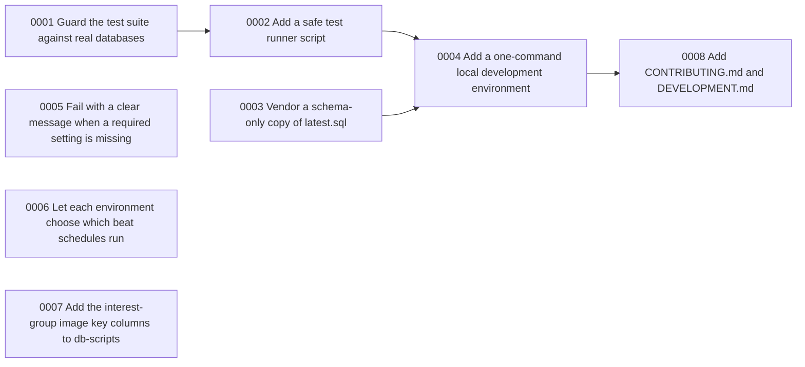
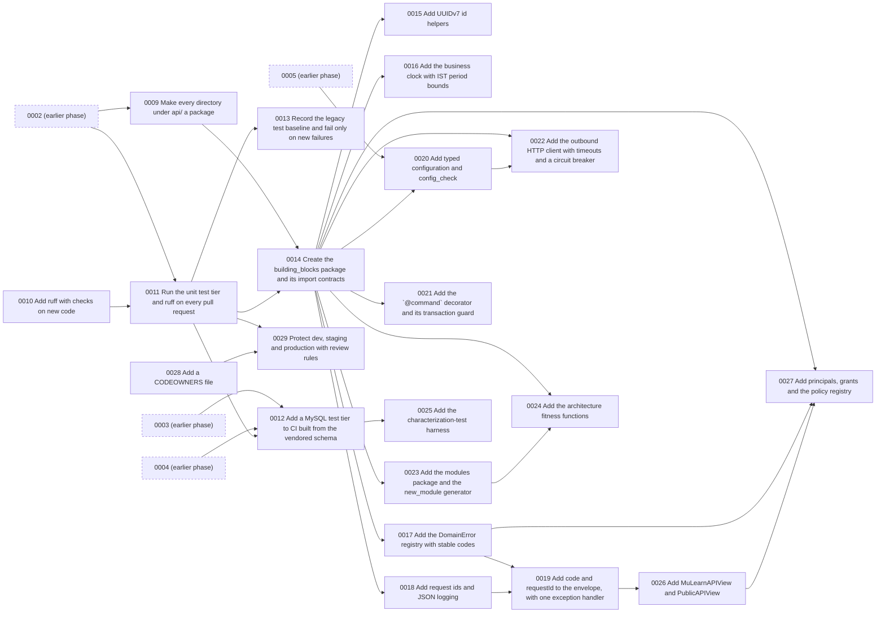
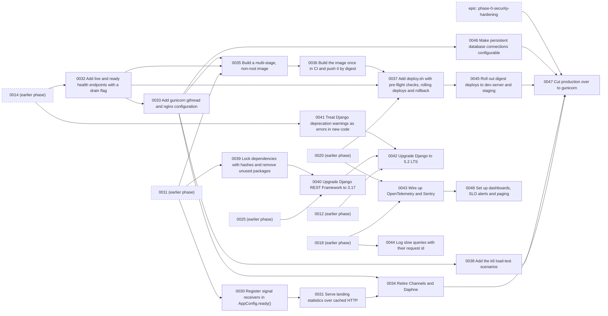
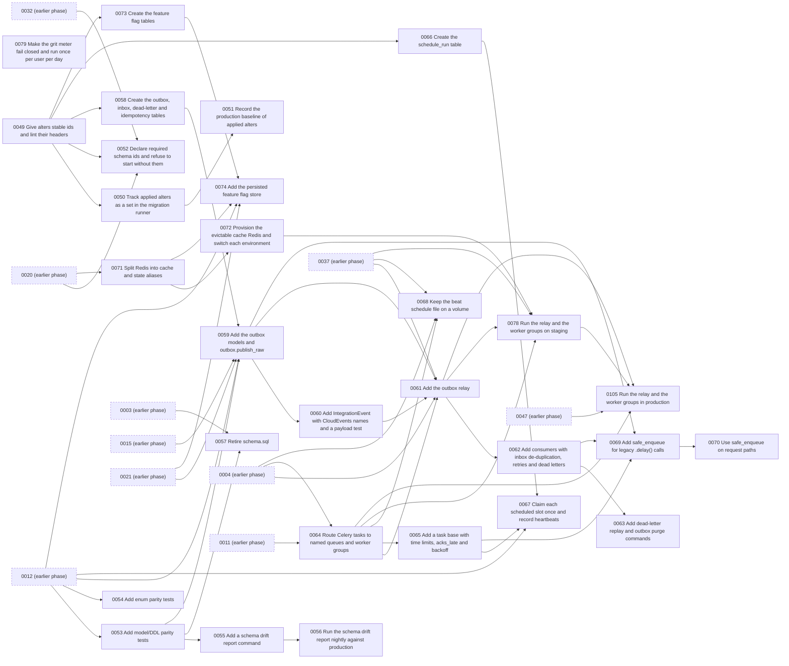
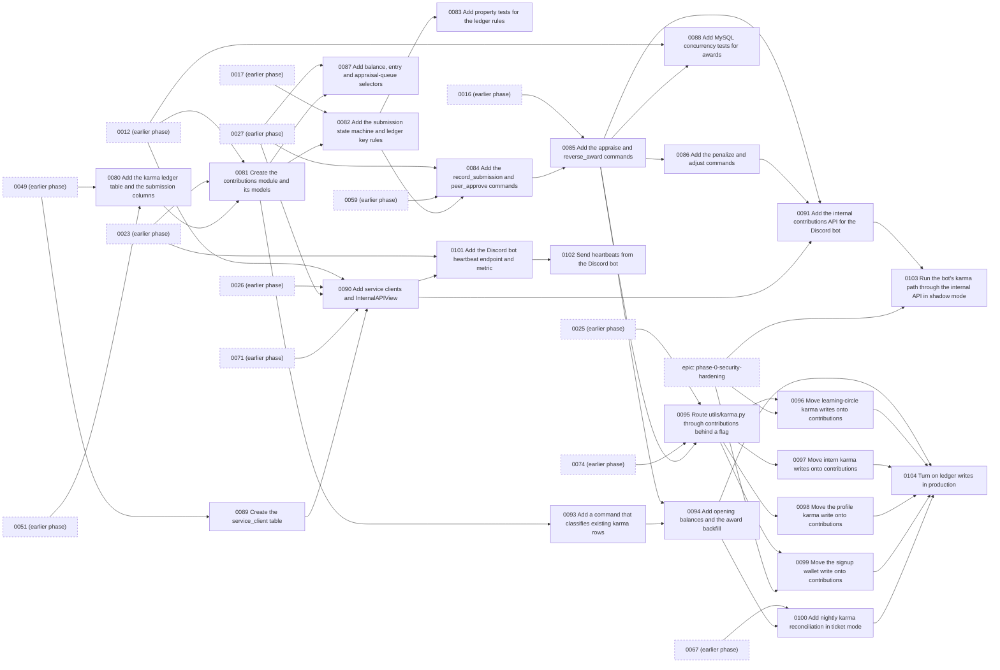

# Architecture issues

This folder breaks the architecture in [docs/architecture/](../README.md) into GitHub issues that anyone can pick up. Each detailed issue is sized for one pull request by someone new to the repository, and includes everything needed to finish it: why it matters, what to read, the exact files, acceptance criteria and safe test commands.

**These files are not filed on GitHub yet.** Maintainers file them, in ID order, from the files in this folder:
- each GitHub issue keeps its four-digit ID at the start of its title, for example `[0001] Guard the test suite against real databases`;
- the labels and milestone come from the issue's header table;
- after filing, the "Depends on" IDs are linked to the GitHub issue numbers in a comment.

## How to pick an issue

1. **Find an open issue whose dependencies have all merged.** Every issue's header table lists "Depends on". The dependency graph for each phase is below.
2. **Read "Before you start".** It links the architecture pages and ADRs you need, and nothing else is assumed.
3. **Comment on the GitHub issue to claim it,** so two people don't work on the same thing. If you stop, say so, so someone else can pick it up.
4. **Work on a branch from `dev`,** and open one pull request into `dev` that does exactly what the issue says. Anything listed under "Out of scope" goes in a separate issue.
5. **Check every acceptance criterion** and paste the test output in the pull request.
6. **Know the review rules.** Issues labelled `core-review` need two approvals, one of them from a maintainer. `maintainer-only` issues need production access, production data or a private repository. They are listed so you can see the whole plan, but only maintainers can do them.

New here? Start with an issue labelled `good first issue`.

## Setting up a fresh clone

Once, after cloning:
1. Install Python 3.10, and the MySQL client headers that `mysqlclient` needs.
2. Run `pip install -r requirements.txt`. Add `-r requirements-dev.txt` once issue 0010 has landed; until then, also run `pip install pytest`.
3. Copy `.env.sample` to `.env`. The safe test commands below override every database setting, so the other values only need to be present.
4. Create the `logs` directory (`mkdir logs`). The logging settings write to `LOGGER_DIR_PATH`, which is `./logs` in `.env.sample`, and the backend fails at startup if it is missing. After issue 0002, `scripts/test.sh` creates it for you.

## Safe test commands

Some legacy tests flush every table of the database they run against. **Until issue 0001 lands, run backend tests only like this:**

Bash:

```sh
DATABASE_ENGINE=django.db.backends.sqlite3 DATABASE_NAME=":memory:" DATABASE_USER= DATABASE_PASSWORD= DATABASE_HOST= DATABASE_PORT= python -m pytest <paths> --import-mode=importlib
```

PowerShell:

```powershell
$env:DATABASE_ENGINE="django.db.backends.sqlite3"; $env:DATABASE_NAME=":memory:"; $env:DATABASE_USER=""; $env:DATABASE_PASSWORD=""; $env:DATABASE_HOST=""; $env:DATABASE_PORT=""; python -m pytest <paths> --import-mode=importlib
```

Issues show their commands in bash. On Windows, use `scripts/test.ps1` once issue 0002 has landed, or the PowerShell form above until then. The PowerShell form sets the variables for the rest of the session, so open a new shell afterwards. In Windows PowerShell 5.1, `$env:X=""` removes the variable instead of emptying it; that is harmless here, because SQLite ignores those settings.

**Never run `pytest` on `api/dashboard` or on the whole repository with a normal `.env`.** After issue 0002 lands, `scripts/test.sh <paths>` does the safe thing for you, and it refuses any database that isn't SQLite or a local `test_` database.

## Labels

| Label | Meaning |
|---|---|
| `arch` | Part of the architecture programme |
| `phase:N` | The phase it belongs to |
| `module:<name>` | The module, `building_blocks`, or `platform` for repo-wide plumbing |
| `type:feature` / `type:chore` / `type:docs` / `type:epic` | The kind of work |
| `size:S` / `size:M` / `size:L` | About ½ day, 1 day or 2 days for someone new to the repo |
| `good first issue` | Small, with no dependencies, no schema change and no money, auth or ledger code |
| `needs-db-change` | Needs a schema change, which a maintainer writes and applies in `db-scripts` first |
| `core-review` | Money, roles, auth, the ledger, the outbox or deploys: two approvals, one from a maintainer |
| `maintainer-only` | Needs production access, production data or a private repository |
| `repo:<name>` | The work happens in another repository |
| `status:blocked` | A dependency hasn't merged yet |

## Phases and milestones

The 12 weeks start on **Thursday 10 December 2026** and end on Wednesday 3 March 2027. They are indicative, because anyone may pick up these issues and the pace isn't known. The full plan, week by week, is in [14-roadmap.md](../14-roadmap.md).

| Phase | Milestone | Weeks (indicative) | Issues |
|---|---|---|---|
| 0 | Phase 0: Stabilise and secure | 1–2 | 8 |
| 1 | Phase 1: Foundations | 1–6 | 21 |
| 2 | Phase 2: Serving and runtime | 4–9 | 19 |
| 3 | Phase 3: Schema safety net and events | 3–11 | 29 |
| 4 | Phase 4: Contributions and the ledger | 6–12 | 24 |
| 5 | Phase 5: Identity and access | after week 12 | epic |
| 6 | Phase 6: Gamification and notifications | after week 12 | epic |
| 7 | Phase 7: People and privacy | after week 12 | epic |
| 8 | Phase 8: API standards and rewards | after week 12 | epic |
| later | Later: on demand | when triggered | epic |

## Work already in flight

These open pull requests already cover work this plan needs, so there is no separate issue for them. They count as in progress.

| Pull request | What it covers |
|---|---|
| mulearnbackend #3289 | Team notifications: access, activity log, push copy versions |
| mulearnbackend #3145 | Banner images for interest groups |
| mulearnbackend #3282 | Socials edit without a socials row (to staging) |
| `db-scripts` (private) | The schema alters the pull requests above need, tracked by the maintainers |

## On hold

**The μCoin integration.** No μCoin work is planned for now. The design stays in [ADR-054](../adr/ADR-054-mucoin-external-consumer.md), and the coin columns stay frozen in core. The issues that would build it aren't filed, and their numbers are left free:
- 0075: the signed webhook delivery adapter for external consumers;
- 0076: publishing `user.registered_via_invite` from registration;
- 0077: short-lived tickets for `mucoin-service`;
- 0092: publishing `task.verified`.

When the integration resumes, the maintainers bring these back, and [#3175](https://github.com/gtech-mulearn/mulearnbackend/issues/3175) tracks it.

## Refreshing the vendored schema

`schema/latest.sql` is a schema-only copy of `db-scripts`' `latest.sql`, and `schema/SOURCE` records the commit it came from (issue 0003). After every alter merges in `db-scripts`, a maintainer:
1. copies the new `latest.sql`, stripped of data statements and of every comment, following issue 0003's rules, and checks it with that issue's two `grep` commands;
2. updates `schema/SOURCE`;
3. opens a pull request titled `schema: refresh from db-scripts <short sha>`, which the CI MySQL tier checks and a second maintainer reads before merge.


## Phase 0: Stabilise and secure

Make the repository safe to work in, and make the release path safe. The security part of this phase is tracked privately by the maintainers ([epic](epics/phase-0-security-hardening.md)). The public part guards the test suite, vendors the schema, gives contributors a one-command local environment and removes two release hazards.

| ID | Title | Phase | Module | Size | Depends on | Labels |
|---|---|---|---|---|---|---|
| [0001](0001-guard-tests-against-real-databases.md) | Guard the test suite against real databases | 0 | platform | S | none | arch, phase:0, module:platform, type:chore, size:S, good first issue |
| [0002](0002-add-safe-test-runner.md) | Add a safe test runner script | 0 | platform | S | 0001 | arch, phase:0, module:platform, type:chore, size:S |
| [0003](0003-vendor-schema-snapshot.md) | Vendor a schema-only copy of latest.sql | 0 | platform | S | none | arch, phase:0, module:platform, type:chore, size:S, maintainer-only, repo:db-scripts |
| [0004](0004-local-dev-environment.md) | Add a one-command local development environment | 0 | platform | M | 0002, 0003 | arch, phase:0, module:platform, type:feature, size:M |
| [0005](0005-clear-error-for-missing-settings.md) | Fail with a clear message when a required setting is missing | 0 | platform | S | none | arch, phase:0, module:platform, type:chore, size:S, good first issue |
| [0006](0006-choose-beat-schedules-per-environment.md) | Let each environment choose which beat schedules run | 0 | platform | S | none | arch, phase:0, module:platform, type:feature, size:S, good first issue |
| [0007](0007-add-interest-group-image-columns.md) | Add the interest-group image key columns to db-scripts | 0 | communities | S | none | arch, phase:0, module:communities, type:chore, size:S, maintainer-only, repo:db-scripts, needs-db-change |
| [0008](0008-contributing-and-development-guides.md) | Add CONTRIBUTING.md and DEVELOPMENT.md | 0 | platform | S | 0004 | arch, phase:0, module:platform, type:docs, size:S |




## Phase 1: Foundations

Build the foundations every later issue stands on: CI with both test tiers, the `building_blocks` package and its import contracts, the module generator, the fitness functions, the characterization-test harness, and the core of authorization. Nothing here changes behaviour for users.

| ID | Title | Phase | Module | Size | Depends on | Labels |
|---|---|---|---|---|---|---|
| [0009](0009-make-api-directories-packages.md) | Make every directory under api/ a package | 1 | platform | S | 0002 | arch, phase:1, module:platform, type:chore, size:S |
| [0010](0010-ruff-for-new-code.md) | Add ruff with checks on new code | 1 | platform | S | none | arch, phase:1, module:platform, type:chore, size:S, good first issue |
| [0011](0011-ci-unit-tier.md) | Run the unit test tier and ruff on every pull request | 1 | platform | M | 0002, 0010 | arch, phase:1, module:platform, type:chore, size:M |
| [0012](0012-ci-mysql-tier.md) | Add a MySQL test tier to CI built from the vendored schema | 1 | platform | M | 0003, 0004, 0011 | arch, phase:1, module:platform, type:chore, size:M |
| [0013](0013-legacy-test-ratchet.md) | Record the legacy test baseline and fail only on new failures | 1 | platform | M | 0011 | arch, phase:1, module:platform, type:chore, size:M |
| [0014](0014-building-blocks-skeleton.md) | Create the building_blocks package and its import contracts | 1 | building_blocks | M | 0009, 0011 | arch, phase:1, module:building_blocks, type:feature, size:M |
| [0015](0015-uuid7-ids.md) | Add UUIDv7 id helpers | 1 | building_blocks | S | 0014 | arch, phase:1, module:building_blocks, type:feature, size:S |
| [0016](0016-business-clock.md) | Add the business clock with IST period bounds | 1 | building_blocks | S | 0014 | arch, phase:1, module:building_blocks, type:feature, size:S |
| [0017](0017-domain-error-registry.md) | Add the DomainError registry with stable codes | 1 | building_blocks | M | 0014 | arch, phase:1, module:building_blocks, type:feature, size:M |
| [0018](0018-request-context-and-json-logs.md) | Add request ids and JSON logging | 1 | building_blocks | M | 0014 | arch, phase:1, module:building_blocks, type:feature, size:M |
| [0019](0019-envelope-code-and-exception-handler.md) | Add code and requestId to the envelope, with one exception handler | 1 | building_blocks | M | 0017, 0018 | arch, phase:1, module:building_blocks, type:feature, size:M |
| [0020](0020-typed-configuration.md) | Add typed configuration and config_check | 1 | building_blocks | L | 0005, 0014 | arch, phase:1, module:building_blocks, type:feature, size:L |
| [0021](0021-command-decorator.md) | Add the `@command` decorator and its transaction guard | 1 | building_blocks | M | 0014 | arch, phase:1, module:building_blocks, type:feature, size:M, core-review |
| [0022](0022-outbound-http-client.md) | Add the outbound HTTP client with timeouts and a circuit breaker | 1 | building_blocks | M | 0014, 0020 | arch, phase:1, module:building_blocks, type:feature, size:M |
| [0023](0023-modules-package-and-generator.md) | Add the modules package and the new_module generator | 1 | building_blocks | L | 0014 | arch, phase:1, module:building_blocks, type:feature, size:L, core-review |
| [0024](0024-architecture-fitness-functions.md) | Add the architecture fitness functions | 1 | platform | M | 0014, 0023 | arch, phase:1, module:platform, type:chore, size:M |
| [0025](0025-characterization-test-harness.md) | Add the characterization-test harness | 1 | platform | M | 0012 | arch, phase:1, module:platform, type:chore, size:M |
| [0026](0026-base-api-views.md) | Add MuLearnAPIView and PublicAPIView | 1 | building_blocks | M | 0019 | arch, phase:1, module:building_blocks, type:feature, size:M, core-review |
| [0027](0027-authz-core.md) | Add principals, grants and the policy registry | 1 | building_blocks | L | 0014, 0017, 0026 | arch, phase:1, module:building_blocks, type:feature, size:L, core-review |
| [0028](0028-codeowners.md) | Add a CODEOWNERS file | 1 | platform | S | none | arch, phase:1, module:platform, type:chore, size:S, maintainer-only |
| [0029](0029-branch-rules.md) | Protect dev, staging and production with review rules | 1 | platform | S | 0011, 0028 | arch, phase:1, module:platform, type:chore, size:S, maintainer-only |




## Phase 2: Serving and runtime

Replace the development server with gunicorn behind nginx, retire Channels and Daphne, build one image in CI and deploy it by digest with a rollback, add observability, and start the platform upgrades (dependency locking, DRF 3.17, Django 5.2). The production cut-over (0047) is gated on load tests and the private security epic.

| ID | Title | Phase | Module | Size | Depends on | Labels |
|---|---|---|---|---|---|---|
| [0030](0030-signal-receivers-in-ready.md) | Register signal receivers in AppConfig.ready() | 2 | platform | M | 0011 | arch, phase:2, module:platform, type:chore, size:M |
| [0031](0031-landing-stats-over-http.md) | Serve landing statistics over cached HTTP | 2 | platform | M | 0030 | arch, phase:2, module:platform, type:feature, size:M |
| [0032](0032-health-endpoints.md) | Add live and ready health endpoints with a drain flag | 2 | building_blocks | M | 0014 | arch, phase:2, module:building_blocks, type:feature, size:M |
| [0033](0033-gunicorn-and-nginx-config.md) | Add gunicorn gthread and nginx configuration | 2 | platform | M | 0032 | arch, phase:2, module:platform, type:feature, size:M |
| [0034](0034-retire-channels-and-daphne.md) | Retire Channels and Daphne | 2 | platform | M | 0031, 0033 | arch, phase:2, module:platform, type:chore, size:M, core-review |
| [0035](0035-production-dockerfile.md) | Build a multi-stage, non-root image | 2 | platform | M | 0011, 0032, 0033 | arch, phase:2, module:platform, type:chore, size:M |
| [0036](0036-ci-image-build-and-push.md) | Build the image once in CI and push it by digest | 2 | platform | M | 0035 | arch, phase:2, module:platform, type:chore, size:M |
| [0037](0037-deploy-script.md) | Add deploy.sh with pre-flight checks, rolling deploys and rollback | 2 | platform | L | 0020, 0032, 0036 | arch, phase:2, module:platform, type:feature, size:L, core-review |
| [0038](0038-k6-load-tests.md) | Add the k6 load-test scenarios | 2 | platform | M | 0033 | arch, phase:2, module:platform, type:chore, size:M |
| [0039](0039-lock-dependencies.md) | Lock dependencies with hashes and remove unused packages | 2 | platform | M | 0011 | arch, phase:2, module:platform, type:chore, size:M |
| [0040](0040-drf-3-17.md) | Upgrade Django REST Framework to 3.17 | 2 | platform | M | 0025, 0039 | arch, phase:2, module:platform, type:chore, size:M |
| [0041](0041-deprecation-warnings-as-errors.md) | Treat Django deprecation warnings as errors in new code | 2 | platform | S | 0014 | arch, phase:2, module:platform, type:chore, size:S |
| [0042](0042-django-5-2.md) | Upgrade Django to 5.2 LTS | 2 | platform | L | 0012, 0040, 0041 | arch, phase:2, module:platform, type:chore, size:L, core-review |
| [0043](0043-opentelemetry-and-sentry.md) | Wire up OpenTelemetry and Sentry | 2 | building_blocks | M | 0018, 0020 | arch, phase:2, module:building_blocks, type:feature, size:M |
| [0044](0044-slow-query-logging.md) | Log slow queries with their request id | 2 | building_blocks | S | 0018 | arch, phase:2, module:building_blocks, type:feature, size:S |
| [0045](0045-rollout-digest-deploys.md) | Roll out digest deploys to dev-server and staging | 2 | platform | S | 0037 | arch, phase:2, module:platform, type:chore, size:S, maintainer-only |
| [0046](0046-persistent-database-connections.md) | Make persistent database connections configurable | 2 | platform | S | 0033 | arch, phase:2, module:platform, type:feature, size:S |
| [0047](0047-rollout-gunicorn-cutover.md) | Cut production over to gunicorn | 2 | platform | M | 0034, 0038, 0045, 0046, epic:phase-0-security-hardening | arch, phase:2, module:platform, type:chore, size:M, maintainer-only |
| [0048](0048-dashboards-and-alerts.md) | Set up dashboards, SLO alerts and paging | 2 | platform | M | 0043 | arch, phase:2, module:platform, type:chore, size:M, maintainer-only |




## Phase 3: Schema safety net and events

Add the schema safety net (stable alter ids, an applied-set runner, parity tests, drift reports) and the event machinery (outbox, relay, consumers, dead letters, routed queues, schedule claims, the flag store). The μCoin webhook adapter lands here too, with the first μCoin event (`user.registered_via_invite`). The grit-meter fix happens in `scheduler-service`.

| ID | Title | Phase | Module | Size | Depends on | Labels |
|---|---|---|---|---|---|---|
| [0049](0049-alter-ids-and-header-lint.md) | Give alters stable ids and lint their headers | 3 | platform | M | none | arch, phase:3, module:platform, type:chore, size:M, maintainer-only, repo:db-scripts |
| [0050](0050-applied-set-migration-runner.md) | Track applied alters as a set in the migration runner | 3 | platform | L | 0049 | arch, phase:3, module:platform, type:feature, size:L, maintainer-only, repo:db-scripts |
| [0051](0051-production-alter-baseline.md) | Record the production baseline of applied alters | 3 | platform | S | 0050 | arch, phase:3, module:platform, type:chore, size:S, maintainer-only, repo:db-scripts |
| [0052](0052-required-schema-ids.md) | Declare required schema ids and refuse to start without them | 3 | platform | M | 0020, 0032, 0049 | arch, phase:3, module:platform, type:feature, size:M, core-review |
| [0053](0053-model-ddl-parity-tests.md) | Add model/DDL parity tests | 3 | platform | L | 0012 | arch, phase:3, module:platform, type:chore, size:L |
| [0054](0054-enum-parity-tests.md) | Add enum parity tests | 3 | platform | M | 0012 | arch, phase:3, module:platform, type:chore, size:M |
| [0055](0055-schema-drift-command.md) | Add a schema drift report command | 3 | platform | M | 0053 | arch, phase:3, module:platform, type:feature, size:M |
| [0056](0056-nightly-drift-job.md) | Run the schema drift report nightly against production | 3 | platform | S | 0055 | arch, phase:3, module:platform, type:chore, size:S, maintainer-only |
| [0057](0057-retire-schema-sql.md) | Retire schema.sql | 3 | platform | S | 0003, 0053 | arch, phase:3, module:platform, type:chore, size:S |
| [0058](0058-messaging-tables-alter.md) | Create the outbox, inbox, dead-letter and idempotency tables | 3 | building_blocks | M | 0049 | arch, phase:3, module:building_blocks, type:feature, size:M, maintainer-only, repo:db-scripts, needs-db-change |
| [0059](0059-outbox-publish.md) | Add the outbox models and outbox.publish_raw | 3 | building_blocks | M | 0012, 0015, 0021, 0053, 0058 | arch, phase:3, module:building_blocks, type:feature, size:M, core-review, needs-db-change |
| [0060](0060-cloudevents-envelope.md) | Add IntegrationEvent with CloudEvents names and a payload test | 3 | building_blocks | M | 0059 | arch, phase:3, module:building_blocks, type:feature, size:M |
| [0061](0061-outbox-relay.md) | Add the outbox relay | 3 | building_blocks | L | 0004, 0037, 0059, 0060, 0064 | arch, phase:3, module:building_blocks, type:feature, size:L, core-review |
| [0062](0062-consumers-inbox-and-dead-letters.md) | Add consumers with inbox de-duplication, retries and dead letters | 3 | building_blocks | L | 0061 | arch, phase:3, module:building_blocks, type:feature, size:L, core-review |
| [0063](0063-replay-and-purge-commands.md) | Add dead-letter replay and outbox purge commands | 3 | building_blocks | M | 0062 | arch, phase:3, module:building_blocks, type:feature, size:M |
| [0064](0064-celery-queue-routing.md) | Route Celery tasks to named queues and worker groups | 3 | platform | M | 0004, 0011 | arch, phase:3, module:platform, type:feature, size:M |
| [0065](0065-task-base-class.md) | Add a task base with time limits, acks_late and backoff | 3 | building_blocks | M | 0064 | arch, phase:3, module:building_blocks, type:feature, size:M |
| [0066](0066-schedule-run-alter.md) | Create the schedule_run table | 3 | building_blocks | S | 0049 | arch, phase:3, module:building_blocks, type:feature, size:S, maintainer-only, repo:db-scripts, needs-db-change |
| [0067](0067-schedule-slot-claims.md) | Claim each scheduled slot once and record heartbeats | 3 | building_blocks | M | 0012, 0065, 0066 | arch, phase:3, module:building_blocks, type:feature, size:M, needs-db-change |
| [0068](0068-beat-schedule-on-a-volume.md) | Keep the beat schedule file on a volume | 3 | platform | S | 0004, 0037, 0064 | arch, phase:3, module:platform, type:chore, size:S |
| [0069](0069-safe-enqueue.md) | Add safe_enqueue for legacy .delay() calls | 3 | building_blocks | M | 0059, 0062, 0065 | arch, phase:3, module:building_blocks, type:feature, size:M |
| [0070](0070-safe-enqueue-on-request-paths.md) | Use safe_enqueue on request paths | 3 | platform | M | 0069 | arch, phase:3, module:platform, type:chore, size:M |
| [0071](0071-redis-cache-and-state-aliases.md) | Split Redis into cache and state aliases | 3 | platform | M | 0020 | arch, phase:3, module:platform, type:feature, size:M |
| [0072](0072-rollout-redis-split.md) | Provision the evictable cache Redis and switch each environment | 3 | platform | S | 0071 | arch, phase:3, module:platform, type:chore, size:S, maintainer-only |
| [0073](0073-feature-flag-tables-alter.md) | Create the feature flag tables | 3 | building_blocks | S | 0049 | arch, phase:3, module:building_blocks, type:feature, size:S, maintainer-only, repo:db-scripts, needs-db-change |
| [0074](0074-feature-flag-store.md) | Add the persisted feature flag store | 3 | building_blocks | M | 0012, 0021, 0071, 0073 | arch, phase:3, module:building_blocks, type:feature, size:M, needs-db-change |
| [0078](0078-rollout-relay-and-worker-groups-staging.md) | Run the relay and the worker groups on staging | 3 | platform | S | 0037, 0061, 0064, 0072 | arch, phase:3, module:platform, type:chore, size:S, maintainer-only |
| [0079](0079-grit-meter-fail-closed.md) | Make the grit meter fail closed and run once per user per day | 3 | gamification | M | none | arch, phase:3, module:gamification, type:chore, size:M, repo:scheduler-service |
| [0105](0105-rollout-relay-and-worker-groups.md) | Run the relay and the worker groups in production | 3 | platform | S | 0047, 0061, 0064, 0078 | arch, phase:3, module:platform, type:chore, size:S, maintainer-only |




## Phase 4: Contributions and the ledger

Build the karma ledger and the `contributions` commands, move the backend's karma writers onto them behind a flag, give the Discord bot an internal API and run it in shadow mode, and start nightly reconciliation. This is the 12-week slice; switching the bot over, revoking its database writes and the Discord reconciler are in the [cut-over epic](epics/phase-4-contributions-cutover.md).

| ID | Title | Phase | Module | Size | Depends on | Labels |
|---|---|---|---|---|---|---|
| [0080](0080-ledger-alter.md) | Add the karma ledger table and the submission columns | 4 | contributions | M | 0049, 0051 | arch, phase:4, module:contributions, type:feature, size:M, maintainer-only, repo:db-scripts, needs-db-change |
| [0081](0081-contributions-module-and-models.md) | Create the contributions module and its models | 4 | contributions | M | 0012, 0023, 0080 | arch, phase:4, module:contributions, type:feature, size:M, core-review, needs-db-change |
| [0082](0082-submission-state-machine.md) | Add the submission state machine and ledger key rules | 4 | contributions | M | 0017, 0081 | arch, phase:4, module:contributions, type:feature, size:M |
| [0083](0083-ledger-property-tests.md) | Add property tests for the ledger rules | 4 | contributions | M | 0082 | arch, phase:4, module:contributions, type:chore, size:M |
| [0084](0084-record-and-peer-approve.md) | Add the record_submission and peer_approve commands | 4 | contributions | M | 0027, 0059, 0082 | arch, phase:4, module:contributions, type:feature, size:M, core-review |
| [0085](0085-appraise-and-reverse.md) | Add the appraise and reverse_award commands | 4 | contributions | L | 0016, 0084 | arch, phase:4, module:contributions, type:feature, size:L, core-review |
| [0086](0086-penalize-and-adjust.md) | Add the penalize and adjust commands | 4 | contributions | M | 0085 | arch, phase:4, module:contributions, type:feature, size:M, core-review |
| [0087](0087-contributions-selectors.md) | Add balance, entry and appraisal-queue selectors | 4 | contributions | M | 0027, 0081 | arch, phase:4, module:contributions, type:feature, size:M |
| [0088](0088-ledger-concurrency-tests.md) | Add MySQL concurrency tests for awards | 4 | contributions | M | 0012, 0085 | arch, phase:4, module:contributions, type:chore, size:M |
| [0089](0089-service-client-alter.md) | Create the service_client table | 4 | building_blocks | S | 0049 | arch, phase:4, module:building_blocks, type:feature, size:S, maintainer-only, repo:db-scripts, needs-db-change |
| [0090](0090-service-clients.md) | Add service clients and InternalAPIView | 4 | building_blocks | L | 0012, 0026, 0027, 0071, 0089 | arch, phase:4, module:building_blocks, type:feature, size:L, core-review, needs-db-change |
| [0091](0091-internal-contributions-api.md) | Add the internal contributions API for the Discord bot | 4 | contributions | L | 0085, 0086, 0090 | arch, phase:4, module:contributions, type:feature, size:L, core-review |
| [0093](0093-classify-karma-log.md) | Add a command that classifies existing karma rows | 4 | contributions | M | 0081 | arch, phase:4, module:contributions, type:feature, size:M, core-review |
| [0094](0094-opening-balances-and-backfill.md) | Add opening balances and the award backfill | 4 | contributions | L | 0085, 0093 | arch, phase:4, module:contributions, type:feature, size:L, core-review |
| [0095](0095-ledger-writes-flag-and-utils-karma.md) | Route utils/karma.py through contributions behind a flag | 4 | contributions | L | 0025, 0074, 0085 | arch, phase:4, module:contributions, type:feature, size:L, core-review |
| [0096](0096-move-learning-circle-karma-writes.md) | Move learning-circle karma writes onto contributions | 4 | contributions | M | 0095, epic:phase-0-security-hardening | arch, phase:4, module:contributions, type:chore, size:M, core-review |
| [0097](0097-move-intern-karma-writes.md) | Move intern karma writes onto contributions | 4 | contributions | M | 0095 | arch, phase:4, module:contributions, type:chore, size:M, core-review |
| [0098](0098-move-profile-karma-write.md) | Move the profile karma write onto contributions | 4 | contributions | S | 0095 | arch, phase:4, module:contributions, type:chore, size:S, core-review |
| [0099](0099-move-signup-and-referral-wallet-writes.md) | Move the signup wallet write onto contributions | 4 | contributions | M | 0095, epic:phase-0-security-hardening | arch, phase:4, module:contributions, type:chore, size:M, core-review |
| [0100](0100-reconciliation-ticket-mode.md) | Add nightly karma reconciliation in ticket mode | 4 | contributions | M | 0067, 0094 | arch, phase:4, module:contributions, type:feature, size:M |
| [0101](0101-bot-heartbeat-endpoint.md) | Add the Discord bot heartbeat endpoint and metric | 4 | integrations | S | 0023, 0090 | arch, phase:4, module:integrations, type:feature, size:S, core-review |
| [0102](0102-bot-sends-heartbeat.md) | Send heartbeats from the Discord bot | 4 | integrations | S | 0101 | arch, phase:4, module:integrations, type:feature, size:S, maintainer-only, repo:aaronchettan |
| [0103](0103-bot-shadow-mode.md) | Run the bot's karma path through the internal API in shadow mode | 4 | integrations | L | 0091, epic:phase-0-security-hardening | arch, phase:4, module:integrations, type:feature, size:L, maintainer-only, repo:aaronchettan |
| [0104](0104-rollout-ledger-writes.md) | Turn on ledger writes in production | 4 | contributions | S | 0094, 0096, 0097, 0098, 0099, 0100 | arch, phase:4, module:contributions, type:chore, size:S, maintainer-only |



## Epics

Later phases are epics. Each is split into detailed issues when its phase comes within reach.

| Epic | Title | Phase |
|---|---|---|
| [phase-0-security-hardening](epics/phase-0-security-hardening.md) | Phase 0: security hardening | 0 |
| [phase-4-contributions-cutover](epics/phase-4-contributions-cutover.md) | Phase 4: finish the contributions cut-over | 4 |
| [phase-5-identity-and-access](epics/phase-5-identity-and-access.md) | Phase 5: identity and access | 5 |
| [phase-6-gamification-and-notifications](epics/phase-6-gamification-and-notifications.md) | Phase 6: gamification and notifications | 6 |
| [phase-7-people-and-privacy](epics/phase-7-people-and-privacy.md) | Phase 7: people and privacy | 7 |
| [phase-8-api-standards-and-rewards](epics/phase-8-api-standards-and-rewards.md) | Phase 8: API standards and rewards | 8 |
| [later-on-demand](epics/later-on-demand.md) | Later: modules on demand and deferred items | later |
